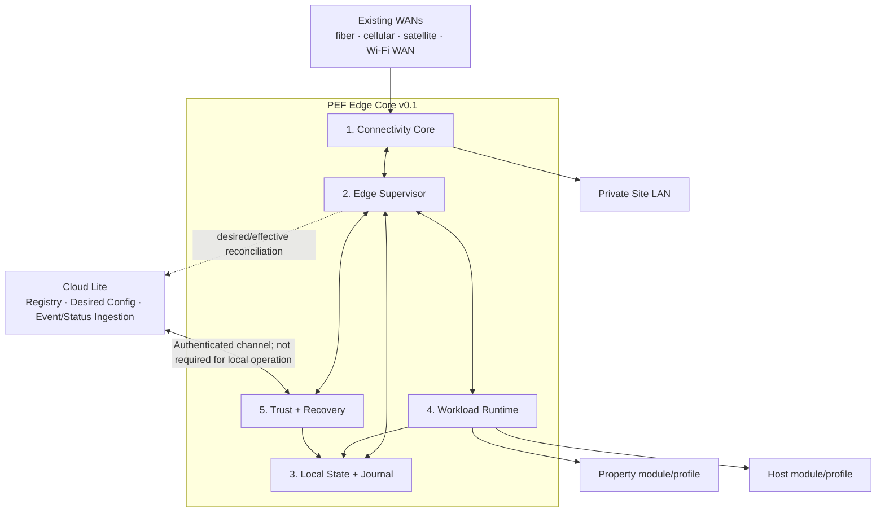

# Private Edge Fabric (PEF) — Foundation v0.1

> **Estado (2026-10-12): BASELINE DOCUMENTAL INICIAL.** Diseño conceptual analizado y consolidado, **sin implementación, benchmarks, validación de clientes ni selección de hardware**. No confundir tareas de diseño «cerradas en conversación» con pruebas superadas.

## Propósito

PEF es una plataforma *local-first* para sitios pequeños: usa conectividad existente, sostiene servicios locales cuando fallan WAN/cloud, conserva estado y evidencia, se recupera de fallos y puede gestionarse remotamente cuando existe conectividad. **No es otro router, una red 5G privada ni un operador de Internet.**

- **Un PEF Core**, adaptable mediante configuración, módulos y recursos.
- **Dos overlays iniciales** para validar la arquitectura: **Property** (segunda residencia/finca) y **Host** (camping/alojamiento pequeño). Son escenarios de producto, **no dos cores**.
- **Nomad** permanece como candidato posterior del research; no forma parte del alcance inmediato de W1.
- **Cloud es gestión, no supervivencia.** El sitio puede permanecer `LOCAL_ONLY`.

## Cómo consumir esta documentación (agentes)

1. Leer [`AGENTS.md`](AGENTS.md) para reglas y semántica de estados.
2. Leer [`docs/01-product-foundation.md`](docs/01-product-foundation.md) para el **porqué** y restricciones comerciales.
3. Leer [`docs/02-core-requirements.md`](docs/02-core-requirements.md) para el **qué** (`REQ-*`).
4. Leer sólo el documento necesario para la tarea: arquitectura [`03`](docs/03-logical-architecture.md), fallos [`04`](docs/04-failure-offline-contract.md), overlays [`05`](docs/05-overlays-workload-contract.md), recursos [`06`](docs/06-resource-envelope.md).
5. Consultar [`docs/07-roadmap-decisions.md`](docs/07-roadmap-decisions.md) para estado real, decisiones y próximo trabajo; usar [subtasks W1.5](docs/tasks/w1.5-resource-execution.md) para ejecución.
6. El informe conservado íntegro en [`source/deep-research-report-original.md`](source/deep-research-report-original.md) es **fuente de antecedentes**, no sustituto de requisitos ni validación independiente de cifras de mercado.

## Arquitectura reducida (baseline de W1.3)

> Diagrama lógico, **no** topología de procesos ni selección de protocolos. El tráfico de datos no necesita atravesar el Supervisor. La imagen [`assets/pef-logical-v0.1-concept.png`](assets/pef-logical-v0.1-concept.png) es ilustrativa y **no normativa**; estos Markdown prevalecen.

## Estado de Wave 1

| Bloque | Estado documental | Validación empírica |
|---|---|---|
| W1.1 Frontera del Core | DOCUMENTED | No aplica todavía / no implementada |
| W1.2 Failure & Offline Contract | DOCUMENTED | PENDING |
| W1.3 Logical Architecture | DOCUMENTED | PENDING |
| W1.4 Property/Host overlays, stress conceptual, SKU | DOCUMENTED | PENDING |
| W1.5.A Perfiles de carga | DOCUMENTED; **provisionales** | PENDING |
| W1.5.B Networking envelope | DOCUMENTED; **targets propuestos** | PENDING |
| W1.5.C Compute & Memory | DOCUMENTED; **presupuesto provisional** | PENDING |
| W1.5.D Storage | DOCUMENTED; **escenarios provisionales** | PENDING |
| **W1.5.E Workload Resource Model** | **NEXT** | PENDING |
| W1.5.F–J / W1.6–W1.8 | PLANNED | PENDING |

> **Integridad del import:** `SHA256SUMS` conserva los checksums de la **primera importación Foundation**; no es un manifiesto vivo del HEAD después de los commits documentales. Usar `git`/GitHub para verificar la versión vigente.

## Alcance y regla de cambio

- Las capacidades del Core están aprobadas **conceptualmente**; hardware, SO, runtime, almacenamiento, protocolos y coste no están elegidos.
- Los números de W1.5 son **hipótesis de especificación**; no resultados medidos ni promesas comerciales.
- Cambiar un requisito exige actualizar su ID, origen, criterio verificable y decisión en [`07-roadmap-decisions.md`](docs/07-roadmap-decisions.md).
- **No crear una sexta pieza Core** para una responsabilidad que cabe en los cinco bloques sin documentar primero el problema y el trade-off.
- Las fuentes originales incluyen marcadores de cita de un research anterior que deben revalidarse antes de publicaciones comerciales/regulatorias o decisiones de compra.

## Entrega y próxima transición

**Repositorio de trabajo:** [`krukmat/logistica`](https://github.com/krukmat/logistica), rama principal `main`. Esta baseline documenta trabajo de diseño; los commits de integración no constituyen validación empírica. Para avanzar: ejecutar **W1.5.E** siguiendo el [plan granular de W1.5](docs/tasks/w1.5-resource-execution.md). Los resultados numéricos de C/D son provisionales hasta W1.7 (benchmarks) y W1.8 (comparación de plataformas).
