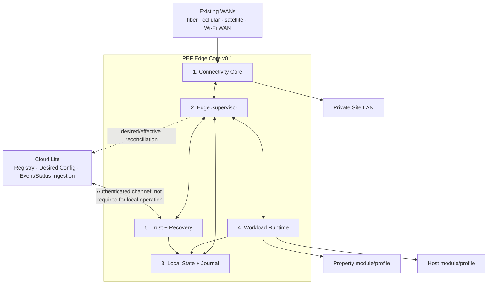

# Private Edge Fabric (PEF) — Foundation v0.1

> **Estado (2026-10-12): W1.9.R puente de portabilidad Core↔Linux CI verificado; emulador y laboratorio visual integrados**, más baseline arquitectónica documental. **Sin hardware PEF certificado, benchmarks físicos ni validación de clientes.** No confundir pruebas del simulador con evidencia física del producto.

## Emulator software-first (W1.9)

### Panel visual en macOS

```bash
git switch main && git pull
npm run dashboard
# abrir http://127.0.0.1:8787
```

El panel ofrece dos modos: **Simulación lógica** (Step/Run/Rewind/Reset en memoria) y **Laboratorio integrado** (WAN sintéticas, eventos de fsync en journal P1 temporal, identidad/revisión, Cloud mock con ACK ambiguo, reintentos, compaction y reinicio, más tests TCP/HTTP localhost). El laboratorio **no cambia las interfaces/rutas del Mac**, pero **sí escribe ficheros temporales de prueba**; no necesita root ni Docker. Linux namespaces sólo se ejecuta en CI y su evidencia es accesible desde el panel. [Contrato de integración obligatorio](docs/15-emulator-integration.md). [Contrato y alcance W1.9.K](docs/tasks/w1.9-k-statechart-dashboard.md).

`npm test` ejecuta la suite Node built-in (incluyendo journal con `fsync` y crash de un proceso hijo), `npm run emulate` los escenarios deterministas y `npm run lab:loopback` prueba HTTP/TCP en localhost. **W1.9.H** verifica routing + selección automática por probes reales **únicamente en namespaces Linux aislados de un runner GitHub-hosted efímero**; no ejecutar fault injection con root en equipos personales. Ver [Emulator](docs/12-emulator.md) y [Tasks W1.9](docs/tasks/w1.9-emulator-execution.md). `SIM_PASS` **no certifica hardware** ni la durabilidad física.

## Propósito

PEF es una plataforma *local-first* para sitios pequeños: usa conectividad existente, sostiene servicios locales cuando fallan WAN/cloud, conserva estado y evidencia, se recupera de fallos y puede gestionarse remotamente cuando existe conectividad. **No es otro router, una red 5G privada ni un operador de Internet.**

- **Un PEF Core**, adaptable mediante configuración, módulos y recursos.
- **Dos overlays iniciales** para validar la arquitectura: **Property** (segunda residencia/finca) y **Host** (camping/alojamiento pequeño). Son escenarios de producto, **no dos cores**.
- **Nomad** permanece como candidato posterior del research; no forma parte del alcance inmediato de W1.
- **Cloud es gestión, no supervivencia.** El sitio puede permanecer `LOCAL_ONLY`.

## Cómo consumir esta documentación (agentes)

1. Leer [`AGENTS.md`](AGENTS.md) para reglas y semántica de estados.
2. Leer [`docs/01-product-foundation.md`](docs/01-product-foundation.md) para el **porqué** y restricciones comerciales.
3. Leer [`docs/02-core-requirements.md`](docs/02-core-requirements.md) para el **qué** (`REQ-*`).
4. Leer sólo el documento necesario para la tarea: arquitectura [`03`](docs/03-logical-architecture.md), fallos [`04`](docs/04-failure-offline-contract.md), overlays [`05`](docs/05-overlays-workload-contract.md), recursos [`06`](docs/06-resource-envelope.md).
5. Consultar [`docs/07-roadmap-decisions.md`](docs/07-roadmap-decisions.md) para estado real; [subtasks W1.5](docs/tasks/w1.5-resource-execution.md), [Resource Gate](docs/08-resource-gate.md), [W1.6 Runtime](docs/09-runtime-contract.md) y [W1.7 Harness Spec](docs/10-benchmark-harness.md) con [subtasks](docs/tasks/w1.7-harness-execution.md), y [W1.8 Shootout](docs/11-architecture-shootout.md).
6. El informe conservado íntegro en [`source/deep-research-report-original.md`](source/deep-research-report-original.md) es **fuente de antecedentes**, no sustituto de requisitos ni validación independiente de cifras de mercado.

## Diagramas de conectividad

La **topología física de alto nivel**, separación de planos, failover/failback y evolución emulador → laboratorio → hardware están documentados en [13 — Conectividad PEF](docs/13-connectivity-topology.md). Los Mermaid dentro de ese archivo son la referencia editable, sin seleccionar interfaces ni hardware.

## Arquitectura reducida (baseline de W1.3)



> Diagrama lógico, **no** topología de procesos ni selección de protocolos. El tráfico de datos no necesita atravesar el Supervisor. La imagen [`assets/pef-logical-v0.1-concept.png`](assets/pef-logical-v0.1-concept.png) es ilustrativa y **no normativa**; estos Markdown prevalecen.

## Estado de Wave 1

| Bloque | Estado documental | Validación empírica |
|---|---|---|
| W1.1 Frontera del Core | DOCUMENTED | No aplica todavía / no implementada |
| W1.2 Failure & Offline Contract | DOCUMENTED | PENDING |
| W1.3 Logical Architecture | DOCUMENTED | PENDING |
| W1.4 Property/Host overlays, stress conceptual, SKU | DOCUMENTED | PENDING |
| W1.5.A Perfiles de carga | DOCUMENTED; **provisionales** | PENDING |
| W1.5.B Networking envelope | DOCUMENTED; **targets propuestos** | PENDING |
| W1.5.C Compute & Memory | DOCUMENTED; **presupuesto provisional** | PENDING |
| W1.5.D Storage | DOCUMENTED; **escenarios provisionales** | PENDING |
| W1.5.E Workload Resource Model | DOCUMENTED; schema, admission design | PENDING |
| W1.5.F Power & Thermal | DOCUMENTED; methodology, W TBD | PENDING |
| W1.5.G Recovery Targets | DOCUMENTED; timing model | PENDING |
| W1.5.H–J Consolidation & Gate | DOCUMENTED; **design GO conditional** | PENDING |
| W1.6 Software Runtime Contract | DOCUMENTED; architecture contracts only | PENDING |
| W1.7 Benchmark & Failure Harness | SPECIFIED; scenarios/evidence schemas | **NO RUNS** |
| W1.8 Architecture Shootout | A–D DOCUMENTED; E–G BLOCKED | **NO HARDWARE RUNS** |
| W1.9 Virtual Edge Emulator | **A–T software/laboratorio: PASS; pre-hardware handoff READY** | **94/94 Node PASS; 7 SIM_PASS; loopback, Linux veth, worker aislado y gate PASS. Dispositivo NO VALIDADO** |

> **Integridad del import:** `SHA256SUMS` conserva los checksums de la **primera importación Foundation**; no es un manifiesto vivo del HEAD después de los commits documentales. Usar `git`/GitHub para verificar la versión vigente.

## Alcance y regla de cambio

- Las capacidades del Core están aprobadas **conceptualmente**; hardware, SO, runtime, almacenamiento, protocolos y coste no están elegidos.
- Los números de W1.5 son **hipótesis de especificación**; no resultados medidos ni promesas comerciales.
- Cambiar un requisito exige actualizar su ID, origen, criterio verificable y decisión en [`07-roadmap-decisions.md`](docs/07-roadmap-decisions.md).
- **No crear una sexta pieza Core** para una responsabilidad que cabe en los cinco bloques sin documentar primero el problema y el trade-off.
- Las fuentes originales incluyen marcadores de cita de un research anterior que deben revalidarse antes de publicaciones comerciales/regulatorias o decisiones de compra.

## Entrega y próxima transición

**Repositorio de trabajo:** [`krukmat/logistica`](https://github.com/krukmat/logistica), rama principal `main`. Esta baseline documenta trabajo de diseño; los commits de integración no constituyen validación empírica. Para avanzar: **W1.9.Q Virtual Site E2E (recepción local-first) integrado y verificado** ([CI 68/68 PASS](https://github.com/krukmat/logistica/actions/runs/38281997428)); continuar con la siguiente task desde la [integración visual](docs/15-emulator-integration.md), continuar el Core mínimo; evolucionar el [emulador](docs/12-emulator.md) hacia un Core mínimo, antes de pruebas físicas W1.8.E–G. [CI H/I audit](docs/audit/w1.9-h-i-2026-10-12.md). [W1.8 Shootout](docs/11-architecture-shootout.md) y [subtasks](docs/tasks/w1.8-shootout-execution.md). El **Product Core compartido** ya está separado del simulador para conectividad, eventos, recepción y replay; **no hay hardware certificado**, y compra/producción sigue NO-GO. `node bin/pef-emulator.js --all` ofrece pruebas **lógicas** reproducibles, no benchmarks.


## Regla de trabajo vigente (W1.9.P0)

Desde ahora **ninguna nueva función implementada puede quedar fuera del emulador**: debe disponer de entrada y observables en el Control Panel, tests HTTP end-to-end, registro de [capacidades](docs/contracts/emulator-integration-v1.json) y evidencia CI. Si requiere root, Linux o hardware se presenta como `CI-only/BLOCKED` con la evidencia, sin ejecutarse en macOS. [Norma y procedimiento](docs/15-emulator-integration.md).

## W1.9.Q — Recepción logística local-first

Desde el [emulador visual](docs/15-emulator-integration.md), en modo **Laboratorio integrado**, se pueden registrar paquetes mediante `POST /api/local/receipts` y verlos persistidos en P1 incluso sin WAN. El mismo journal gestiona deduplicación por ID, recuperación tras reinicio y sincronización con Cloud mock. [Diagrama y guía E2E](docs/17-virtual-site-e2e.md). [CI #38281997428](https://github.com/krukmat/logistica/actions/runs/38281997428): 68 pruebas Node, 7 escenarios SIM y ambos laboratorios PASS. La API escucha sólo en localhost y no representa todavía una red productiva.

## W1.9.R — Portabilidad al hardware (prioridad arquitectónica cerrada en software)

El Core común se encuentra en [`src/core/`](src/core), el runtime de composición en [`src/runtime/`](src/runtime) y los adaptadores OS/Linux en [`src/adapters/`](src/adapters). **El emulador y Linux veth usan la misma política WAN y el mismo Core**; el dashboard puede reiniciarse sin detener un runtime inyectado. Los tests comparan 128 vectores de WAN entre emulador y controlador Linux-compatible y rechazan ACK de journal sin fsync confirmado.

[Arquitectura Mermaid y matriz de portabilidad](docs/18-hardware-portability-bridge.md) · [Tasks R](docs/tasks/w1.9-hardware-portability.md) · [CI #38284356529](https://github.com/krukmat/logistica/actions/runs/38284356529): **76/76 tests Node PASS**, 7 SIM_PASS y los laboratorios loopback/Linux PASS. El adaptador físico `device` continúa `BLOCKED`; requiere hardware Linux capaz de ejecutar Node.js, drivers/seguridad y ensayos específicos. La admisión/aislamiento real de workloads permanece pendiente.

## W1.9.S — Workload Runtime & Isolation (software/lab)

El **Workload Manager** y el **Process Supervisor** están integrados en el mismo Product Core portable y en el dashboard: manifiestos versionados, cuotas/admisión, proceso `pef-receiver` controlado por IPC, health, crash, backoff, circuit breaker y recepción logística offline hacia P1. El proceso del Mac es **NODE_PROCESS_ONLY: NO sandbox**, sin límites reales de CPU/RAM/FS/red.

Una prueba **Linux GitHub-hosted y efímera**, separada del proceso del Mac, valida el mismo Core en `cgroup v2` con CPU 150 mCPU, memoria 64 MiB, 16 PIDs, network namespace sin WAN, chroot y UID 65534. No es un backend aislado de producción ni un dispositivo certificado. **Pendiente:** conectar el supervisor a un driver Linux con aislamiento persistente y quotas P2/P3 físicas.

[Arquitectura y cómo probarlo](docs/19-workload-runtime.md) · [Tasks S1–S6](docs/tasks/w1.9-workload-runtime.md) · [CI #38293362918](https://github.com/krukmat/logistica/actions/runs/38293362918): **84/84 tests Node PASS, 7 SIM_PASS, loopback/veth y S3 isolation LAB_PASS/CLEAN**.

## W1.9.S3.4–S3.8 — Linux supervised isolation bridge (CI-only)

El **mismo Workload Supervisor del Core** ya lanza, supervisa, recupera y detiene un proceso real bajo cgroup v2/netns/chroot mediante `src/adapters/linux-isolated-process-driver.js`. No es sólo un harness de aislamiento independiente. [Arquitectura detallada](docs/20-supervised-linux-driver.md) · [CI kernel PASS](https://github.com/krukmat/logistica/actions/runs/38299928948).

Linux CI validó 150 mCPU, 64 MiB, swap 0, 16 PIDs, aislamiento de red/FS/UID, crash/restart, throttling y **OOM kill=1** con reinicio, y recepción offline conservada. El panel visualiza esa prueba como **CI-only**; su proceso local Mac sigue siendo `NODE_PROCESS_ONLY` sin aislamiento de recursos. **No está desplegado aún como driver en un dispositivo real.**

## W1.9.T — Emulador pre-hardware: software cerrado

**Estado a 2026-10-12: `SOFTWARE_LAB_READY` / `GO_FOR_DEVICE_INTEGRATION_ONLY`.** Se ejecuta un `Edge Service` autónomo sin navegador, con configuración v1 estricta, identidad persistida y época de sesión renovada, single-writer lab guard, API privada localhost, políticas WAN del Core, journal fsync P1 y supervisor de workers. La prueba SIGKILL→nuevo arranque confirma idempotencia y recuperación. En Linux CI el mismo host utiliza interfaces de red/rutas netns y, con driver explícito, supervisa un worker aislado por cgroup/netns/chroot.

El emulador mantiene un botón de diagnóstico del Edge autónomo que invoca **el servicio HTTP real**, no otra simulación de su lógica. [Arquitectura y guía operativa](docs/21-autonomous-edge-handoff.md) · [Tasks T1–T5](docs/tasks/w1.9-t-autonomous-edge.md) · [Contrato de migración](docs/contracts/hardware-handoff-v1.json).

[CI final #38314630311](https://github.com/krukmat/logistica/actions/runs/38314630311) **94/94 Node PASS**, 7 SIM_PASS, Linux WAN & supervised isolated worker LAB_PASS/CLEAN, tercer job **prehardware-gate SUCCESS** con artefacto `pef-prehardware-gate.json`. **No confundir esto con seguridad física, hardware validado o autorización de producción**: `device`, NICs reales, PKI, cloud real, almacenamiento ante powercut, arranque en dispositivo y OTA siguen `BLOCKED/NOT_RUN` y corresponden a la fase siguiente.

## W1.10.A — Pre-hardware port conformance (software-only)

`npm run ports:conformance` or **Laboratorio integrado → Ejecutar matriz prehardware** runs 13 stable checks through the shared Product Core, faultable synthetic WAN ports and a temporary OS-file journal. It checks failover/failback, malformed probes, route rejection, offline receipt fsync, deduplication and journal reopen. Device remains `BACKEND_NOT_IMPLEMENTED`.

[Contract](docs/contracts/predevice-ports-v1.json) · [architecture/limitations](docs/22-predevice-ports.md) · [task plan](docs/tasks/w1.10-predevice-emulation.md). LAB results do not certify NIC, powercut, watts, performance or physical hardware. Next: W1.10.B bounded ports/partial route recovery.

### W1.10.B1 — Verified route adapter / partial-commit faults

The same matrix now also injects **post-mutation** route failure, false reported success, failed rollback and explicit operator reconciliation (17 checks total). `src/adapters/verified-route-ports.js` verifies readback and rolls back where possible; when rollback fails it quarantines routing instead of asserting an incorrect Core selection. Simulated operator repair is a test fixture, **not** a physical repair path. Bounded operations/timeouts still pending W1.10.B2.

**W1.10 CI (2026-10-15):** [workflow #38735602133](https://github.com/krukmat/logistica/actions/runs/38735602133) PASS — 99/99 Node, 17 predevice conformance checks, Linux CI and prehardware gate. [Evidence and limitations](docs/audit/w1.10-a-b1-2026-10-15.md); no device/hardware qualification.

### W1.10.B2 — Timeouts and uncertain operations (software lab)

The predevice matrix now adds six scenarios (23 checks): slow probe, route timeout/late mutation, cooperative abort, permanently hung change and boot reconciliation. Bounded ports always quarantine a timed-out route until the underlying operation has settled and readback confirms a trusted expected route. `AbortSignal` is advisory; this is not Linux subprocess fencing, driver certification or actual device bootstrap. [Contract and limits](docs/22-predevice-ports.md).

**W1.10.B2 CI closed (2026-10-15):** [Actions #38736879970](https://github.com/krukmat/logistica/actions/runs/38736879970) **101/101 Node PASS**, **23/23 predevice port checks LAB_PASS** and full prehardware gate success. [Detailed audit](docs/audit/w1.10-b2-2026-10-15.md). This confirms software-lab behavior only, not hardware readiness.

### W1.10.B3 — Fault-injected persistence (software lab)

The shared predevice matrix now rehearses **34 checks** (including 11 storage faults) against the existing OS-file journal and Product LocalReceipts: injected ENOSPC, torn/zero write, failed fsync ambiguity, quota/control reserve, checksum/tail corruption, simulated before/after-rename crash, and schema migration. No device power-cycle or actual host disk exhaustion. [Details](docs/22-predevice-ports.md).

**W1.10.B3 software-lab CI closed (2026-10-15):** [run #38766556115](https://github.com/krukmat/logistica/actions/runs/38766556115) **103/103 Node PASS**, **34/34 predevice LAB_PASS**, isolated Linux and prehardware gate SUCCESS. [Full evidence](docs/audit/w1.10-b3-2026-10-15.md). Hardware powercut remains NOT_RUN; successful lab fsync is not a physical reliability certification.

### W1.10.B4 — Golden trace parity (software lab)

Run `npm run traces:check` for four pinned Product Core scenarios; `npm run traces:check -- --output /absolute/mac.json` writes your local report. Download the `pef-golden-traces-linux` CI artifact, then run `npm run traces:check -- --compare /absolute/pef-golden-traces-linux.json` to validate Mac vs Linux behavior (both independently checked against pinned reference). Alternatively **Laboratorio integrado → Comparar trazas canónicas**. Wall time and process RSS are observations only; this is not a physical device benchmark. [Contract](docs/23-golden-traces.md).

**W1.10.B4 software/lab closed 2026-10-15:** [CI #38768767489](https://github.com/krukmat/logistica/actions/runs/38768767489), 107 Node tests + 34 prehardware checks + four pinned golden traces PASS. [Audit](docs/audit/w1.10-b4-2026-10-15.md). Physical device `BACKEND_NOT_IMPLEMENTED`; Mac comparison is an optional explicit local validation, not already proven by Linux CI.

### W1.10.C1 — Device-integration preflight (no hardware)

`npm run device:preflight` executes a nine-case host-safe rehearsal: Linux driver port requirements, unsigned lab-only boot intent with real host `fsync`, rejected unverified provisioning claims, route mismatch/quarantine, operator-simulated repair, Core receipt persistence and strict checks on reopen. From the dashboard use **Laboratorio integrado → Ejecutar preflight sin hardware**. **The device backend is always blocked**; this code neither configures your Mac's NICs nor installs packages, certificates or a service. [C1 technical scope](docs/24-device-integration.md).


**W1.10.C1 lab closure (2026-10-15):** [CI #38780758276](https://github.com/krukmat/logistica/actions/runs/38780758276) **110/110 Node**, **9/9 safe preflight**, **34/34 port checks**, **4/4 golden traces**, Linux lab and third gate PASS. The device backend remains `BACKEND_NOT_IMPLEMENTED` and requires independent physical acceptance. [C1 audit](docs/audit/w1.10-c1-2026-10-15.md).

### W1.10.C2 — Comparison of low-cost physical Edge candidates

`npm run device:candidates` checks three candidate configurations, source-backed board price snapshots, missing required bill-of-materials items and an **unprivileged host-only** journal fsync/reopen sampler. `npm run device:candidates -- --output /tmp/pef-c2.json` saves typed JSON evidence. The dashboard's **Laboratorio integrado → Evaluar candidatos y observaciones** runs the same evaluation. Candidate choice is provisional; physical NIC, installed CPU/RAM measurements, watts, uptime/powercut and actual complete EU landed BOM remain `NOT_RUN`. [W1.10.C2 report](docs/25-hardware-screening.md).

**W1.10.C2 cheap-first correction (2026-10-15):** First physical POC prioritizes lowest **complete-unit** cost (provisional goal ≤60 EUR), not premium SBCs. Shortlist: refurbished HP T620 (24 EUR bare unit with PSU listing), refurbished Dell Wyse 5070 (from 54 EUR), Orange Pi R1 Plus LTS (59 EUR listing, 1GB RAM). Extra network ports/storage/power/shipping may disqualify candidates; none has a proven finished-unit quote. Phase one runs local-first logistics behind existing router (one NIC) while retaining full WAN/failover hardware acceptance as BLOCKED. [Updated shortlist and risks](docs/25-hardware-screening.md).

**Current C2 source policy (2026-10-15; overrides previous used/refurb suggestions):** only **new Seeed Studio** hardware; no used HP/Dell. Low-cost H28K USD39.90 has vendor MOQ 50; cheapest modular reRouter dual-GbE carrier USD45 requires a separate CM4 module (e.g. USD62.50 for 2GB Lite), storage and PSU; H68K 2GB USD99 out of stock. The C2 dashboard **must show zero confirmed qualifying one-unit PEF builds**, not recommend non-orderable products. [Updated C2](docs/25-hardware-screening.md).

**ARM64 VM D1/D2.1:** native ARM64 CI checks the shared Core, Golden Traces, fsync/reopen and RSS; Apple M5 Lima guest can test a real 1GiB VM limit via bash scripts/arm64-vm/lima.sh create r28s-1g followed by run r28s-1g. Hardware unverified. See docs/26-arm64-virtual-device-lab.md.

**W1.10.D3/D4 (2026-10-16):** Virtual ARM64 forced-stop protocol and dashboard JSON comparison implemented; 123/123 ARM64 CI tests, 2k receipts validated on unconstrained runner. For actual 1GiB VM evidence run `bash scripts/arm64-vm/lima.sh d3-prepare r28s-1g`, `d3-force-stop`, `d3-verify`, then `run`, `load`, `d4-compare` and `d4-export`. Do not infer physical powercut/NIC performance. [Audit](docs/audit/w1.10-d3-d4-virtual-arm64-2026-10-16.md).

**ARM64 constrained guest result (operator, 2026-10-18):** D3/D4 virtual comparison 7/7 PASS on 972MiB reported VM (2,000 events, 53.11MiB process RSS). Research can advance to guest-wide memory/72h offline durability and topology; physical device remains BLOCKED. [Audit](docs/audit/w1.10-d3-d4-mac-1g-2026-10-18.md).

**W1.10.E1–E5 (2026-10-18):** ARM64 1GiB full-guest RAM/cgroup probe, bounded 72h offline sizing/fsync test, streamed OS journal reopen, low-cost 2-Ethernet topology, and research-only E5 combined gate. On M5: `bash scripts/arm64-vm/lima.sh e1 r28s-1g`, `e2`, `e5`, then `e5-export` to JSON and import under ARM64 Virtual Lab. E5 does **not** approve hardware purchase. [Operator guide](docs/27-arm64-1gb-resource-validation.md).

**W1.10.F1–F3:** guarded ARM64 journal 10k/50k/100k stage benchmark, 72h offline model and NEW R28S sidecar BOM/read-only router observation. From Mac M5: `bash scripts/arm64-vm/lima.sh f1 r28s-1g`, then `f2`, `f1-export` and `f2-export` for ARM64 Virtual Lab dashboard. Full 100k/72h/physical acceptance is NOT implied by CI. [Guide](docs/28-arm64-f1-f3-next-gates.md).

**M1 functional evidence & visual proof (2026-10-18):** `npm run m1:evidence` runs a real autonomous Edge subprocess through virtual-WAN outage, durable business receipt, SIGKILL/restart and replay to in-memory Cloud mock; outputs one runId-scoped JSON/trace/Markdown/HTML/SHA256 bundle. `npm run m1:evidence:verify -- artifacts/m1/<runId>` verifies integrity; opt-in Playwright `npm run m1:evidence:video -- --dir artifacts/m1/<runId>` records the exact evidence as WebM. Dashboard integrated M1 report/trace import. Never claim physical hardware or real Cloud. [Commands](docs/tasks/m1-end-to-end-evidence.md).

**M1 accepted as software-lab end-to-end (2026-10-18):** [CI #39142671151](https://github.com/krukmat/logistica/actions/runs/39142671151) validates real daemon/receipt/SIGKILL and recovery, mock Cloud replay, Markdown/JSON/HTML/SHA256 proof and same-run Playwright WebM in the downloadable `m1-e2e-video-39142671151` artifact. [Audit](docs/audit/m1-e2e-video-2026-10-18.md). Cloud Lite and hardware are still pending.

**M3.1–M3.2 (2026-10-18):** supervisor headless `npm run m3:supervise -- --config /abs/edge.json` y smoke `npm run m3:evidence` con SIGKILL, restart/receipt fsync y límites de reintentos; Linux `scripts/m3/linux-locked-supervisor.sh` añade exclusión kernel `flock` entre instancias cooperantes, solo probada en CI. Dashboard → Laboratorio integrado → prueba M3; [Task y límites](docs/tasks/m3-autonomous-lifecycle.md). Cualquier despliegue físico sigue BLOCKED; Cloud Lite pagado aplazado.

**M3.3/M3.4 LAB PASS:** `npm run m3:recovery` prueba política del supervisor con transacciones fsynced, revisión last-known-good, rollback por falla de health y SAFE_MODE tras reinicios repetidos con recuperación local. Panel integrado, [CI #39154660415](https://github.com/krukmat/logistica/actions/runs/39154660415), [tareas y límites](docs/tasks/m3-config-safe-mode.md). No cubre identidad firmada ni OTA física; M3.5/3.6 se cierran sólo en laboratorio.

## M3.5–M3.6 — Diagnósticos y evidencia integral de laboratorio

El mismo supervisor M3 ofrece fase, revisión, presupuesto de reinicio, causa de SAFE_MODE y eventos redactados sin revelar credenciales. El Control Panel expone Laboratorio integrado → M3.5–M3.6, con el Edge real. Un único recorrido headless produce report.json, trace.ndjson, summary.md, m3-operations.html y un manifiesto SHA256 verificable.

```bash
npm run m3:bundle
npm run m3:bundle:verify -- artifacts/m3/<run-dir>
# Vídeo opcional; instalar Playwright/Chromium antes
npm run m3:bundle:video -- artifacts/m3/<run-dir>
npm run m3:bundle:verify-video -- artifacts/m3/<run-dir>
```

El vídeo es una reproducción de los registros del mismo ensayo, NO un dispositivo filmado. Requiere ejecución opt-in en CI (m3_video=true) para certificar el artefacto audiovisual. La prueba no demuestra powercut, configuraciones firmadas, Cloud Lite ni hardware. [Tareas y DoD](docs/tasks/m3-operations-evidence.md).

**M3 LAB CLOSED (2026-10-18):** [CI #39157645016](https://github.com/krukmat/logistica/actions/runs/39157645016) SUCCESS, ARM64 160/160 PASS, Linux x64 159 PASS + 1 platform skip, todos los gates de laboratorio y vídeo WebM same-run verificados. [Auditoría M3.5–M3.6](docs/audit/m3-operations-2026-10-18.md). Siguiente: M4 Property/Host con el Core común; M2 Cloud Lite remoto sigue DEFERRED por presupuesto.

## M4.1 — Property overlay (software lab)

El mismo Core de PEF ejecuta ahora un perfil **Property** opcional: `pef-property` (proceso Node allowlisted, Supervisor/health compartidos), alerta de instalación local → evento O1 con fsync → ACK operativo como segundo evento inmutable. La configuración `workload.profile="property"` selecciona el perfil; `receiver` continúa por defecto. `POST/GET /property/incidents` requiere token operador y sólo escucha en localhost. No se crea un journal vertical ni se admite ejecución arbitraria.

En el **dashboard → Laboratorio integrado → M4.1**, ejecutar la prueba para observar WAN sintética desconectada, comandos inválidos/orphan/conflictos rechazados, idempotencia, reapertura con incidente retenido y replay hacia Cloud mock. Código en `src/core/property-incidents.js`, runner real `src/emulator/lab/property-smoke.js`, tests `test/property-overlay.test.js` y [task](docs/tasks/m4-property-overlay.md). No demuestra sensores, sandbox Linux Property, WAN/cloud reales, powercut ni hardware certificado.

**M4.1 LAB CLOSED:** `npm run m4:property` ejecuta el mismo escenario standalone sin dashboard y devuelve un reporte JSON con checks. [CI #39209710426](https://github.com/krukmat/logistica/actions/runs/39209710426) SUCCESS: ARM64 163/163, x64 162 PASS + 1 skip y otros gates Linux/prehádware en verde. [Auditoría](docs/audit/m4-property-2026-10-19.md). Siguiente: M4.2 Host.

## M4.2 — Host (CLOSED — SOFTWARE LAB ONLY)

`npm run m4:host` reproduce una incidencia local de mantenimiento (`OPEN` de unidad/categoría → `ACK`) a través del Edge HTTP autónomo, workload `pef-host` y Journal compartido, durante una caída de WAN **sintética** y una sincronización posterior a Cloud mock. Alternativamente, **dashboard → Laboratorio integrado → M4.2 Host** muestra el mismo escenario y evidencias. Cualquier proceso/driver Host estático se ejecuta sin sandbox Linux; recursos reservados por política, no impuestos por kernel.

**Diseño:** `src/core/site-operations.js` + `src/core/site-operation-contract.js` reemplazan la duplicación de reglas y persistencia Property/Host; la API previa `src/core/property-incidents.js` sigue funcionando sin modificar IDs/eventos Property. `src/workloads/site-operations-worker.js` sirve ambos perfiles mediante un registro estático. [Plan](docs/tasks/m4-host-overlay.md). M4.3 cuantificará reutilización; M2 Cloud Lite hosted sigue aplazado.

**M4.2 LAB CLOSED:** [CI #39216398340](https://github.com/krukmat/logistica/actions/runs/39216398340) SUCCESS, ARM64 171/171, x64 170 PASS + 1 skip; Host y Property HTTP smoke regresan a verde, Linux/prehardware gates PASS. [Auditoría](docs/audit/m4-host-2026-10-19.md). No valida cgroups Host, sensores, PMS, cloud real, powercut ni dispositivo.

## M4.3 — Commonality y resiliencia (LAB ONLY)

`npm run m4:commonality` ejecuta paridad Property/Host, eventos históricos Property, fallos de proceso real Node, pruebas sintéticas de health/agotamiento, journal con fsync inyectado, admisión, WAN virtual y Cloud mock con ACK ambiguo. Reporta memoria RSS y CPU del hijo por IPC, latencias observadas y líneas compartidas **sólo de una muestra explícita**. El dashboard integra **Laboratorio integrado → M4.3** con el mismo camino HTTP. [Task](docs/tasks/m4-commonality-resilience.md) · [Auditoría](docs/audit/m4-commonality-2026-10-19.md). CI [#39218335525](https://github.com/krukmat/logistica/actions/runs/39218335525) PASS: ARM64 176/176, x64 175 PASS + 1 skip, Linux namespace y prehardware gate SUCCESS. Sin hardware, WAN real, cuotas kernel Property/Host ni Cloud alojado.

## M4.4 — Paquete integral Property + Host (software lab)

`npm run m4:bundle` ejecuta Property, Host y M4.3 en una sola pasada, construye `artifacts/m4/run-*` (report, aserciones NDJSON, summary, HTML estático, hashes y manifiesto) y verifica el bundle antes de responder éxito. `npm run m4:bundle:verify -- <directorio>` valida después sin volver a correr Edge. `npm run dashboard` → **Laboratorio integrado → M4.4** para ejecutar el mismo productor y mostrar ruta temporal (borrada al reset/cierre del panel). [Tasks](docs/tasks/m4-integrated-closure.md) y [auditoría](docs/audit/m4-integrated-closure.md).

M4.4 es evidencia **LAB_ONLY**; SHA-256 no firma identidad y `events.ndjson` contiene aserciones, no registros directos del journal. No valida hardware, WAN/Cloud reales, PKI, cuotas kernel de ambos overlays, energía ni 72h. M5 requiere trabajo adicional.

**M4 LAB CLOSED (2026-10-19):** [CI #39226414601](https://github.com/krukmat/logistica/actions/runs/39226414601) SUCCESS: ARM64 178/178, x64 177 PASS + 1 skip, netns-lab y prehardware PASS. [Bundles CI x64](https://github.com/krukmat/logistica/actions/runs/39226414601/artifacts/12173203985) y [ARM64](https://github.com/krukmat/logistica/actions/runs/39226414601/artifacts/12173842813); [auditoría](docs/audit/m4-integrated-closure.md). Pendientes M5 y device/Cloud real.

## M5.1–M5.2 — Instalación reproducible (prehardware)

`npm run m5:lab` ejecuta una instalación temporal del servicio Edge desde release empaquetada, comprueba idempotencia, proceso autónomo Node, fsync de una incidencia Property, parada/rearranque, actualización v2 y rollback v1 sin borrar journal, rechazo de corrupción y un fallo justo antes de activar. `npm run m5:linux` ejecuta idéntica prueba sólo en Linux (CI x64/ARM64). Control Panel: **Laboratorio integrado → M5.1–M5.2**, con evidencia visual. Para CLI manual en directorio de laboratorio temporal, `npm run m5:install -- install --root /tmp/pef-m5-... --version v1` y `verify/upgrade/rollback`. [Plan](docs/tasks/m5-reproducible-install-linux-lab.md) · [auditoría](docs/audit/m5-reproducible-install-2026-10-19.md).

**No es instalador de producto ni habilita systemd, reboot real, red física, secreto firmado ni hardware.** M5.3 sigue bloqueado hasta disponer de hardware físico; no hacer compras ni elevar un LAB_PASS a certificación.

**M5.1–M5.2 CLOSED — SOFTWARE LAB ONLY:** [CI #39232965785](https://github.com/krukmat/logistica/actions/runs/39232965785) Linux x64 182 PASS +1 skip, native ARM64 183/183, `m5:linux` and dashboard E2E PASS, symlink escaping rejected. [x64 artifact](https://github.com/krukmat/logistica/actions/runs/39232965785/artifacts/12178436821) / [ARM64 artifact](https://github.com/krukmat/logistica/actions/runs/39232965785/artifacts/12177852754). Mac smoke command `npm run m5:lab`. M5.3 requires separate physical tests; no systemd/launchd activation or reboot certification.

## M5.4–M5.5 — Servicio systemd + overlays Linux aislados (CI lab)

`npm run m5:systemd:contract` valida el contrato de unidad offline de M5.4. En CI Linux efímero, `scripts/lab/m5-systemd-smoke.sh` inicia realmente el Edge desde un release versionado mediante systemd, verifica fsync y recuperación tras SIGKILL. Property y Host se prueban por separado en `scripts/lab/workload-isolation-smoke.sh`, con cgroups v2, netns, chroot, UID 65534 y límites CPU/RAM/PIDs **efectivos para el worker**, no para todo el Edge. [Task/runbook](docs/tasks/m5-4-5-systemd-linux-isolation.md) · [auditoría](docs/audit/m5-4-5-systemd-isolation-2026-10-19.md) · [CI #39239226280](https://github.com/krukmat/logistica/actions/runs/39239226280).

El reboot total de la VM Lima ARM64 fue **ejecutado por el operador y validado LAB_PASS (5/5)**; el harness opt-in (`scripts/arm64-vm/m54-lima-service.sh`) tiene pasos `prepare/reboot/verify/cleanup` y no toca servicios del Mac. El dashboard muestra los contratos M5.4/M5.5 pero nunca activa systemd o cgroups localmente. Todo es LAB_ONLY; M5.4 y M5.5 están cerrados en sus respectivos alcances software/lab; M5.3 hardware queda BLOCKED.

## M5.6 — systemd + Linux kernel isolation integration (closed software lab)

[CI #39246560682](https://github.com/krukmat/logistica/actions/runs/39246560682) **SUCCESS**: staged Edge release → actual systemd service → shared Core Supervisor → cgroup/netns/chroot isolated Property/Host worker. Both profiles demonstrate durable offline business operations, SIGKILL/restart and persistent journal. Evidence independently schema-verified and exposed via `m56Integration` dashboard contract; artifacts CI only. `npm run m5:integrated:contract` is safe/read-only on the Mac. [Plan](docs/tasks/m5-6-integrated-linux-service.md) · [audit](docs/audit/m5-6-integrated-linux-service-2026-10-19.md).

**LAB ONLY:** root-capable sandbox restricted to disposable GitHub CI, not a production installer; no combined VM OS-reboot test, physical device or external Cloud. Next: M6 Cloud Lite local without new paid infrastructure.

## M6.1 — Cloud Lite Registry local (sin hosting externo)

`npm run m6:registry` inicia un **servidor HTTP real en loopback** y comprueba enrolamiento, autenticación por dispositivo, persistencia de hashes tras reiniciar, rechazo de identidades/credenciales erróneas y del acceso no autorizado. Sin SDK de terceros ni coste nuevo de hosting. Disponible desde `npm run dashboard` → M6.1. `node bin/pef-cloud-lite.js --root /ruta/temporal/privada/existente` ejecuta el servidor independiente con `PEF_CLOUD_LITE_ADMIN_TOKEN` de 64 dígitos hexadecimales generado localmente. [Plan](docs/tasks/m6-cloud-lite-local.md) · [auditoría](docs/audit/m6-1-local-registry-2026-10-19.md).

M6.1 **no reemplaza todavía el Cloud mock**: no hay ingestión/ACK de eventos (M6.2) ni transporte Edge→Cloud autenticado (M6.3); sólo credenciales locales por bearer token, sin TLS/mTLS ni provisión física. El almacenamiento es temporal para el laboratorio, no una base operativa de producción.

## M6 Cloud Lite local real — Edge → Cloud Lite (sin hosting de pago)

`npm run m6:registry` (M6.1), `npm run m6:ingest` (M6.2), `npm run m6:sync` (M6.3) y `npm run m6:matrix` (M6.4) ejecutan pruebas HTTP locales con dos perfiles Edge (Property/Host), registro/credenciales individuales, ingesta fsynced, ACK HMAC de laboratorio, pérdida de ACK, caída de backend, token y prueba adulterados, retry idempotente y recuperación. Acceso visual: `npm run dashboard` → Laboratorio integrado M6.1–M6.4. La referencia antigua a M6.1 como única fase terminada ha quedado supersedida. [Plan](docs/tasks/m6-cloud-lite-local.md) · [Auditoría](docs/audit/m6-2-4-cloud-lite-local-2026-10-19.md).

**LAB ONLY**: Cloud real pero restringido a loopback, WAN sintética, Cloud mock aún presente en demostraciones legacy, sin TLS remoto, powercut real, PKI ni garantía de 72 horas. Infraestructura externa nueva: ninguna.

**Cierre M6:** [CI #39272167885](https://github.com/krukmat/logistica/actions/runs/39272167885) SUCCESS: 210/210 native ARM64, 209 PASS +1 skip Linux x64, dashboard M6.3/M6.4 y CLI reales, artifacts x64/ARM64. **M6.1–M6.4 CLOSED SOFTWARE LAB ONLY**. La nota anterior sobre gates pendientes ha sido supersedida; Cloud Lite sigue siendo local sin hosting externo ni TLS remoto.

## M7.1–M7.2 — Identidad Ed25519 y releases autorizados (CI pendiente)

`npm run m7:identity` prueba un keystore Ed25519 **software** create-once con fsync y challenge firmado; `npm run m7:release` usa el **mismo instalador M5** bajo una clave pública de autoridad anclada para rechazar firmas manipuladas, ordinals de downgrade y activaciones sin permiso, y revierte a known-good firmado después de un health-check negativo **inyectado** tras arrancar un paquete Edge real. En `npm run dashboard` → Laboratorio integrado se exponen `m71Identity` y `m72Release` y sus evidencias sin la clave privada. [Task M7](docs/tasks/m7-security-pilot.md), [auditoría](docs/audit/m7-identity-and-signed-release-2026-10-19.md) y [contrato](docs/contracts/m7-security-lab-v1.json).

**Estado de aceptación:** IMPLEMENTED / CI_PENDING; no confundir código publicado con pruebas superadas. La clave privada local no es TPM/HSM, el high-water es software y no se certifican secure boot, TLS/mTLS, hardware ni resistencia frente a rollback del disco completo. La ruta M5 unsigned sólo continúa en raíces sin trust anchor, para regresión antigua. M7.3–M7.6 siguen PROPOSED. Sin nuevos costes de hosting.

**M7.1/M7.2 accepted in CI lab:** [GitHub Actions #39286831769](https://github.com/krukmat/logistica/actions/runs/39286831769) SUCCESS at `fc9ac7f`: native ARM64 216 PASS, x64 215 PASS+1 skip, `m7:identity` and `m7:release` CLI and two dashboard HTTP actions PASS. Installed packaged `bin/pef-edge.js` verifies active signed release before runtime load; tampering is rejected. Previous CI_PENDING notes are superseded. **LAB_ONLY**, no secure boot/TPM/TLS or resistance to a full state-file rollback.

## M7.3–M7.6 — Continuación sin hardware obligatorio

`npm run m7:mtls`: HTTPS TLS1.3 **mTLS real en localhost**, CA Ed25519 temporal, scopes Property/Host, fallo de trust/identidad/credencial y recuperación offline. `npm run m7:ops`: auditoría de M3 recovery autenticado con `fsync`, cadena SHA256 y correlación. `npm run m7:stress`: sólo estrés **corto**, medido en CPU/RSS y ciclos Cloud Lite reales. `npm run m7:pilot`: valida todos los gates software, emite GO exclusivo para LAB pero **NO-GO para piloto físico**. El dashboard incluye M7.3–M7.6. [Plan](docs/tasks/m7-security-pilot.md) · [Audit](docs/audit/m7-3-6-security-pilot-lab-2026-10-19.md). CI x64/ARM64 mTLS [#39293654717](https://github.com/krukmat/logistica/actions/runs/39293654717), short stress/pilot [#39295301813](https://github.com/krukmat/logistica/actions/runs/39295301813). Cert revocation, M7.1-to-TLS key binding, 2h/24h soak, 72h retention, device NIC and physical powercut remain **not validated**. Hosting nuevo: ninguno.

## M7.5 targeted continuation — resource and paced TLS lab (2026-10-20)

`npm run m7:sustained -- --seconds 6` exercises two actual local Property/Host Edge hosts against a **persistent loopback TLS1.3 mTLS Cloud Lite server** under paced writes and server outage/restart, with software journal/fsync/reopen and parent resource samples. The dashboard laboratory exposes the same six-second action; it is not a hardware test nor a 15–30 minute endurance result. Tests longer than 30 seconds require an explicit opt-in environment variable and are not run by CI.

`npm run m7:pilot -- --evidence /absolute/m75-long-soak.json` optionally **inspects** the complete external 2h periodic operator JSON (scope, chronology, failures, sample coverage). It cannot attest the reporter, establish a stable RSS/worker baseline, or authorize a physical pilot. The original operator report is documented but its complete raw samples are not stored in this repository. `GO_SOFTWARE_LAB_ONLY` / physical **NO-GO** persists. [M7 follow-up tasks](docs/tasks/m7-security-pilot.md).

## M7.5.D2 — real per-worker process resources

`npm run m7:sustained -- --seconds 6` now includes authenticated IPC metrics from two **distinct Node worker PIDs**, Property and Host, for RSS, heap, external, CPU and active Node resources at each sample. In `npm run dashboard`, select **Laboratorio integrado → M7.5.E** and inspect the **M7.5.D2 RSS/heap por proceso** view. The shared parent PID runs both Edge hosts, Cloud Lite and harness; `edgeCloudRssSeparatelyValidated=false`. This is a **six-second software lab** only, without hardware or steady-state memory validation. [Task details](docs/tasks/m7-security-pilot.md).

**D2 CI acceptance:** [#39455644514](https://github.com/krukmat/logistica/actions/runs/39455644514) green at `95ca431`, 236/236 ARM64 and 235 PASS + 1 skip x64. Still requires a new Mac operator measurement to classify memory growth; D3 pending.

## M7.5.D3 — memory trend classification (2026-10-20)

`npm run m7:sustained -- --seconds 6` now includes a `memoryTrend` object, but **6 seconds is insufficient for a trend**. In the dashboard, choose **Laboratorio integrado → M7.5.E → Tendencia de memoria por PID**; it honestly shows `INSUFFICIENT_OBSERVATION_WINDOW`. To gather a **descriptive** result for the existing Mac (not mandatory for using the dashboard):

```bash
PEF_M75_LONGRUN_ACK=EXPLICIT_OPERATOR_LONG_SOAK_LOCAL npm run --silent m7:sustained -- --seconds 90 > m75-memory-90s.json
npm run m7:memory -- --report m75-memory-90s.json
```

This is an opt-in **90-second** local software experiment: parent RSS includes Edge Property/Host + Cloud Lite + harness, while the two workers each have independent PID/RSS/heap trends. Trend classes are heuristic; no proven leak, GC-controlled plateau, 2h endurance, 72h retention, physical WAN or powercut. [Task](docs/tasks/m7-security-pilot.md).

**D3 post-recovery interpretation:** the M7.5.E runner emits per-sample fault phases and the analyzer separates whole-run slope from `postRecovery` RSS/heap slope. A 90s run typically has an insufficient recovered window, so an **optional** opt-in 180s run is needed before interpreting a post-recovery trend. Even then, slope is descriptive, never a memory-leak verdict.

**D3 software CI:** [CI #39459546240](https://github.com/krukmat/logistica/actions/runs/39459546240) SUCCESS: native ARM64 245/245 PASS, Linux x64 244 PASS +1 skip (0 failed); memory stability on the Mac and long continuous endurance are still not empirically established.

**M7.5.D3 npm redirection correction:** use `npm run --silent m7:sustained` when redirecting stdout to `.json`. Old files containing the npm banner can be salvaged without rerunning: `sed -n '/^{/,$p' m75-memory-90s.json > m75-memory-90s.clean.json`, then analyze the `.clean.json` file. Do not delete the original or treat a partial JSON as proof.

## M8.1.A — ARM64 1GiB guest preparation (2026-10-22)

The first M8 block is implemented as a **read-only VM eligibility contract and opt-in guest inspector**, not as a VM rollout. Run `npm run m8:preflight -- --contract` or use the dashboard **ARM64 Virtual Lab → M8.1.A**. Optional pre-existing *running* `pef-r28s-1g` inspection:

```bash
PEF_M81_VM_ACK=EXPLICIT_READ_ONLY_LIMA_M81 bash scripts/arm64-vm/m81-lima-observe.sh r28s-1g > /tmp/m81-guest-observation.json
npm run m8:preflight -- --report /tmp/m81-guest-observation.json
```

An imported guest report is **unattested** and never authorizes M8.1.B: the production Linux worker driver is currently **GitHub-hosted-root-only**, so `readyForM81B=false`. No VM creation/start, guest install/route mutation, systemd service, additional hardware or cloud spend is performed. Use `npm test` locally; no GitHub Actions for future verification. [Scope, dependencies and rollback](docs/tasks/m8-virtual-appliance-integrated.md).
