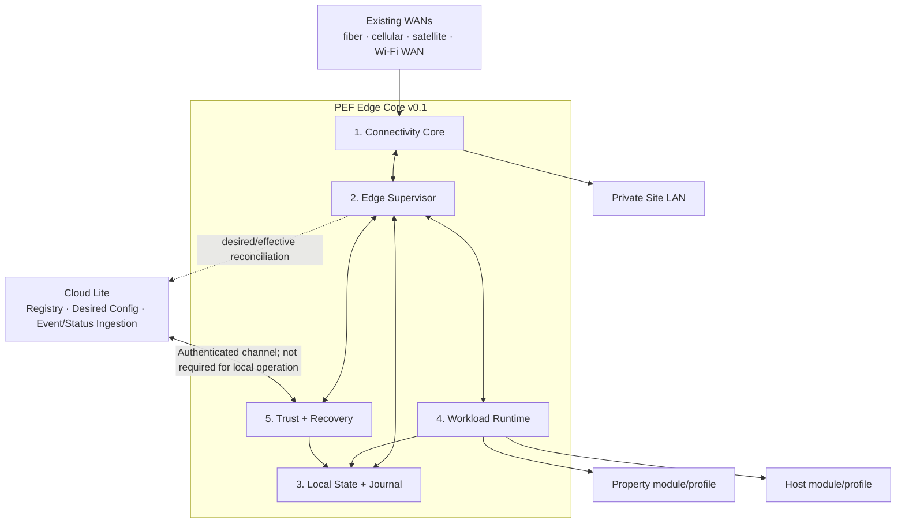

# Private Edge Fabric (PEF) — Foundation v0.1

> **Estado (2026-10-12): W1.9.R puente de portabilidad Core↔Linux CI verificado; emulador y laboratorio visual integrados**, más baseline arquitectónica documental. **Sin hardware PEF certificado, benchmarks físicos ni validación de clientes.** No confundir pruebas del simulador con evidencia física del producto.

## Emulator software-first (W1.9)

### Panel visual en macOS

```bash
git switch main && git pull
npm run dashboard
# abrir http://127.0.0.1:8787
```

El panel ofrece dos modos: **Simulación lógica** (Step/Run/Rewind/Reset en memoria) y **Laboratorio integrado** (WAN sintéticas, eventos de fsync en journal P1 temporal, identidad/revisión, Cloud mock con ACK ambiguo, reintentos, compaction y reinicio, más tests TCP/HTTP localhost). El laboratorio **no cambia las interfaces/rutas del Mac**, pero **sí escribe ficheros temporales de prueba**; no necesita root ni Docker. Linux namespaces sólo se ejecuta en CI y su evidencia es accesible desde el panel. [Contrato de integración obligatorio](docs/15-emulator-integration.md). [Contrato y alcance W1.9.K](docs/tasks/w1.9-k-statechart-dashboard.md).

`npm test` ejecuta la suite Node built-in (incluyendo journal con `fsync` y crash de un proceso hijo), `npm run emulate` los escenarios deterministas y `npm run lab:loopback` prueba HTTP/TCP en localhost. **W1.9.H** verifica routing + selección automática por probes reales **únicamente en namespaces Linux aislados de un runner GitHub-hosted efímero**; no ejecutar fault injection con root en equipos personales. Ver [Emulator](docs/12-emulator.md) y [Tasks W1.9](docs/tasks/w1.9-emulator-execution.md). `SIM_PASS` **no certifica hardware** ni la durabilidad física.

## Propósito

PEF es una plataforma *local-first* para sitios pequeños: usa conectividad existente, sostiene servicios locales cuando fallan WAN/cloud, conserva estado y evidencia, se recupera de fallos y puede gestionarse remotamente cuando existe conectividad. **No es otro router, una red 5G privada ni un operador de Internet.**

- **Un PEF Core**, adaptable mediante configuración, módulos y recursos.
- **Dos overlays iniciales** para validar la arquitectura: **Property** (segunda residencia/finca) y **Host** (camping/alojamiento pequeño). Son escenarios de producto, **no dos cores**.
- **Nomad** permanece como candidato posterior del research; no forma parte del alcance inmediato de W1.
- **Cloud es gestión, no supervivencia.** El sitio puede permanecer `LOCAL_ONLY`.

## Cómo consumir esta documentación (agentes)

1. Leer [`AGENTS.md`](AGENTS.md) para reglas y semántica de estados.
2. Leer [`docs/01-product-foundation.md`](docs/01-product-foundation.md) para el **porqué** y restricciones comerciales.
3. Leer [`docs/02-core-requirements.md`](docs/02-core-requirements.md) para el **qué** (`REQ-*`).
4. Leer sólo el documento necesario para la tarea: arquitectura [`03`](docs/03-logical-architecture.md), fallos [`04`](docs/04-failure-offline-contract.md), overlays [`05`](docs/05-overlays-workload-contract.md), recursos [`06`](docs/06-resource-envelope.md).
5. Consultar [`docs/07-roadmap-decisions.md`](docs/07-roadmap-decisions.md) para estado real; [subtasks W1.5](docs/tasks/w1.5-resource-execution.md), [Resource Gate](docs/08-resource-gate.md), [W1.6 Runtime](docs/09-runtime-contract.md) y [W1.7 Harness Spec](docs/10-benchmark-harness.md) con [subtasks](docs/tasks/w1.7-harness-execution.md), y [W1.8 Shootout](docs/11-architecture-shootout.md).
6. El informe conservado íntegro en [`source/deep-research-report-original.md`](source/deep-research-report-original.md) es **fuente de antecedentes**, no sustituto de requisitos ni validación independiente de cifras de mercado.

## Diagramas de conectividad

La **topología física de alto nivel**, separación de planos, failover/failback y evolución emulador → laboratorio → hardware están documentados en [13 — Conectividad PEF](docs/13-connectivity-topology.md). Los Mermaid dentro de ese archivo son la referencia editable, sin seleccionar interfaces ni hardware.

## Arquitectura reducida (baseline de W1.3)



> Diagrama lógico, **no** topología de procesos ni selección de protocolos. El tráfico de datos no necesita atravesar el Supervisor. La imagen [`assets/pef-logical-v0.1-concept.png`](assets/pef-logical-v0.1-concept.png) es ilustrativa y **no normativa**; estos Markdown prevalecen.

## Estado de Wave 1

| Bloque | Estado documental | Validación empírica |
|---|---|---|
| W1.1 Frontera del Core | DOCUMENTED | No aplica todavía / no implementada |
| W1.2 Failure & Offline Contract | DOCUMENTED | PENDING |
| W1.3 Logical Architecture | DOCUMENTED | PENDING |
| W1.4 Property/Host overlays, stress conceptual, SKU | DOCUMENTED | PENDING |
| W1.5.A Perfiles de carga | DOCUMENTED; **provisionales** | PENDING |
| W1.5.B Networking envelope | DOCUMENTED; **targets propuestos** | PENDING |
| W1.5.C Compute & Memory | DOCUMENTED; **presupuesto provisional** | PENDING |
| W1.5.D Storage | DOCUMENTED; **escenarios provisionales** | PENDING |
| W1.5.E Workload Resource Model | DOCUMENTED; schema, admission design | PENDING |
| W1.5.F Power & Thermal | DOCUMENTED; methodology, W TBD | PENDING |
| W1.5.G Recovery Targets | DOCUMENTED; timing model | PENDING |
| W1.5.H–J Consolidation & Gate | DOCUMENTED; **design GO conditional** | PENDING |
| W1.6 Software Runtime Contract | DOCUMENTED; architecture contracts only | PENDING |
| W1.7 Benchmark & Failure Harness | SPECIFIED; scenarios/evidence schemas | **NO RUNS** |
| W1.8 Architecture Shootout | A–D DOCUMENTED; E–G BLOCKED | **NO HARDWARE RUNS** |
| W1.9 Virtual Edge Emulator | **A–T software/laboratorio: PASS; pre-hardware handoff READY** | **94/94 Node PASS; 7 SIM_PASS; loopback, Linux veth, worker aislado y gate PASS. Dispositivo NO VALIDADO** |

> **Integridad del import:** `SHA256SUMS` conserva los checksums de la **primera importación Foundation**; no es un manifiesto vivo del HEAD después de los commits documentales. Usar `git`/GitHub para verificar la versión vigente.

## Alcance y regla de cambio

- Las capacidades del Core están aprobadas **conceptualmente**; hardware, SO, runtime, almacenamiento, protocolos y coste no están elegidos.
- Los números de W1.5 son **hipótesis de especificación**; no resultados medidos ni promesas comerciales.
- Cambiar un requisito exige actualizar su ID, origen, criterio verificable y decisión en [`07-roadmap-decisions.md`](docs/07-roadmap-decisions.md).
- **No crear una sexta pieza Core** para una responsabilidad que cabe en los cinco bloques sin documentar primero el problema y el trade-off.
- Las fuentes originales incluyen marcadores de cita de un research anterior que deben revalidarse antes de publicaciones comerciales/regulatorias o decisiones de compra.

## Entrega y próxima transición

**Repositorio de trabajo:** [`krukmat/logistica`](https://github.com/krukmat/logistica), rama principal `main`. Esta baseline documenta trabajo de diseño; los commits de integración no constituyen validación empírica. Para avanzar: **W1.9.Q Virtual Site E2E (recepción local-first) integrado y verificado** ([CI 68/68 PASS](https://github.com/krukmat/logistica/actions/runs/38281997428)); continuar con la siguiente task desde la [integración visual](docs/15-emulator-integration.md), continuar el Core mínimo; evolucionar el [emulador](docs/12-emulator.md) hacia un Core mínimo, antes de pruebas físicas W1.8.E–G. [CI H/I audit](docs/audit/w1.9-h-i-2026-10-12.md). [W1.8 Shootout](docs/11-architecture-shootout.md) y [subtasks](docs/tasks/w1.8-shootout-execution.md). El **Product Core compartido** ya está separado del simulador para conectividad, eventos, recepción y replay; **no hay hardware certificado**, y compra/producción sigue NO-GO. `node bin/pef-emulator.js --all` ofrece pruebas **lógicas** reproducibles, no benchmarks.


## Regla de trabajo vigente (W1.9.P0)

Desde ahora **ninguna nueva función implementada puede quedar fuera del emulador**: debe disponer de entrada y observables en el Control Panel, tests HTTP end-to-end, registro de [capacidades](docs/contracts/emulator-integration-v1.json) y evidencia CI. Si requiere root, Linux o hardware se presenta como `CI-only/BLOCKED` con la evidencia, sin ejecutarse en macOS. [Norma y procedimiento](docs/15-emulator-integration.md).

## W1.9.Q — Recepción logística local-first

Desde el [emulador visual](docs/15-emulator-integration.md), en modo **Laboratorio integrado**, se pueden registrar paquetes mediante `POST /api/local/receipts` y verlos persistidos en P1 incluso sin WAN. El mismo journal gestiona deduplicación por ID, recuperación tras reinicio y sincronización con Cloud mock. [Diagrama y guía E2E](docs/17-virtual-site-e2e.md). [CI #38281997428](https://github.com/krukmat/logistica/actions/runs/38281997428): 68 pruebas Node, 7 escenarios SIM y ambos laboratorios PASS. La API escucha sólo en localhost y no representa todavía una red productiva.

## W1.9.R — Portabilidad al hardware (prioridad arquitectónica cerrada en software)

El Core común se encuentra en [`src/core/`](src/core), el runtime de composición en [`src/runtime/`](src/runtime) y los adaptadores OS/Linux en [`src/adapters/`](src/adapters). **El emulador y Linux veth usan la misma política WAN y el mismo Core**; el dashboard puede reiniciarse sin detener un runtime inyectado. Los tests comparan 128 vectores de WAN entre emulador y controlador Linux-compatible y rechazan ACK de journal sin fsync confirmado.

[Arquitectura Mermaid y matriz de portabilidad](docs/18-hardware-portability-bridge.md) · [Tasks R](docs/tasks/w1.9-hardware-portability.md) · [CI #38284356529](https://github.com/krukmat/logistica/actions/runs/38284356529): **76/76 tests Node PASS**, 7 SIM_PASS y los laboratorios loopback/Linux PASS. El adaptador físico `device` continúa `BLOCKED`; requiere hardware Linux capaz de ejecutar Node.js, drivers/seguridad y ensayos específicos. La admisión/aislamiento real de workloads permanece pendiente.

## W1.9.S — Workload Runtime & Isolation (software/lab)

El **Workload Manager** y el **Process Supervisor** están integrados en el mismo Product Core portable y en el dashboard: manifiestos versionados, cuotas/admisión, proceso `pef-receiver` controlado por IPC, health, crash, backoff, circuit breaker y recepción logística offline hacia P1. El proceso del Mac es **NODE_PROCESS_ONLY: NO sandbox**, sin límites reales de CPU/RAM/FS/red.

Una prueba **Linux GitHub-hosted y efímera**, separada del proceso del Mac, valida el mismo Core en `cgroup v2` con CPU 150 mCPU, memoria 64 MiB, 16 PIDs, network namespace sin WAN, chroot y UID 65534. No es un backend aislado de producción ni un dispositivo certificado. **Pendiente:** conectar el supervisor a un driver Linux con aislamiento persistente y quotas P2/P3 físicas.

[Arquitectura y cómo probarlo](docs/19-workload-runtime.md) · [Tasks S1–S6](docs/tasks/w1.9-workload-runtime.md) · [CI #38293362918](https://github.com/krukmat/logistica/actions/runs/38293362918): **84/84 tests Node PASS, 7 SIM_PASS, loopback/veth y S3 isolation LAB_PASS/CLEAN**.

## W1.9.S3.4–S3.8 — Linux supervised isolation bridge (CI-only)

El **mismo Workload Supervisor del Core** ya lanza, supervisa, recupera y detiene un proceso real bajo cgroup v2/netns/chroot mediante `src/adapters/linux-isolated-process-driver.js`. No es sólo un harness de aislamiento independiente. [Arquitectura detallada](docs/20-supervised-linux-driver.md) · [CI kernel PASS](https://github.com/krukmat/logistica/actions/runs/38299928948).

Linux CI validó 150 mCPU, 64 MiB, swap 0, 16 PIDs, aislamiento de red/FS/UID, crash/restart, throttling y **OOM kill=1** con reinicio, y recepción offline conservada. El panel visualiza esa prueba como **CI-only**; su proceso local Mac sigue siendo `NODE_PROCESS_ONLY` sin aislamiento de recursos. **No está desplegado aún como driver en un dispositivo real.**

## W1.9.T — Emulador pre-hardware: software cerrado

**Estado a 2026-10-12: `SOFTWARE_LAB_READY` / `GO_FOR_DEVICE_INTEGRATION_ONLY`.** Se ejecuta un `Edge Service` autónomo sin navegador, con configuración v1 estricta, identidad persistida y época de sesión renovada, single-writer lab guard, API privada localhost, políticas WAN del Core, journal fsync P1 y supervisor de workers. La prueba SIGKILL→nuevo arranque confirma idempotencia y recuperación. En Linux CI el mismo host utiliza interfaces de red/rutas netns y, con driver explícito, supervisa un worker aislado por cgroup/netns/chroot.

El emulador mantiene un botón de diagnóstico del Edge autónomo que invoca **el servicio HTTP real**, no otra simulación de su lógica. [Arquitectura y guía operativa](docs/21-autonomous-edge-handoff.md) · [Tasks T1–T5](docs/tasks/w1.9-t-autonomous-edge.md) · [Contrato de migración](docs/contracts/hardware-handoff-v1.json).

[CI final #38314630311](https://github.com/krukmat/logistica/actions/runs/38314630311) **94/94 Node PASS**, 7 SIM_PASS, Linux WAN & supervised isolated worker LAB_PASS/CLEAN, tercer job **prehardware-gate SUCCESS** con artefacto `pef-prehardware-gate.json`. **No confundir esto con seguridad física, hardware validado o autorización de producción**: `device`, NICs reales, PKI, cloud real, almacenamiento ante powercut, arranque en dispositivo y OTA siguen `BLOCKED/NOT_RUN` y corresponden a la fase siguiente.

## W1.10.A — Pre-hardware port conformance (software-only)

`npm run ports:conformance` or **Laboratorio integrado → Ejecutar matriz prehardware** runs 13 stable checks through the shared Product Core, faultable synthetic WAN ports and a temporary OS-file journal. It checks failover/failback, malformed probes, route rejection, offline receipt fsync, deduplication and journal reopen. Device remains `BACKEND_NOT_IMPLEMENTED`.

[Contract](docs/contracts/predevice-ports-v1.json) · [architecture/limitations](docs/22-predevice-ports.md) · [task plan](docs/tasks/w1.10-predevice-emulation.md). LAB results do not certify NIC, powercut, watts, performance or physical hardware. Next: W1.10.B bounded ports/partial route recovery.
