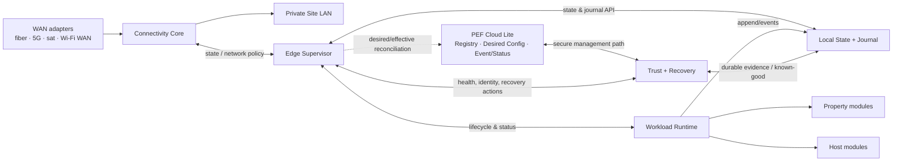
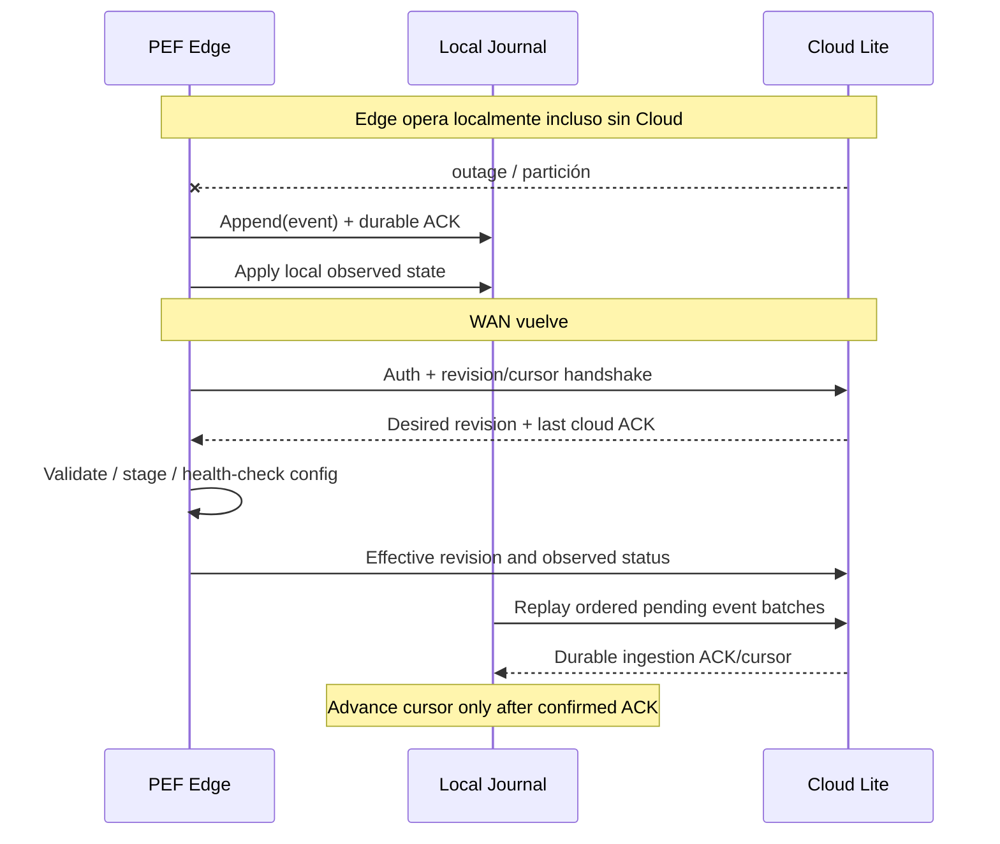

# 03 — Logical architecture v0.1 (W1.3)

**Status:** DOCUMENTED conceptual · **Boundary:** cinco responsabilidades Edge más Cloud Lite. Estos bloques **NO** implican cinco procesos, cinco servicios de red ni una topología monolítica. Selección de SO/runtime/IPC pendiente W1.6.

## Modelo de sistema

La red de datos LAN↔WAN pasa por **Connectivity Core**, no por Supervisor ni por Cloud. La comunicación con cloud es lógica; su transporte concreto se define en W1.6. Los módulos Property/Host son opcionales, no componentes Core.

## Responsabilidades / fuera de frontera

| Bloque | Responsabilidades exclusivas | No debe hacer |
|---|---|---|
| **1 Connectivity Core** | descubrimiento/health WAN, selección y failover/failback, transporte normalizado, routing/NAT/VLAN/DHCP/DNS/firewall básicos | conocer PMS, cámaras, detalles comerciales de Property/Host |
| **2 Edge Supervisor** | estado general, config desired/effective, transacciones, coordinación, reconciliación, lifecycle coordination | almacenar eventos sin journal, controlar directamente credenciales, implementar todo el dataplane |
| **3 Local State + Journal** | persistencia durable, ACK semantics, backlog/cursors, last-known-good, metadatos de recuperación | resolver por sí mismo políticas de transporte/configuración o lógica de verticales |
| **4 Workload Runtime** | registro/health/start/stop/restart, resource admission, límites y storage allocation, Network Intent request, aislamiento | privilegios sobre Core state, identidad, firewall/routing arbitrario |
| **5 Trust + Recovery** | identidad del dispositivo, validación de firma y canal seguro, health/escalación/watchdog, safe mode, rollback, interfaz local mínima autenticada | depender de cloud para supervivencia; ofrecer rollback «best effort» sin known-good |
| **Cloud Lite** | registry de dispositivos, desired config revisionada, event/status ingestion | dataplane, estado operacional local, servicio necesario para arrancar el Edge |

## Ownership de estado — single-writer conceptual

| Dato | Autoridad semántica | Persistencia |
|---|---|---|
| Salud WAN/transporte activo | Connectivity Core | snapshot/eventos en State + Journal |
| Desired config remoto | Cloud Lite (intención) | copia cacheada y revisionada localmente |
| Effective config / estado global | Edge Supervisor | State + Journal |
| Eventos comprometidos, backlog y cursores ACK | State + Journal | State + Journal |
| Known-good config/software + recovery metadata | Supervisor/Recovery (política) | State + Journal y almacenamiento seguro del sistema |
| Workload lifecycle/health | Workload Runtime | snapshot/eventos en State + Journal |
| Device identity / claves | Trust + Recovery | almacenamiento protegido; mecanismo **por decidir** |
| Fleet registry | Cloud Lite | Cloud Lite |

**Regla:** tener copias o snapshots no confiere autoridad de escritura. Reconciliación nunca sobrescribe ciegamente cambios operacionales Edge tras partición.

## Contratos mínimos entre bloques (interfaces lógicas, no protocolo)

| Interface | Entrada / salida mínima |
|---|---|
| `Connectivity.GetStatus` | transport_id, state, available, selected, health, priority, cost_class/metered, failure_reason, last_transition |
| `Connectivity.ApplyPolicy` | configuración revisada y validada; resultado/health tras aplicar |
| `Supervisor.ApplyDesiredRevision` | revision, hash, validated intents → effective_revision o rollback |
| `Journal.Append` | event_id, correlation_id, class, payload, durability/ACK; rechazo/backpressure explícitos |
| `Journal.ExportPending/Acknowledge` | cursor/revisión, batch ordenado, ACK remoto y avance seguro |
| `Runtime.Register/Admit/Run` | workload spec, capabilities, CPU/RAM/storage/net limits, lifecycle & health |
| `Runtime.RequestNetworkIntent` | intención declarativa; permiso/denegación; sin mutar directamente políticas de red |
| `Recovery.Report/Act` | component health, severity, retries, action, result, known-good reference |
| `LocalAPI.GetStatus/Recover` | endpoint autenticado en LAN / plano de administración, estado y acciones acotadas |
| `CloudLite.Sync` | identidad/canal seguro, desired revisions, status/event batches; idempotencia pendiente concretar |

Los tipos y errores específicos se detallarán al seleccionar runtime (W1.6). No asumir un message broker obligatorio; usar contratos directos + journal inicialmente.

## Dependencias, bootstrap y shutdown

**Dependencias fuertes:** todo Core puede persistir estados/evidencia mediante State+Journal; workloads no son dependencia para boot de LAN/Core; cloud es opcional. Evitar bucles circulares de arranque entre supervisión, storage e identidad.

**Orden lógico de bootstrap (refinamiento, por confirmar técnicamente en W1.6):**

1. **Minimal trusted bootstrap / known-good recovery path** disponible sin red ni runtime de workloads.
2. Montar y validar almacenamiento P0/P1; acceder a identidad persistente (orden físico dependiente de plataforma segura).
3. Inicializar Connectivity y servicios LAN locales con última configuración válida.
4. Iniciar Edge Supervisor, event journal operacional y health/recovery supervisor completo; decidir modo.
5. Iniciar Workload Runtime y los workloads admitidos (prioridad local-only).
6. Conectar al Cloud Lite **si hay WAN**; autenticar, reconciliar revisiones y drenar backlog.

> **OPEN-BOOT-01:** en W1.3 el bootstrap de Trust/Recovery se describe antes de storage, aunque la identidad y known-good necesitan persistencia. La propuesta es distinguir un *bootstrap mínimo privilegiado* de Trust/Recovery completo. No se fija proceso ni tecnología hasta W1.6.

**Shutdown/power loss:** no contar con shutdown limpio; después de ACK, los eventos deben sobrevivir apagado abrupto. Al iniciar, validar journal/known-good antes de cargas opcionales. Shutdown intencional: detener admisión, vaciar operaciones cuando sea posible, persistir cursores/estado, cerrar workloads antes que Core.

## Reconciliación edge/cloud

Se exige autoridad local para operación mientras el cloud está desconectado y resolución explícita de conflicto; política exacta de merge/idempotencia **OPEN-SYNC-01**.

## Integración de recuperación

- Cada owner intenta recuperación **local y limitada** de su dominio.
- Trust + Recovery orquesta escalación si no converge (restart → aislamiento → last-known-good → rollback → safe mode → reboot controlado).
- Supervisor mantiene la imagen global y coordina restricciones entre componentes.
- Cada fallo material debe producir evidencia durable aun sin Cloud.

## Decisiones deliberadamente abiertas

`OPEN-BOOT-01` trusted bootstrap; `OPEN-SYNC-01` conflict/idempotency; `OPEN-RUNTIME-01` native vs containers, system service manager, IPC; `OPEN-NET-01` network stack y ubicación de DHCP/DNS/firewall; `OPEN-STORE-01` durable store, partitions/quota, fsync; `OPEN-SEC-01` trust root/secure element; `OPEN-OTA-01` dual image/update/rollback. Resolverlas con criterios de [`06`](06-resource-envelope.md), [`07`](07-roadmap-decisions.md) y tests W1.7, no por intuición tecnológica.

## W1.6 — Refinamiento de ejecución

El contrato concreto de las fronteras lógicas y los estados está en [09-runtime-contract](09-runtime-contract.md). **Health**, **Connectivity**, **Cloud** y **Security** son dimensiones ortogonales (ej.: `HEALTHY + LOCAL_ONLY`), y el bootstrap mínimo no exige cloud, full Supervisor ni Workload Runtime. Esto resuelve semántica de diseño `OPEN-STATE-01` y `OPEN-BOOT-01`; su implementación sigue pendiente. Los demás puntos abiertos requieren W1.7/W1.8.
