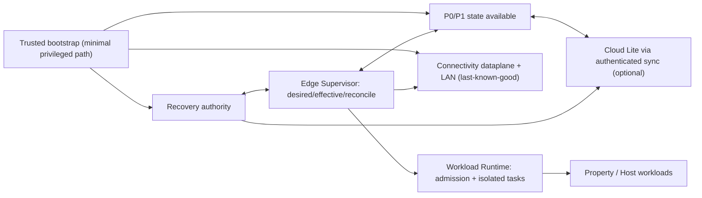

# 09 — PEF Core Software Runtime Contract v0.1 (W1.6)

**Estado:** DOCUMENTED / DESIGN ONLY (2026-10-12). No ejecutable, no hardware seleccionado, ninguna prueba funcional realizada. Descomposición [W1.6.A–I](tasks/w1.6-runtime-execution.md). Fuentes normativas: [02 Requirements](02-core-requirements.md), [03 Logical Architecture](03-logical-architecture.md), [04 Offline/Failure](04-failure-offline-contract.md), [06 Resource Envelope](06-resource-envelope.md), [08 Resource Gate](08-resource-gate.md). Este documento **refina responsabilidades** sin reemplazar sus invariantes.

## A — Deployment boundary: 5 logical blocks ≠ 5 mandatory processes

**Logical owner vs process:** Connectivity may use OS kernel networking + small userspace adapter; Supervisor and control services may initially share a process; Journal must have an isolated durability boundary (transaction/service API); Runtime isolates workloads; Trust+Recovery spans **minimal bootstrap** and a runtime supervisor. This is **not** a mandate for five daemons or distributed microservices.

**Candidate PoC deployment shape (ADR PROPOSED):** one Linux-capable appliance/VM, native or tightly privileged Core system services, isolated workload processes or containers; simple local IPC; no Kubernetes/message broker. **Do not freeze** OpenWrt/Debian, init/service manager, database, WireGuard implementation, container engine, ISA, TPM or OTA tool until W1.7/W1.8 verify capabilities/cost. If split hardware later, it must pass G-PEF-CORE-01 end to end; compute node cannot be prerequisite for essential LAN if design claims otherwise.

**Least privilege rules:** dataplane mutation only through Connectivity adapter after Supervisor+Trust policy approval; Runtime never obtains host-network admin, device private key, P0/P1 volume write or Recovery authority; local control API is authenticated even offline.

## B — Bootstrap, known-good and safe mode

**Dependence resolution for OPEN-BOOT-01 (accepted as logical design, not OS choice):**

1. Firmware/boot path selects signed/verified previously valid slot or repair state. A **minimal trusted bootstrap** reads protected metadata and detects interrupted update/config. It does not require Cloud, full Supervisor, workloads or full Journal service.
2. Storage P0 initialized/read-only validation first; key/identity handle unlocked or verified using available local trust. If unavailable, **never regenerate identity automatically**; permit only safe local recovery as authenticated and physically permitted.
3. Mount/validate P1 journal with integrity checks; recovery of unapplied/partial transaction must finish before normal ACK traffic. If corrupted/read-only, enter safe degraded mode without false durability.
4. Connectivity applies cached **last-known-good** LAN/network config; does not require WAN or remote auth. Device reaches `LOCAL_READY` if essential local functions pass, even all WAN offline.
5. Start full Supervisor+Recovery and Workload Runtime, admit local-only-capable workloads after resource reserve. Cloud sync starts after WAN and valid remote trust. Loss of Cloud must not regress local readiness.
6. Startup and rollback transitions append incident evidence when P1 available, otherwise expose explicit degraded health / emergency metadata; no promise of durable evidence if all persistent media have failed.

**Controlled shutdown:** stop new admissions → request workload graceful stop → persist effective/cursors/known-good → stop optional workloads → keep networking/recovery available until last safe moment. **Uncontrolled power loss is the primary design assumption**; no reliance on graceful shutdown to preserve committed events. After reboot, reconcile partial config/OTA with last-good markers atomically.

## C — Orthogonal state machines and local IPC

Previous `LOCAL_ONLY` vs `HEALTHY` ambiguity is resolved **conceptually** by separate dimensions:

| Dimension | Enumerations | Semantic owner |
|---|---|---|
| Core health | BOOTING, HEALTHY, DEGRADED, RECOVERING, SAFE_MODE, CRITICAL | Supervisor + Recovery |
| Site connectivity | MULTI_WAN_HEALTHY, REDUNDANCY_DEGRADED, CONNECTED, LOCAL_ONLY | Connectivity |
| Cloud sync | ONLINE, CLOUD_DISCONNECTED, RECONNECTING | Supervisor |
| Remote security | SECURE, SECURITY_DEGRADED, REMOTE_ISOLATED, SECURITY_RECOVERY | Trust+Recovery |
| Workload health | PENDING, RUNNING, DEGRADED, FAILED, ISOLATED, STOPPED | Workload Runtime |

`HEALTHY + LOCAL_ONLY + CLOUD_DISCONNECTED` is legitimate if *essential LAN/local-only workload readiness* and durability remain healthy; site losing Internet is still a connectivity incident, **not a proof of failed local Core**. Security compromise or P1 failure may independently reduce health.

**IPC semantic contract** (transport TBD): every state-changing operation carries `request_id`, `actor`, `revision/expected_version`, `deadline`, optional `correlation_id`; replies carry `status`, `effective_revision`, `error_code`, and durable event ref only if ACKed. Bounded timeouts/cancel; read-only queries must not block on Cloud. Retry idempotently by `request_id`; repeated requests may return committed result, never apply twice. Components expose versioned method schemas, health/readiness and error categories, not raw shell to vertical modules.

**Control contracts:**

| Interface | Mutating owner | Precondition | Result/error |
|---|---|---|---|
| Connectivity.ApplyPolicy | Connectivity (under Supervisor authority) | signed/authorized desired, staged+versioned | effective policy/health or ROLLBACK |
| Supervisor.ApplyConfig | Supervisor | validated schema, local authority check | STAGED→VALIDATED→COMMITTED or ROLLBACK |
| Journal.Append | State+Journal | quota+durability facility healthy | durable event ACK or `STORAGE_UNSAFE` |
| Journal.SyncAck | State+Journal | authenticated cloud durable ACK, monotonic cursor | cursor advanced atomically or unchanged |
| Runtime.Admit/Start | Runtime | trust, schema, quota+Core reserve, Network Intent policy | admission result + bounded lifecycle |
| Recovery.Act | Trust+Recovery | authorized escalation and known-good | action outcome/evidence or SAFE_MODE |
| LocalAPI.Recover | Trust+Recovery | authenticated local principal and bounded action | accepted/rejected with audit ID |

**Event envelope:** `event_id`, `schema_version`, `site_id`, `device_id`, `correlation_id`, `observed_at_wall`, `observed_at_monotonic`, `event_class` (O0..O3), `component`, `event_type`, `payload_digest`, `config_revision`, `software_revision`. Stable event id for dedup and same correlation across detection/action/recovery. Clock rollback never means monotonic duration negative. Sensitive payload redacted; provenance recorded.

## D — Networking adapter and reversible Network Intent

Connectivity is the **single network mutation boundary**, may use kernel routing/NAT, VLAN, DHCP/DNS and firewall through adapters. Device-specific WAN drivers, modem/Starlink link checks and userland DNS/DHCP **are ports**, not required Core dependencies of the architecture. Active health combines link, gateway, upstream reachability, latency/loss; probe thresholds, timers and routing offload decided empirically.

Network Intent: Runtime requests `local_service_discovery`, `egress`, `isolated_network`, `local_service_publish`; Supervisor evaluates site policy + owner authorization, Connectivity applies **validated bounded** rule set and returns effective revision. Deny raw nft/iptables, host networking, arbitrary port/firewall writes. On failed health after network policy change, roll back to last-known-good without remote access required. Route changes must not starve local API path. **No captive portal, Wi-Fi controller, SD-WAN bonding** in v0.1.

## E — Edge ↔ Cloud Lite replication contract

**OPEN-SYNC-01 refinement (design PROPOSED):** `HELLO(device identity, software/config rev, last_cursor)` → mutual auth + replay protection → `DESIRED_CONFIG(revision, digest)` → local validate/stage/activate/health/commit or explicit reject → `OBSERVED_EFFECTIVE(revision, status)` → `PENDING_EVENTS(event IDs, ordered batches)` → `CLOUD_DURABLE_ACK(ids or cursor)` → atomically persist local ACK cursor/prune eligible records. **Do not conflate Cloud desired with Edge effective.**

- Cloud may issue monotonically versioned desired revisions; Edge uses **compare-and-apply** and last-valid cache. Conflicting revisions are surfaced (e.g. `CONFLICT_REVISION`), never blind overwrite of local operational state. Local emergency override carries its own revision/lease and is reconciled explicitly; exact merge & conflict policy remains OPEN for W1.7 scenario.
- Event ingest **at-least-once**; cloud idempotently deduplicates `device_id,event_id`. Ambiguous remote ACK leaves local cursor unchanged; rerun safe. Retain O0/O1 per policy even after ingestion ACK where required. At-least-once applies to delivery, **not** automatic repeat of non-idempotent side effects.
- All WAN offline: same local operation continues until bounded P1 capacity; on full journal apply backpressure/reject *new* committed writes, no silent event loss. Offline SaaS entitlements only valid within last-known local policy window (length TBD); do not infer indefinite access.
- Network regained but auth invalid: stay `REMOTE_ISOLATED`; LAN local unaffected and no unauthenticated fallback. Time sanity and trust renewal handled before privileged sync.

## F — Storage/journal transactions

P0 holds boot identity references and known-good; P1 is dedicated/isolated bounded journal + recovery evidence; P2/P3 workloads are quota-limited. Write-ahead journal or equivalent transactional store is **candidate implementation pattern**, not a selected database/FS. Events are ACKed **only after durable commit/barrier** with verified semantics under chosen storage medium, even with group commit. If error `STORAGE_FULL_OR_UNSAFE`, caller sees rejection and must avoid claiming success.

Crash cases: before durable ACK event may or may not be present; reissue with stable event ID. After ACK event must survive within declared medium power-loss guarantees; pending sync batches replay; remote ingestion ACK + local cursor update are separate failure boundaries and require cloud dedup. Corrupted P2 never corrupts P1; P1 corruption enters degraded mode, no fake success. No file-system or TBW/endurance promise before physical tests D-PER and W1.7.

## G — Device trust, OTA and rollback

Device identity has one stable locally protected handle plus recovery metadata. Provisioning incomplete means UNPROVISIONED (restricted local recovery only). Remote channel needs authenticated peers, pinned identity/trust material and strong encryption; no fallback to plaintext when overlay/mTLS fails. Device clock unavailable: use last trusted plus monotonic for local state; privileged remote ops may block. Offline revocation cache lifetime remains a policy choice.

Config updates `VALIDATE→STAGE→ACTIVATE→HEALTH→COMMIT` or rollback; software `VERIFY_SIGNATURE→STAGE_CANDIDATE→BOOT_CANDIDATE→HEALTH→COMMIT`, unsuccessful health/checkpoint → known-good boot slot; preserve P0/P1 journal across system image rollback. Avoid storing all critical state only inside replaceable root image. *Distribution from Cloud at scale deferred*; signed local update/rollback capability stays Core. Concrete trust root, dual partitions, framework/tool and update payload method require platform evaluation.

## H — Workload isolation and recovery

Load versioned [Workload Manifest](contracts/workload-manifest-v0.1.schema.json). Schema check is not enough: cross-field requests≤limits, trust, capabilities, network intent approval, CPU/RAM/P2 quota fit and reserved Core headroom must be enforced **at runtime**. Runtime deny/uninstall/restart actions cannot run arbitrary root shell or reach host network. For optional workloads, memory pressure → reject new admission → throttle/restart/isolate → preserve P0/P1/local networking. For essential workloads, report degradation without borrowing Core reserve.

**Restart circuit breaker:** bounded attempts within a defined window, exponential backoff or escalating delay with cap, isolate on repeated failure, emit evidence; no infinite restart loop. Recovery authority remains available without Workload Runtime. Refuse cloud-remote workaround that bypasses local authentication.

## I — Gate, proposed decisions and W1.7 handoff

| ID | Runtime design assertion | Acceptance scenario |
|---|---|---|
| R1 | trusted bootstrap + LAN ready without cloud | G-CLOUD-01, G-CON-03, G-SEC-04 |
| R2 | orthogonal health/connectivity, bounded recovery | G-REC-01/02, G-CON-04 |
| R3 | safe local configuration transaction | G-PER-02, G-CLOUD-03 |
| R4 | durable journal, cloud idempotency/cursor | G-PER-01, D-SYN-01, G-OBS |
| R5 | isolation + Network Intent mediation | E-01..E-06, G-WRK-01/02 |
| R6 | signed lifecycle and boot fallback | G-OTA-01/02/03 |
| R7 | power-loss, storage pressure, Cloud outage | D-PER-01..06, F-UPS-01 |
| R8 | observability and trustworthy incident lineage | G-OBS-01/02/03 |

**W1.6 design gate: GO_TO_W1.7_SPEC (conditional)**; implementation is *NOT started* and runtime choice remains contingent on W1.8. **Unresolved hardware/protocol:** `OPEN-RUNTIME-01` init/containers/IPC, `OPEN-NET-01` Linux stack/offload, `OPEN-STORE-01` FS/DB/partitions, `OPEN-SEC-01` trust root, `OPEN-OTA-01` update method; `OPEN-SYNC-01` merge policy needs negative tests. `OPEN-BOOT-01` and `OPEN-STATE-01` have **resolved logical models** but no executable implementation.

**No new PEF Core block or vendor lock-in introduced.**

## Refinamiento de referencia W1.9.O (lab, no producto)

[14 — Identity/Replay Contract](14-identity-replay-contract.md) aporta IDs estables de sitio/dispositivo **proporcionados como fixtures**, sesión por arranque, revisiones, eventos de WAN correlacionados y manejo de ACK remoto ambiguo con mock Cloud. Se probó en CI Node/Linux, pero no constituye identidad protegida, transporte autenticado, persistencia Cloud productiva ni durabilidad física. `OPEN-SEC-01` y `OPEN-SYNC-01` siguen abiertos para implementación real.
