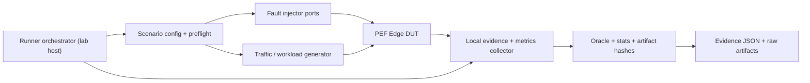

# 10 — Benchmark & Failure Harness Contract v0.1 (W1.7)

**Status:** SPECIFICATION ONLY; catalog/schema authored, no PEF test runner, no injection drivers, no physical bench, no PASS. [Granularity](tasks/w1.7-harness-execution.md) and [W1.6 runtime](09-runtime-contract.md). **Primary task:** falsify [requirements](02-core-requirements.md), [W1.2 invariants/gates](04-failure-offline-contract.md) and [W1.5 resources](06-resource-envelope.md) consistently across Property/Host and future hardware.

## A — Architecture and lifecycle

**Lab isolation:** faults affect named test interfaces, virtual networks, lab power switches or sandbox volumes only. No arbitrary power-off/wipe commands against unknown hosts, public/cloud production systems or user network. `preflight` must require sandbox lab ID, device ID, target endpoints, explicit injection capability, expected revision/config and reversible cleanup path. Fail closed: `BLOCKED_PRECONDITION` and do not inject. Physical power-loss tests require controllable bench equipment; a simulated process kill **is not** power-loss proof.

**Workflow:** inventory → fixture immutability/hash → prepare → baseline health → fault/load injection → observe recovery → assert invariants → export raw evidence → restore → post-cleanup diff → result. Fail to restore is `ERROR_HARNESS` and halts next destructive test. Every run gets unique run ID; artifacts readonly/content-hashed; exception, timeout and power-cut count as samples.

**Drivers/ports (to implement, NOT available yet):** `wan_link`, `wan_blackhole`, `traffic_gen`, `cloud_partition`, `journal_probe`, `disk_pressure`, `workload_control`, `config_ota`, `clock_trust`, `power_relay`, `temperature_sensor`, `wall_power_meter`. Drivers advertise support/capabilities. Missing driver => `BLOCKED`, never substitute a softer failure silently.

## B — Scenarios and source of truth

Structured registry: [harness-scenarios-v0.1.json](contracts/harness-scenarios-v0.1.json), [schema](contracts/harness-scenario-v0.1.schema.json). Each record contains stable `scenario_id`, `gate_ids`, `profile`, `preconditions`, `stimulus`, `driver`, `oracle`, `evidence_fields` and `execution_status`. All initial records `NOT_RUN`. Source ids from W1.2 G-CON/CLOUD/PER/SW/OTA/SEC/REC/OBS/WRK and C/D/E/F/G of W1.5. Do not conflate specification count with implemented test coverage.

**Required dimensions:** Core-only, Property Base/Pro, Host H50/H100/H150/H250-stress; WAN up/down/upstream blackhole/flapping; Cloud ONLINE vs CLOUD_DISCONNECTED vs LOCAL_ONLY; event rate/size 72h vs 7d; WAN health carrier up; OTA partial; workloads light, hostile and optional NVR-like. Only valid combinations selected; `LOCAL_ONLY_CAPABLE` claims need actual service exercise, not just Core green status.

## C — Network and transport oracles

Measure `t0_fault`, `t_detect`, `t_first_new_useful_flow`, `t_stable`, `t_failback`, `false_flips`, DNS health, surviving LAN functions. Link-down and carrier-up blackhole must be separate populations; no seamless TCP migration assumption. W1.5.B proposed WAN failover p95 <10 s MUST, <5 s TARGET under **declared scenario conditions**. Report raw outcomes and whether threshold was reached; no pass by mean.

Network performance: 64/512/1500-byte frames, TCP/UDP, flows/sec and concurrent conntrack, routing/firewall on/off/offload, overlay throughput and CPU/IRQ/softirq, packet drops, latency under load, WAN direction. 1 Gbps Base MUST and 2.5 Gbps Pro TARGET remain unvalidated. A host outside bottleneck + physical interface rate must be recorded.

## D — Storage/OTA/lifecycle oracles

Evidence for P1 durability has temporal boundary: `ACKed(event_id)` → physical cut (not graceful shutdown) → reboot + compare hash/event_id. Before ACK may replay or not; safe retry/dedup required. Full P2 should never consume P0/P1; P1 exhausted rejects new commits without false ACK. Inject cloud ACK lost before local cursor commit; replay must dedupe. Test config rollback and candidate image signed/invalid/power-interrupted. Never intentionally corrupt real operator volumes; use prepared test volumes/checkpoints.

Measure event payload serialized size p50/p95/p99, WAL/index capacity factor, physical write amplification, durable latency/fsync, backlog replay rate, P1/O0/O1 retention. Storage hardware selection remains W1.8, not W1.7 specification.

## E — Workload, trust and cloud oracles

Validate [workload schema](contracts/workload-manifest-v0.1.schema.json) plus semantic `requests ≤ limits` and Trust policy; deny unauthorized network intent, root/identity access, P0/P1 mount, oversize CPU/RAM/storage admission; restart with bounded attempts and isolate. Even if workload is `essential`, Core trust and P0/P1 outrank it. Offline UI/auth cannot bypass authentication. Cloud auth fail disconnects remote only; recovery local must work without cloud. On cloud restoration verify revision compare, event ID dedup, durable ACK/cursor and no blind overwrite.

## F — Power, thermal and measured boundaries

Measure **wall W** with chosen supplies and accessories enumerated; externally powered APs/switches/sensors/modems separated unless site-level UPS claim includes them. Profile idle/steady/routing+overlay+journal/peak. Environment temperature and SoC/modem/storage temps logged; measure thermal throttling and persistent function. A virtual CI job cannot validate wall power, UPS or real flash endurance. **No synthetic substitution for physical safety claims.**

## G — Evidence schema and statistical acceptance

Schema: [harness-evidence-v0.1.schema.json](contracts/harness-evidence-v0.1.schema.json). A result must contain exact scenario/profile, hardware/software/fixture revisions, input/environment, named driver, `t0/t1` durations using monotonic, raw metrics sample refs and artifact hashes, oracle observations, cleanup status and limitations. For a result `PASS`, `evidence_complete=true`, cleanup successful, raw sample refs/hashes nonempty, negative oracle failure absent and sample count adequate. A JSON Schema alone cannot prove the samples or hashes genuine: runtime validator + operator review necessary.

**Statistical conventions:** ≥30 runs exploratory per independent fault family; ≥100 for initial p95 evaluation; p99 needs larger N, report exploratory without adequate coverage. Preserve failures/timeouts in denominator, record censoring and confidence intervals; don't mix link-down and blackhole as one homogeneous population. p95 threshold is not established until measured on an actual target with consistent load. Invariants (P1 durability, auth) take precedence over fast recovery.

## H — Runner/error/restore contract

Status: `NOT_RUN`, `BLOCKED`, `ERROR`, `FAIL`, `PASS`. `BLOCKED` if driver/physical fixture missing; `ERROR` on runner failure, corrupted evidence or incomplete restore; `FAIL` if actual PEF behavior violates oracle; `PASS` only observed positive evidence. Expected faults should not be misclassified `ERROR`. Destructive tests default manual lab authorization by operator; no unattended host power action or live network reconfiguration. A dry run may validate fixtures but **cannot** mark PEF tests as PASS.

## I — Gate / current implementation reality

**W1.7 design DoD = SPECIFIED**: repeatable scenario vocabulary and acceptance oracles, test registry, evidence schema, driver capability needs, restoration and statistical sampling. **Runtime implementation tests: NONE; drivers: NONE; hardware: NONE; evaluated outcomes: NONE.** W1.8 cannot claim a shootout result until physical or properly scoped virtual implementations exist; preliminary comparisons must be marked **HYPOTHESIS**.

**Next:** W1.8 decision methodology; build executable runner/adapters and lab infrastructure only once runtime implementation and test hardware or simulation harness exist.
