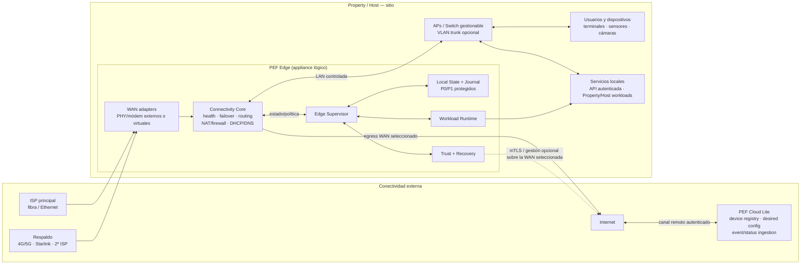
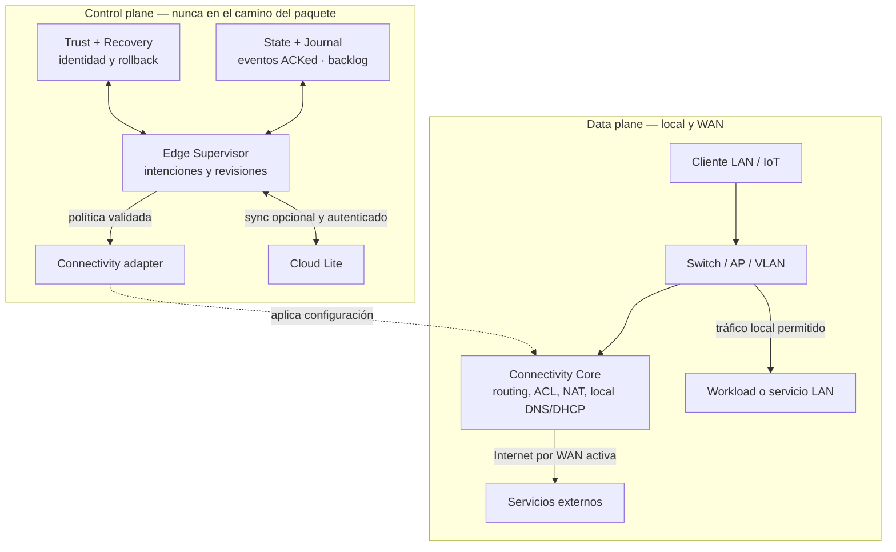
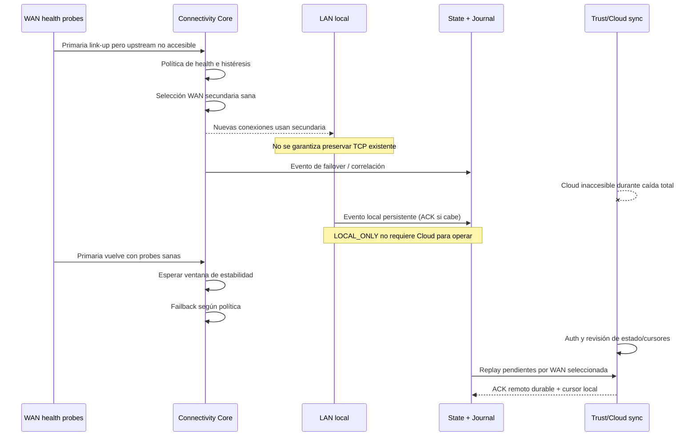
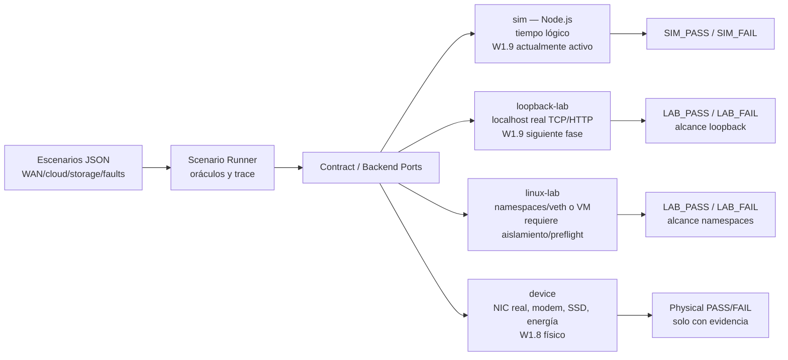
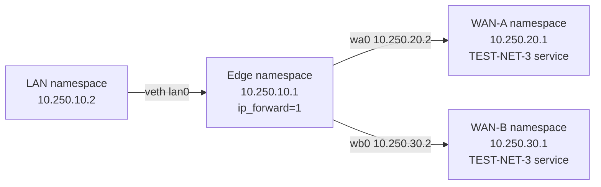

# 13 — Conectividad PEF: topología, flujos y emulación v0.1

**Estado:** `DOCUMENTED` — contrato de conectividad de alto nivel para **Property** y **Host**, sin hardware escogido ni rendimiento certificado. Integra [arquitectura lógica W1.3](03-logical-architecture.md), [fallos W1.2](04-failure-offline-contract.md), [resource envelope W1.5.B/G](06-resource-envelope.md), [runtime W1.6](09-runtime-contract.md) y [emulador W1.9](12-emulator.md). Mermaid es **fuente editable** de los diagramas. Las líneas indican roles y flujos *lógicos*, no un cableado/NIC contractual definitivo.

## A. Topología de instalación — PEF como gateway de las redes bajo su control

**Interpretación física:** PEF actúa como gateway/router para las VLAN/redes que gestiona. APs y switches pueden ser de terceros; no hace falta construir el Wi-Fi en el appliance. ISP1/ISP2 pueden estar tras routers de proveedor (posible doble NAT). Número real de NIC/puertos, Wi-Fi WAN, LTE/Starlink y trunk VLAN siguen **abiertos** hasta W1.8. Si PEF se despliega sólo como *sidecar* detrás de otro router, **no** controla necesariamente el default route de todos los clientes ni puede garantizarles failover; requeriría un contrato/topología distinto.

## B. Dos planos: tráfico de datos vs control/gestión

- **Data plane:** paquetes de la LAN cruzan únicamente Connectivity/kernel/router; ni Cloud Lite, ni Supervisor, ni Journal deben introducirse en el camino crítico de forwarding.
- **Control plane:** Supervisor autoriza intenciones y revisiones; Connectivity es el único owner que muta rutas/firewall/DHCP y aplica rollback; Trust garantiza acceso remoto autenticado y recovery.
- **Offline:** la LAN, el API local autenticado y los workloads `LOCAL_ONLY_CAPABLE` pueden seguir; las funciones de terceros en Internet no pueden prometer continuidad. Eventos remotos se acumulan en P1 **hasta la cuota**; al llenarse hay backpressure explícita, no ACK falso.

## C. Estados y conmutación WAN — secuencia

La secuencia ilustra el **comportamiento esperado**, no una duración medida. Los objetivos previos de failover `p95 <10 s MUST propuesto` y `p95 <5 s TARGET` son **hipótesis sin benchmark**. Un enlace con carrier `UP` no se considera WAN saludable por sí solo. Failback necesita histéresis para evitar flapping.

## D. Conectividad del emulador: sin hardware → red virtual → dispositivo

**No equiparar** pruebas: `sim` modela selecciones; un `loopback-lab` podrá comprobar I/O y errores TCP sobre `127.0.0.1`, pero no modifica rutas ni prueba NIC/failover real; Linux namespaces/VM puede comprobar forwarding real **en su sandbox**; sólo el dispositivo mide enlaces físicos, potencia, endurance y failover bajo condiciones reales. `device` requiere permisos del owner antes de fault injection destructivo.

### Matriz de puertos evolutivos

| Contrato | `sim` (actual) | `loopback-lab` (CI verificado) | `linux-lab` | `device` |
|---|---|---|---|---|
| `WanProbe` | `link/upstream` flags | HTTP localhost, blackhole/503/latencia mock | veth/namespace/route | modem/NIC/ISP |
| `NetworkPolicy` | selección lógica | selección de cliente para probes, no rutas | routing/firewall en sandbox | gateway real |
| `CloudTransport` | ACK/dedup en memoria | servicio mock TCP | endpoint en red aislada | mTLS cloud |
| `Journal` | P1 array y ACK virtual | mismo array o store sandbox, **no powercut real** | fsync/DB sandbox | medio duradero + corte |
| `RecoveryBoot` | transición `power_cut` | restart proceso sin cortar energía | VM snapshot/restart | watchdog/boot slots |
| `Clock` | `tick` controlado | monotonic + timeouts reales | monotonic | HW time and probes |

## E. Escenarios de conectividad y trazabilidad

| Scenario ID | Qué se comprueba | Requisito/gate | Alcance disponible |
|---|---|---|---|
| `EMU-WAN-OFFLINE` | upstream blackhole, failover, all-WAN LOCAL_ONLY | REQ-CON-01/02/03, G-CON-01/02/03 | sim (model only) |
| `EMU-FAILBACK` | retorno a primaria tras estabilidad | REQ-CON-02, G-CON-04 | sim (model only) |
| `EMU-CLOUD-REPLAY` | backlog e idempotencia al restaurar WAN/cloud | REQ-STA-01/02, G-CLOUD-02 | sim (model only) |
| `EMU-TRUST-ROLLBACK` | remote auth aislada, LAN/Core viva | REQ-SEC, G-SEC-01 | sim (model only) |
| `SC-G-CON-01/02/03/04` | pruebas W1.7 de red para futuro | W1.7 | NOT_RUN físico |

## F. Preguntas abiertas para implementación física

1. ¿PEF siempre será gateway del segmento gestionado? En W1 la baseline **lo asume**, y el modo sidecar queda fuera de promesas de failover transparente.
2. ¿WAN por NICs físicas, trunk, USB módem o adaptadores virtuales? **No definido**: dimensión de W1.8.
3. ¿Cloud remoto accede mediante overlay o conexión outbound del dispositivo? El diseño exige **conexión autenticada** y acceso local cuando falla WAN; protocolo final sigue pendiente de W1.6/W1.8.
4. ¿Qué hace el sitio sin alimentación de AP/switch externos? La continuidad depende también de su energía y de un UPS de sitio si se promete blackout resiliency.
5. ¿Cuántos clientes y qué throughput se certifican? Los valores Base/Pro de W1.5.B siguen propuestos y necesitan pruebas.

**Regla de cambios:** si Linux/device difiere del modelo, registrar `MODEL_BUG`, `IMPLEMENTATION_BUG`, `PLATFORM_LIMIT` o `UNVERIFIED`; no modificar un requisito sin ADR y evidencia.

## G. Topología del laboratorio Linux namespaces (W1.9.G)

En el smoke Linux, una prueba HTTP originada dentro de LAN cruza efectivamente la namespace Edge y un enlace veth a WAN-A o WAN-B. Se provoca blackhole en WAN-A manteniendo el enlace `UP`, se cambia la ruta por defecto **sólo dentro de Edge**, se prueba failover a WAN-B y después se quita WAN-B para comprobar que LAN sigue accesible. La política de recuperación automática y métricas de tiempo permanecen **pendientes de W1.9.H/W1.7**.

## H. Observación W1.9.H sobre failback y rutas de retorno

El [laboratorio Linux de política automática](audit/w1.9-h-i-2026-10-12.md) pasó `LAB_PASS` en CI #38259618954. El controlador hizo probes HTTP desde Edge en veth por WAN, aplicó `default route` en Edge bajo la selección del modelo, y validó por **HTTP originado en LAN** la WAN realmente alcanzada. Una regresión identificó que restablecer sólo la IP de WAN-A no restablecía la ruta estática de retorno hacia la LAN; corregir esa ruta fue necesario para que el failback entregara tráfico bidireccional. **Regla de diseño:** no dar por recuperada una WAN sólo por probe/control plane; la prueba end-to-end desde LAN es parte de la aceptación. No se midió p95 en segundos reales.
