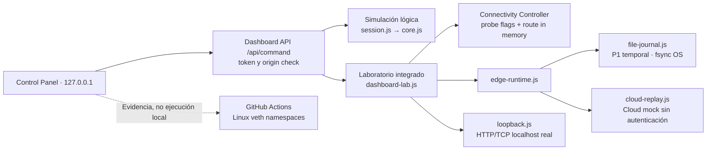

# 15 — Contrato de integración del emulador (W1.9.P0)

**Estado:** IMPLEMENTED + CI VERIFIED (2026-10-12). Este documento convierte en **obligatorio** que toda funcionalidad nueva de PEF esté disponible desde el emulador, respaldada por el mismo módulo que implementa su lógica y cubierta mediante tests de extremo a extremo. Véase también [AGENTS.md](../AGENTS.md), [registro legible por CI](contracts/emulator-integration-v1.json) y [tasks W1.9](tasks/w1.9-emulator-execution.md).

## Interfaz y modos



### Iniciar en macOS / PC

```bash
cd ~/logistica
git switch main && git pull
npm test
npm run dashboard
# http://127.0.0.1:8787
```

No necesita Docker, root, modificar rutas ni cambiar la red doméstica. **Sólo el modo integrado** escribe el journal en un directorio privado temporal del proceso Node, eliminado al cerrar el servidor. El modo lógico sigue siendo puramente memoria y conserva Step / Run / Rewind de escenarios. El modo integrado no ofrece rewind: los ACK de disco son operaciones reales y no se pueden deshacer fingiendo un rebobinado.

### Pruebas desde el Control Panel

1. Seleccionar **Laboratorio integrado · W1.9.O**. Ver identidad `demo-site / demo-edge`, revisión `cfg-demo-1` y sesión aleatoria por arranque. Son valores de laboratorio, nunca credenciales.
2. Pulsar **Sondear + reconciliar**. Observar transición primaria, nuevo `eventId`, `ack=true` y `fsyncCompleted=true` en **Evidencia y resultados**, con evento persistido en **Pendientes**.
3. **Cortar WAN primaria** → conmutación modelada a respaldo; cortar respaldo → `LOCAL_ONLY`, manteniendo `HEALTHY`; restaurar primaria → Cloud disponible. El route adapter del panel modifica sólo memoria; el laboratorio Linux CI usa kernel veth real, no disponible desde el Mac.
4. Para probar ACK ambiguo: con WAN alcanzable y evento pendiente, pulsar **Perder próximo ACK remoto**, luego **Sincronizar**. Se observará `REMOTE_ACK_LOST`, cursor local pendiente y evento guardado en Cloud mock. Repetir **Sincronizar** y comprobar el duplicate ACK válido; con **Falsificar próximo ACK** se obtiene `INVALID_REMOTE_ACK` y el cursor no avanza.
5. **Reiniciar sesión / reabrir P1** conserva eventos del fichero, cambia `sessionId` pero mantiene `siteId/deviceId/configRevision`. **Compactar journal** transforma O2/O3 ya confirmados en referencias, conservando eventos críticos O0/O1 y los pendientes según política de laboratorio.
6. Elegir cuota **Presión (2.4 KiB)** y **Restablecer laboratorio**. Provocar sucesivas transiciones WAN; comprobar `DEGRADED`, `ack=false`, cola volátil acotada y que la WAN sigue funcionando. El reset borra exclusivamente el journal temporal de esta sesión de prueba.
7. **Test TCP/HTTP loopback** ejecuta el laboratorio de sockets reales en `127.0.0.1`, incluyendo 503, timeout y reset; estado `LAB_PASS/LAB_FAIL`. Linux namespaces es sólo CI: usar el enlace del panel para ver sus ejecuciones.

## Semántica de alcance

| Observable | Qué prueba | Qué NO prueba |
|---|---|---|
| `SIM_PASS` | contrato de máquina de estados lógica | WAN real, disco real |
| `LAB_PASS` loopback | sockets HTTP/TCP en localhost | NIC/ISP, rutas del host |
| Lab integrado / `fsyncCompleted` | persistencia hasta `fsync` del sistema operativo y reapertura | durabilidad ante pérdida eléctrica del SSD |
| Cloud mock / `SYNC_OK` | ACK simulado, dedup y cursor local comprobado por digest | mTLS, DB Cloud duradera, dispositivo autenticado |
| Linux veth CI / `LAB_PASS` | forwarding kernel dentro de namespaces aislados | hardware, throughput, ISP real |
| W1.8 device | `BLOCKED / NOT_RUN` | ningún resultado físico atribuido |

No confundir las **WAN sintéticas de la interfaz** con tráfico real entre interfaces; el laboratorio Linux aislado sí prueba routing kernel, pero únicamente en GitHub Actions.

## Puerta permanente de desarrollo

Cada nuevo bloque o task de código debe actualizar **simultáneamente**:
- Módulo/adapter reutilizable (sin duplicar el comportamiento en frontend).
- **Acción y observable** en `public/dashboard.html` / `public/dashboard.js` y ruta autorizada en `dashboard-server.js` o su backend integrado.
- [Registro de capacidades](contracts/emulator-integration-v1.json), señalando `sim`, `lab` o `ci-evidence` con estado/hardware correctos.
- Tests Node: petición HTTP real con token al dashboard, ejecución del adapter y comprobación de estado/ACK/journal; CI exige `npm test` y el gate `test/dashboard-integration-gate.test.js`.
- Documentación de task, riesgos, demo reproducible y [roadmap](07-roadmap-decisions.md).

**Criterio de cierre:** Core + integración visual + test extremo a extremo + documentación + CI verde. Si falta una pieza, reportar `PARTIAL` y no declarar la funcionalidad `IMPLEMENTED/CLOSED`. Para capacidades con privilegios/hardware aún no disponible, la UI debe exhibir `BLOCKED/CI-only` con evidencia y no proporcionar acciones que alteren la máquina del operador.

## Evidencia

[GitHub Actions #38272443257](https://github.com/krukmat/logistica/actions/runs/38272443257): **58 tests Node PASS, 7 escenarios SIM_PASS, localhost LAB_PASS y Linux namespace LAB_PASS CLEANUP=CLEAN.** El panel sirve tanto el simulador como el laboratorio integrado y la batería HTTP invoca el mismo `edge-runtime`, `file-journal` y `cloud-replay` usados en los tests de laboratorio. Sigue sin haber hardware PEF certificado ni pruebas de browser automatizado de píxeles.
