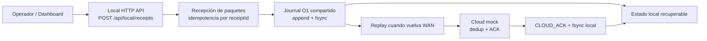
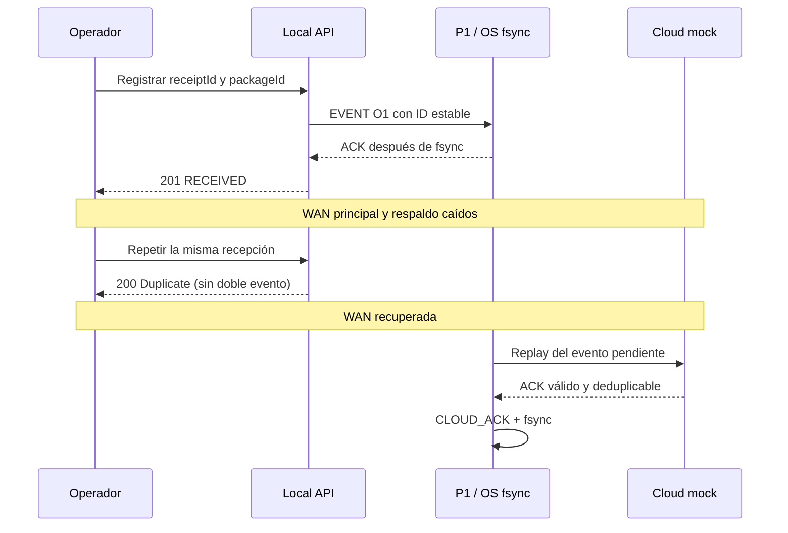

# W1.9.Q — Sitio virtual de logística: E2E local-first

**Estado:** implementado y probado exclusivamente en laboratorio. Cloud, WAN del panel y dispositivo son mocks; el journal temporal realiza `fsync` en el SO anfitrión. Las rutas Linux reales se prueban por separado en CI.

## Arquitectura del flujo



## Secuencia offline → recuperación



## Prueba reproducible en macOS

```bash
cd ~/logistica
git switch main && git pull
npm test
npm run dashboard
```

Abrir `http://127.0.0.1:8787` → **Laboratorio integrado**. Cortar WAN primaria y respaldo; registrar `R001` / `PKG001` desde el formulario **Recepción logística local**. Debe aparecer `RECEIVED` con fsync confirmado y Cloud pendiente. Repetir igual: duplicado sin nueva recepción; repetir ID con otro paquete: conflicto. Reiniciar sesión: el registro sigue disponible. Recuperar WAN primaria y sincronizar: aparece `cloudAcked=true`; compactar y reiniciar: O1 permanece.

La API exige token de sesión del panel, escucha sólo en `127.0.0.1` y no está publicada a la LAN real. `POST` devuelve 201 (nuevo), 200 (duplicado), 409 (conflicto), 400 (entrada inválida) o 507 (journal lleno); `GET` expone la vista retenida. Fuera del modo laboratorio devuelve 409.

**Límites:** un registro se considera aceptado únicamente si el journal devolvió ACK tras `fsync`; no hay durabilidad certificada ante corte de energía física, Cloud real ni entrega exactamente-una-vez fuera del mock. La aceptación local puede rechazarse explícitamente por cuota; nunca confirmar silenciosamente un evento no persistido.
