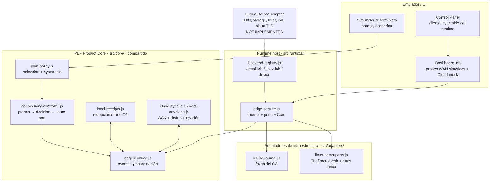

# 18 — Hardware Portability Bridge · W1.9.R

**Estado (2026-10-12): IMPLEMENTED / CI VERIFIED, alcance software y Linux sandbox exclusivamente.** La migración al dispositivo físico **no está realizada ni certificada**. [Tasks R](tasks/w1.9-hardware-portability.md), [CI #38284356529](https://github.com/krukmat/logistica/actions/runs/38284356529) y [evidencia](audit/w1.9-r-2026-10-12.md).

## Objetivo e invariante

PEF no debe convertirse en dos implementaciones: una del emulador y otra del producto. Las políticas WAN, aceptación offline, identidad de eventos y reglas de sincronización están ahora en `src/core/`; los efectos sobre red, almacenamiento, Cloud y proceso se resuelven mediante **adaptadores intercambiables** y la composición `src/runtime/edge-service.js`.



**No se comparte la implementación de la infraestructura**: Mac usa probes/rutas en memoria y un fichero temporal; el sandbox de CI usa `ip netns` reales y rutas únicamente dentro de namespaces; el dispositivo futuro tendrá drivers y servicios propios. En todos los casos la política de selección se ejecuta mediante **la misma función de Core**.

## Qué se ha refactorizado de verdad

| Antes | Ahora / dueño | Evidencia |
|---|---|---|
| `core.js` y `netns-policy.js` decidían WAN usando la instancia del simulador | `src/core/wan-policy.js` (pure function); `src/core/connectivity-controller.js` usa esa política sin importar simulador | 128 vectores deterministas comparan selección, conectividad y reloj entre sim/controlador |
| `edge-runtime.js`, recepción, envelope, replay estaban bajo `src/emulator/lab` | `src/core/{edge-runtime,local-receipts,event-envelope,cloud-sync}.js`; archivos antiguos ahora son adaptadores de compatibilidad | tests de Core sin filesystem + regresión anterior |
| Runtime abría él mismo P1 y dependía de `src/emulator` | `src/core/edge-runtime.js` recibe `journal`, `probe`, `applyRoute`; `src/runtime/edge-service.js` hace la composición de host | ports inyectados y rechazo a ACK sin durabilidad |
| P1 con `fsync` vivía en el árbol de emulación | `src/adapters/os-file-journal.js` es el adaptador OS; shim de importación para compatibilidad | pruebas de fsync, reapertura y compactación |
| Network adapter Linux mezclado con el escenario de CI | `src/adapters/linux-netns-ports.js` y `src/runtime/backend-registry.js`, backend `linux-lab` con **preflight estricto** | Linux veth/HTTP real CI; rutas sólo en namespace |
| Servidor Dashboard poseía siempre el ciclo de vida de PEF | `createDashboardServer({runtimeLab})` acepta runtime externo y **no lo cierra**; UI por defecto crea uno de prueba | test: parar y reiniciar UI conservando recepción/estado |
| Registro de integración sólo exigía features en UI | `W1.9.R` añadido al registry y tests de contrato, sin liberar hardware | integración CI + estado de backend visible |

## Backend/capability semantics

- `virtual-lab`: ejecuta el Core compartido con **ports sintéticos inyectados** y journal con fsync en directorio temporal. El dashboard permite visualizar `virtual-lab / shared PEF Core`.
- `linux-lab`: ruta de **runtime asíncrono real** mediante `openRuntimeBackend("linux-lab")`, sólo si Linux/root + GitHub-hosted ephemeral runner + autorización `PEF_NETNS_ACK` + namespace names validan. No manipula rutas del host físico.
- `device`: `BACKEND_NOT_IMPLEMENTED` de forma intencional. No hay drivers reales, ni código de producto desplegado.
- `src/emulator/backends.js` sigue seleccionando únicamente el **runner de escenarios síncronos** (`sim`). Pedir `linux-lab` allí permanece `SIM_BLOCKED` aunque el backend asíncrono **sí exista** en `src/runtime/backend-registry.js`. No se atribuyen propiedades de hardware al scenario runner.

## Durability boundary / fail closed

Una aceptación local de negocio, evento de transición WAN o cursor `CLOUD_ACK` sólo es durable si el journal declara `ack=true` **y** `fsyncCompleted=true`, o se trata de un duplicado previamente confirmado. Un port falso que devuelva `ack=true` sin `fsync` causa rechazo explícito; la red continúa y la salud puede degradarse. **No se confunde fsync del host con supervivencia física a corte eléctrico.**

## Cómo probarlo

```bash
cd ~/logistica
git switch main && git pull
npm test
npm run dashboard
# abrir http://127.0.0.1:8787 → Laboratorio integrado
```

Desde el panel: observar la casilla **Runtime / adaptador** (`virtual-lab · shared PEF Core`), provocar failover y caída completa WAN, registrar una recepción offline, reiniciar la sesión y sincronizar al restaurar WAN. El mismo Core ejecuta las mismas reglas mediante API HTTP → host → `src/core/`. **Linux real:** consultar CI (no ejecutar como root en Mac).

## Lo que sigue pendiente antes de hardware real

1. **Driver de dispositivo**: NIC/carrier/routing/NAT/firewall/DHCP y aislamiento/recursos Workload Runtime (no basta el lab `veth`).
2. **Provisioning y Trust**: claves protegidas, root de identidad, autorización y mTLS remoto, configuración firmada.
3. **Persistencia física**: pruebas de corte de alimentación, recuperación de P0/P1, desgaste/controladora, multi-writer/lock y storage schema.
4. **Empaquetado/botabilidad**: systemd/OpenWrt/init, servicio independiente de UI, boot seguro, logs, OTA/rollback. La inyección del ciclo de vida prueba desacoplamiento, **no constituye daemon instalado**.
5. **Portabilidad tecnológica**: este Core es **JavaScript/Node 20+** (algunas dependencias `node:crypto`); es candidato para hardware Linux capaz de ejecutarlo. **No migrará automáticamente a microcontroladores sin Node/JS**, ni garantiza portabilidad de binarios entre ISA.
6. **Core aún lógico**: admission/isolation del Workload Runtime en `src/emulator/core.js` sigue modelado; faltan componentes runtime reales equivalentes, aunque la política WAN y el flujo de negocio/journal/replay sí se comparten.

**Criterio de paso a W1.8:** implementar driver/device y ejecutar la misma batería de contratos de Core en equipo real con instrumentación. El verde de CI es suficiente sólo para cerrar **W1.9.R software bridge**, no para `DEVICE VALIDATED`.

## S — Product Core para workloads (refinamiento posterior)

`src/core/workload-manager.js` y `workload-supervisor.js` incorporan admisión y coordinación de procesos al Core portable. `src/adapters/node-process-driver.js` ejecuta en laboratorio un child allowlisted con IPC, **sin sandbox OS**. `src/adapters/linux-workload-isolation.js` deriva de la misma manifest cuotas cgroup verificadas en un **runner Linux efímero separado**; el harness ejecuta el mismo admission/local-receipts Core dentro de chroot+netns, sin WAN y con fsync. El adaptador físico o driver de producción que una el supervisor a esta protección queda abierto. [19 — Workload Runtime](19-workload-runtime.md), [CI #38293362918](https://github.com/krukmat/logistica/actions/runs/38293362918).
