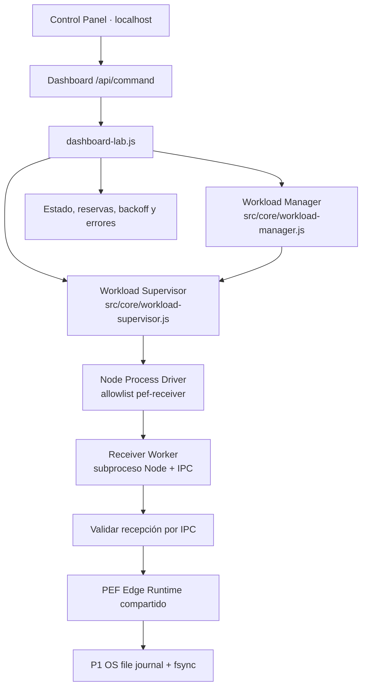
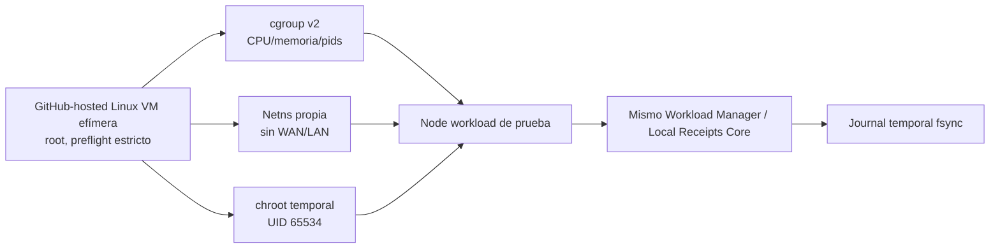

# 19 — W1.9.S Workload Runtime & Isolation

**Estado (2026-10-12): SOFTWARE/LAB CI VERIFIED**, [GitHub Actions #38293362918](https://github.com/krukmat/logistica/actions/runs/38293362918). Un proceso de prueba real ya se inicia y supervisa desde el emulador, y un laboratorio Linux separado valida cgroups/netns/chroot. **NO implica que el proceso ejecutado en macOS esté aislado por cgroups ni que exista un driver de dispositivo productivo.**

## S1/S2 — Product Core, manifiesto y proceso



- **Admisión**: se verifica el manifiesto v0.1 (`manifest_version`, ID, compatibilidad, conectividad, prioridad, límites/requests, storage class, intents, health/restart); requiere `trusted=true`, rechaza intents no autorizados y workloads `INTERNET_REQUIRED` estando offline. Los presupuestos de CPU/memoria/storage se **reservan lógicamente** para las cuotas del manager; no se presentan como enforcement kernel en el Mac.
- **Supervisor**: driver inyectable, arranque/parada, `ipc-ready`, health `ipc-heartbeat`, fallos y backoff exponencial **acotado** (hasta 30 s) con `max_attempts` del manifiesto; circuit breaker `ISOLATED` ante fallo repetido. El host del emulador ejecuta reconciliación automática cada 250 ms, sin requerir una pulsación del usuario.
- **Proceso permitido**: `src/adapters/node-process-driver.js` sólo ejecuta `pef-receiver` desde ruta fija, `shell:false`, `execArgv:[]`, entorno reducido y mensajes IPC. **Separación por proceso no equivale a sandbox**, ni limita por sí sola memoria RSS, CPU, red o filesystem.
- **Recepción offline**: el worker valida la petición por IPC y el host la persiste mediante `src/core/local-receipts.js` en P1; la operación no depende de Cloud. Si el proceso está detenido/aislado, la acción de workload devuelve `WORKLOAD_NOT_RUNNING` sin confirmar un nuevo evento. La API local de W1.9.Q continúa siendo un contrato separado de Core y no se suprime al detener este workload de prueba.

## S3 — Prueba de aislamiento kernel en Linux CI



El adaptador `src/adapters/linux-workload-isolation.js` deriva límites de **la misma definición de manifiesto**: `cpu.max=15000 100000` (150 mCPU), `memory.max=67108864` (64 MiB), `pids.max=16`; rechaza binarios no autorizados y planes fuera de presupuesto. `scripts/lab/workload-isolation-smoke.sh` exige runner GitHub-hosted/CI/Linux/root y opt-in explícito; crea cgroup y netns temporales, copia el mínimo runtime a un chroot, ejecuta con UID sin privilegios y limpia recursos.

**Evidencia en [CI #38293362918](https://github.com/krukmat/logistica/actions/runs/38293362918):** `PEF_S3_ISOLATION=LAB_PASS CLEANUP=CLEAN`; kernel `cpu.max`, `memory.max`, `pids.max` verificados; proceso UID 65534; canary host no accesible; red inaccesible; recepción offline confirmada tras fsync usando el **mismo código de dominio**. Memoria peak observada ~9 MiB en ese runner, no benchmark de producto.

**Brecha S3 todavía abierta:** esta prueba aislada es un harness Linux y **todavía no constituye el driver Linux de producción conectado al supervisor persistente**. No se ha implementado cuota física de almacenamiento P2/P3, seccomp completo, capabilities minimizadas del dispositivo, packaging ni pruebas en hardware. La app visual de macOS sigue ejecutando un child Node `NODE_PROCESS_ONLY`. No sumar dos evidencias distintas como si fueran una prueba E2E de un único sandbox de producción.

## S4/S5 — Pruebas desde el emulador

```bash
cd ~/logistica
git switch main && git pull
npm test
npm run dashboard
# http://127.0.0.1:8787
```

En **Laboratorio integrado**, sección **S — Workload Runtime**:

1. **Admitir e iniciar** → `pef-receiver` pasa a RUNNING, con reservas y manifest visibles.
2. Cortar las WAN primaria y secundaria; **Registrar recepción por IPC** usando los IDs del formulario Q → el proceso responde y P1 acepta sólo después de fsync.
3. **Simular crash** → BACKOFF; reconciliación automática → RUNNING con nuevo proceso cuando expire el backoff. Después de fallos repetidos dentro de ventana → ISOLATED, sin bucles infinitos.
4. **Comprobar health / recovery** muestra estado observables; **Detener y liberar cuota** termina proceso y devuelve presupuesto.
5. El panel indica claramente `actualLimitsEnforced=false` para su proceso Node. Un enlace **S3 Linux kernel lab CI-only** lleva a la evidencia separada, sin solicitar root en el Mac.

## S6 — Pruebas y criterios de cierre

[CI #38293362918](https://github.com/krukmat/logistica/actions/runs/38293362918) **COMPLETED/SUCCESS**: 84/84 tests Node PASS, 7 escenarios `SIM_PASS`, localhost TCP/HTTP `LAB_PASS`, Linux veth `LAB_PASS CLEAN`, S3 kernel isolation `LAB_PASS CLEAN`. Las pruebas incluyen política de admisión/rechazo, confianza, cuota, allowlist, health/IPC, proceso real, crash→backoff→auto restart, circuit breaker, recepción offline, registro/acciones del panel y plan Linux de límites derivado del manifiesto.

El registro `docs/contracts/emulator-integration-v1.json` y `test/dashboard-integration-gate.test.js` impiden cerrar silenciosamente una capacidad sin punto de entrada del emulador o evidencia CI-only.

**Decisión de alcance:** W1.9.S1–S2, S4–S6 **IMPLEMENTED / CI VERIFIED (lab)**. W1.9.S3 **LAB_ISOLATION_PROOF PASS**, con adaptador de aislamiento Linux de producción/persistente y cuota storage **PENDING**. No reclamar seguridad/hardware de producción ni continuidad de proceso de workload ante reboot físico.
