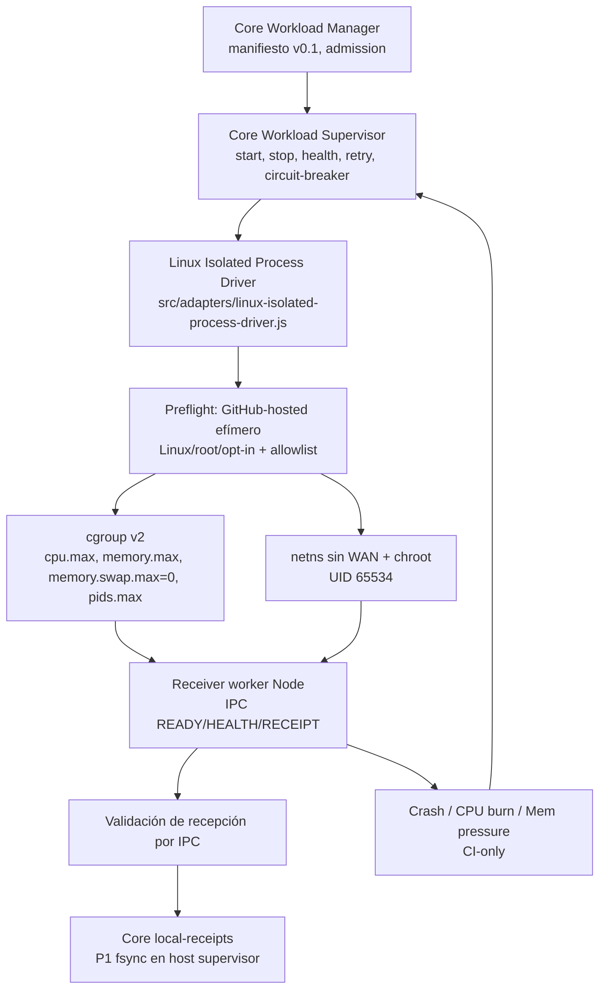

# 20 — S3.4–S3.8: Supervisor → Linux Isolated Process Driver

**Estado: IMPLEMENTED / LAB VERIFIED en GitHub-hosted Linux CI, NO productivo.** La misma API `createWorkloadSupervisor` del Product Core controla ahora **el propio proceso aislado Linux**, eliminando la brecha anterior entre el supervisor local y un harness de aislamiento independiente. [Prueba CI con kernel OOM](https://github.com/krukmat/logistica/actions/runs/38299928948).

## Contrato ejecutado

### S3.4 — Driver conectado, no duplicado

`createLinuxIsolatedProcessDriver` implementa exactamente el contrato `ProcessDriver` del supervisor usado por `createNodeProcessDriver` en el Mac. Sólo admite `pef-receiver`; la instalación de cgroup/netns/chroot está reservada a un runner GitHub-hosted temporal autorizado. **Nunca intenta alterar el Mac ni ejecutar comandos privilegiados en un servidor productivo.**

El driver deriva CPU/RAM/PIDs de `makeLinuxIsolationPlan(demoManifest())`, comprueba los valores realmente aplicados al kernel antes de iniciar, mueve el launcher detenido al cgroup, inicia Node en netns/chroot con UID sin privilegios y verifica por IPC el aislamiento de red y filesystem. El supervisor recibe `actualLimitsEnforced=true` **únicamente cuando el proceso Linux se ha validado**.

### S3.5 — Ciclo de vida unificado

`start → READY → HEALTH → RECEIPT → crash → BACKOFF → restart → STOP` se ejecuta con el mismo supervisor. El host conserva estado/journal después de terminar el worker; si un health check falla, el supervisor detiene primero el proceso anterior antes de programar el siguiente. El reinicio automático no depende de la interfaz gráfica. La liberación final termina el proceso y elimina los recursos aislados efímeros mediante el script CI, que registra `CLEANUP=CLEAN`.

### S3.6 — Inyección y pruebas negativas

- **Crash:** el worker sale; el Core se mantiene operativo, rechaza nuevas recepciones dirigidas al proceso inactivo y reinicia al expirar backoff.
- **CPU:** inyección acotada `CPU_BURN`, evidencia de `nr_throttled` y `cpu.max=15000 100000` (150 mCPU).
- **Memoria:** `memory.max=67108864` (64 MiB), `memory.swap.max=0`. Inyección `MEMORY_PRESSURE` termina el worker mediante OOM del cgroup y el supervisor reinicia; se observa `oom_kill=1` en el kernel.
- **PIDs, filesystem, red:** `pids.max=16`, chroot con UID 65534, canary host inaccesible y conexiones WAN denegadas. No se atribuye a ello defensa completa contra exploits ni seccomp.
- **Offline:** mensaje de recepción validado por IPC y aceptado por el Core tras `fsync` local aun sin WAN. El registro permanece disponible después del crash.

### S3.7 — Emulador y visibilidad

Abrir el panel con `npm run dashboard` → **Laboratorio integrado → Workload Runtime**. En macOS, los botones start/stop/crash/health/recepción controlan **sólo un proceso Node local NO aislado por el kernel**. En la misma sección hay un bloque **S3.4–S3.6 Linux CI-only** con enlace a [ejecución validada](https://github.com/krukmat/logistica/actions/runs/38299928948) y [evidencia CI reciente](https://github.com/krukmat/logistica/actions/workflows/pef-emulator.yml).

El estado muestra `localProcessIsolated=false` para el Mac y `linuxCiEvidence.state=LAB_PASS_CI_ONLY` por separado. **El panel no ofrece un botón para ejecutar cgroups/netns como root en el Mac.**

### S3.8 — Aceptación

[GitHub Actions #38299928948](https://github.com/krukmat/logistica/actions/runs/38299928948): 87/87 Node PASS, 7 escenarios SIM_PASS, loopback LAB_PASS, Linux WAN netns LAB_PASS y S3 Linux supervisor isolado LAB_PASS/CLEAN. Las pruebas de S3.7 añaden comprobación de los enlaces y de que la interfaz nunca atribuye enforcement kernel al Mac.

**Límites pendientes para hardware productivo:** proceso Linux sólo bajo guardas GitHub-hosted efímeras, sin instalación de daemon/servicio de arranque, políticas seccomp completas, network policy productiva, cuota durable P2/P3, aislamiento multi-tenant certificado, credenciales/PKI, OTA ni pruebas de corte eléctrico físico. Cerrar el **bridge de laboratorio** no cierra el **device driver/product deployment**.
