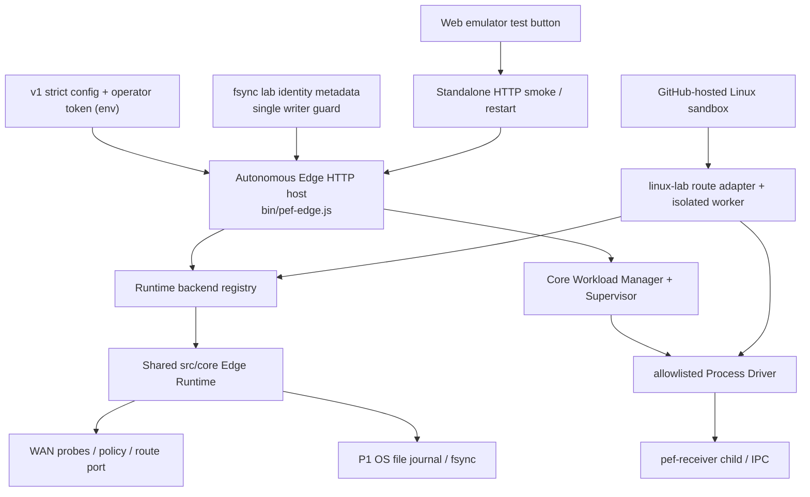

# 21 — Autonomous Edge Service & Pre-Hardware Gate (W1.9.T)

**Status: SOFTWARE/LAB IMPLEMENTED / CI VERIFIED (2026-10-12). Physical device and production GO: BLOCKED/NOT_RUN.** 
[Integrated Linux CI](https://github.com/krukmat/logistica/actions/runs/38314630311) · [Tasks T](tasks/w1.9-t-autonomous-edge.md) · [Handoff contract](contracts/hardware-handoff-v1.json).

## Goal

The emulator is no longer the only host of the PEF Core. A standalone, noninteractive service (`bin/pef-edge.js`) now owns a versioned configuration, a single lab writer, persistent identity metadata and the shared Edge Runtime. It runs without the browser, receives local business operations via HTTP and supervises an approved Node child automatically. The emulator **calls the very same service** for its visual boot/reopen smoke test.



## T1–T5 implementation map

| Area | Implementation and evidence |
|---|---|
| T1 — Service and API | `src/runtime/autonomous-edge.js`, `bin/pef-edge.js`; loopback-only HTTP `/health`, authenticated `/ready`, `/state`, `/receipts`, `/workloads/receipts` and test-only `/lab/wan`, `/lab/sample`; no dashboard dependency |
| T2 — Strict runtime config and boot | `src/runtime/edge-config.js`, shared `lab-boot-metadata.js`, `single-writer.js`; schema v1, explicit backend, scope/revision checks, 0600 identity metadata + fsync, new session epoch on restart |
| T3 — Linux composition | `virtual-lab` for safe local Mac; `linux-lab` for actual Linux netns routes in ephemeral GitHub CI; `device` remains unavailable. Linux backend refuses an unisolated workload fallback. CI also injects the cgroup/netns/chroot `ProcessDriver` into the **same daemon** to verify protected workload lifecycle |
| T4 — Recovery | Node/HTTP E2E, launch → receipt fsync → process SIGKILL → restart new epoch and journal reopen. Linux netns E2E demonstrates both WAN down → offline acceptance → recovery/reopen. CI cgroup trial demonstrates crash/CPU throttle/memory OOM and autonomous worker restart |
| T5 — Handoff gate | `src/runtime/handoff-gate.js` + `bin/pef-prehardware-gate.js`: third GitHub Actions job consumes other two job results **and their saved evidence**, checking Linux offline/reopen and daemon running the kernel-isolated receiver. Produces `pef-prehardware-gate.json` artifact or fails closed |

## Practical local smoke

Use Node 22+. This does **not** require root, Docker, physical NIC changes, or production Cloud services. Example local lab:

```bash
cd ~/logistica
git switch main && git pull
mkdir -p /tmp/pef-edge-demo
cat > /tmp/pef-edge-demo.json <<'JSON'
{
  "schemaVersion": 1,
  "backend": "virtual-lab",
  "identity": {"siteId": "local-site", "deviceId": "local-edge", "configRevision": "r1"},
  "storageDir": "/tmp/pef-edge-demo",
  "http": {"host": "127.0.0.1", "port": 8788},
  "sampleIntervalMs": 500,
  "workload": {"enabled": true, "reconcileMs": 250},
  "journal": {"capacityBytes": 65536, "controlReserveBytes": 4096},
  "wan": {
    "primary": {"link": true, "upstream": false},
    "backup": {"link": true, "upstream": false}
  }
}
JSON
node bin/pef-edge.js --config /tmp/pef-edge-demo.json --check
export PEF_EDGE_TOKEN="$(openssl rand -hex 32)"
npm run edge -- --config /tmp/pef-edge-demo.json
```

In a second terminal using the same operator token:

```bash
curl -s http://127.0.0.1:8788/health
curl -s -H "x-pef-token: $PEF_EDGE_TOKEN" http://127.0.0.1:8788/state
curl -s -X POST -H "x-pef-token: $PEF_EDGE_TOKEN" \
  -H 'content-type: application/json' \
  -d '{"receiptId":"R001","packageId":"PKG001"}' \
  http://127.0.0.1:8788/workloads/receipts
```

Stop using Ctrl+C. Restart with the **same storage directory and identity**: accepted receipt remains; session epoch rotates. An unexpected second writer is rejected. Changed site/device/config revision, malformed journal or unsafe identity metadata **fail closed**. The PID guard is lab-only advisory, **not** a production multiprocess locking primitive. Never place `PEF_EDGE_TOKEN` in the config or commit it.

To inspect through the emulator: `npm run dashboard` → **Laboratorio integrado → T: Edge Service autónomo → Probar arranque autónomo y reapertura**. The button actually starts another HTTP host, sends a receipt through IPC, stops it and reopens the journal. The Mac process remains unsandboxed, and no privileged Linux route operations are performed on macOS.

## Pre-hardware acceptance

The [CI pipeline](https://github.com/krukmat/logistica/actions/workflows/pef-emulator.yml) must complete three dependent jobs:

1. `emulator` — Node regression, dashboard HTTP integration, 7 deterministic scenarios and localhost loopback.
2. `netns-lab` — guarded Linux routes, real standalone Edge host with WAN outage and P1 reopen, and cgroup-isolated supervisor + autonomous host with IPC/fault/recovery.
3. `prehardware-gate` — reads actual status and downloaded JSON evidence, requires `STANDALONE_DAEMON_KERNEL_WORKER` and `STANDALONE_DAEMON_OFFLINE_FSYNC`, emits `SOFTWARE_LAB_READY` / `GO_FOR_DEVICE_INTEGRATION_ONLY`, or `NO_GO`.

[CI run #38314630311](https://github.com/krukmat/logistica/actions/runs/38314630311) showed all three jobs PASS before final mandatory daemon assertion was added; subsequent runs must also meet that stricter gate.

## What this does NOT close

- A **real physical device backend**: NIC carrier, routing/NAT, DHCP, firewall, radio/LoRa, measured throughput, load and latency.
- Actual provisioning, cryptographic identity, PKI/mTLS and a persistent Cloud implementation.
- Deployment/boot validation: `ops/systemd/pef-edge.service.example` is a **review-only template**, not installed or exercised on real hardware. OS watchdog/OTA/secure boot remain pending.
- Crash safety under controller power failure, filesystem durability under powercut, PID-lock replacement with true product-grade locking, P2/P3 capacity quotas and multi-tenant container/process security hardening.
- A secure, physical production-ready or economically validated product. The tests use JavaScript/Node on laboratory Linux/macOS, not an edge appliance.

**Decision:** close W1.9.T as **software pre-hardware stage**, then move to device integration and W1.8 physical acceptance. No device purchase, production release or hardware SLA can be authorized by this gate.
