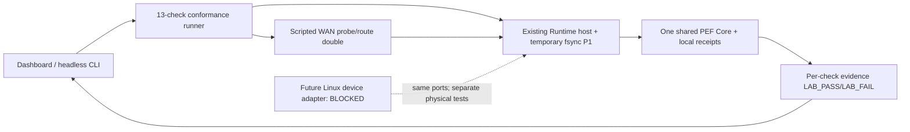

# 22 — Predevice port conformance (W1.10.A)

**IMPLEMENTED in software, CI verification pending.** No real device driver is present. [Tasks](tasks/w1.10-predevice-emulation.md) · [machine contract](contracts/predevice-ports-v1.json).

The same `src/core/edge-runtime.js` and actual OS-file journal are used in this software rehearsal, not a parallel set of business rules. Malformed probes and route refusals cause no Core state commit; idempotent offline receipt requires fsync; reopening P1 retains the receipt. No NIC/route on the operator's computer is modified.

**Important limitation:** the mocked route adapter rejects before mutation. An actual Linux driver can fail *after* changing some OS state. The current Core does not provide route rollback; W1.10.B must design verification, compensation, retry deadline and consistency checks before connecting device NICs. Physical power-cut persistence, PKI, workload isolation, boot/OTA, thermals, wattage and unit economics remain `NOT_RUN`.

Run `npm run ports:conformance` or from `npm run dashboard` → Laboratorio integrado → **Ejecutar matriz prehardware**. Evidence includes stable IDs, per-check observations, `physicalValidated:false` and `deviceBackend:BACKEND_NOT_IMPLEMENTED`.
