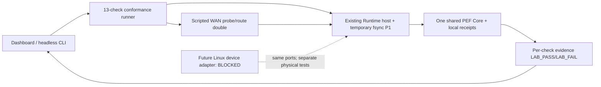
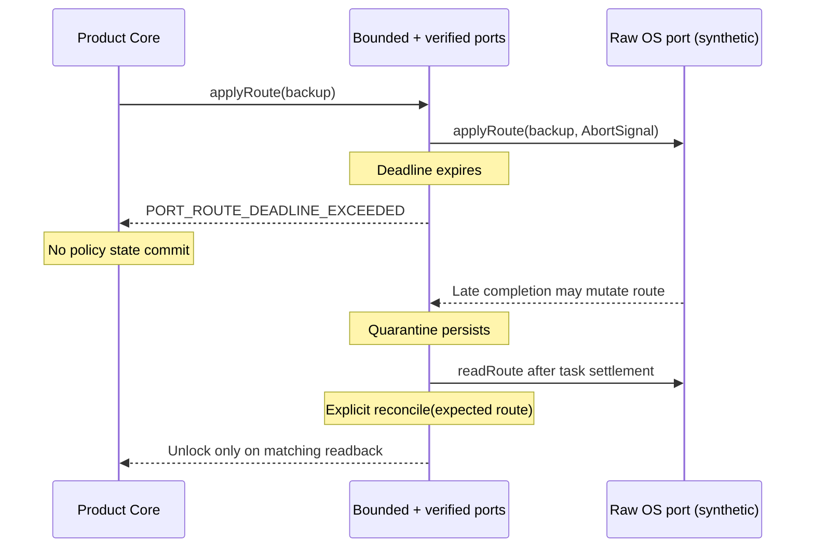

# 22 — Predevice port conformance (W1.10.A)

**CI VERIFIED in software/laboratory (2026-10-15).** [Run #38735602133](https://github.com/krukmat/logistica/actions/runs/38735602133): 99/99 Node PASS, 17/17 port conformance LAB_PASS, isolated Linux and prehardware gate SUCCESS. The physical device backend remains blocked. No real device driver is present. [Tasks](tasks/w1.10-predevice-emulation.md) · [machine contract](contracts/predevice-ports-v1.json).

The same `src/core/edge-runtime.js` and actual OS-file journal are used in this software rehearsal, not a parallel set of business rules. Malformed probes and route refusals cause no Core state commit; idempotent offline receipt requires fsync; reopening P1 retains the receipt. No NIC/route on the operator's computer is modified.

**Important limitation:** the mocked route adapter rejects before mutation. An actual Linux driver can fail *after* changing some OS state. The current Core does not provide route rollback; W1.10.B must design verification, compensation, retry deadline and consistency checks before connecting device NICs. Physical power-cut persistence, PKI, workload isolation, boot/OTA, thermals, wattage and unit economics remain `NOT_RUN`.

Run `npm run ports:conformance` or from `npm run dashboard` → Laboratorio integrado → **Ejecutar matriz prehardware**. Evidence includes stable IDs, per-check observations, `physicalValidated:false` and `deviceBackend:BACKEND_NOT_IMPLEMENTED`.

## B1: verified route transaction (2026-10-15)

The port boundary `createVerifiedRoutePorts(raw)` requires `readRoute()` in addition to `probe` and `applyRoute`. It reads current route before mutation, applies the candidate and checks readback. Failure triggers compensation to previous route and verifies it; failed compensation enters **quarantine**, where all further route changes are rejected until explicit `reconcile(expectedRoute)` confirms the external state.

This protects the **Core commit boundary**, but does not prove kernel route atomicity: the test uses synthetic ports, including a deliberately partially-mutated route. A Linux driver needs trustworthy readback and bounded commands. A process crash between partial mutation and rollback still needs boot reconciliation; deadlines, persistence, watchdog and real-device tests remain W1.10.B2/C.

## B2 — Bounded WAN adapter and boot gate · CI VERIFIED 2026-10-15

`createBoundedWanPorts(raw,{probeTimeoutMs,routeTimeoutMs,reconcileTimeoutMs})` is **new adapter composition**, reusing the existing verified route adapter and Product `ConnectivityController`. The raw driver receives an advisory `AbortSignal` for probes, route apply, and readback. The wrapper enforces a timer-based deadline for each operation. A rejected/late probe does not advance Core clock nor change routes. A timed-out route **always** quarantines further writes, even if the underlying asynchronous operation later reports success.

**Bootstrap is fail-closed:** on every newly created bounded adapter, routing remains blocked until `reconcile(expectedRoute)` compares external readback with a *trusted* expected route (the lab passes this explicitly). Do not derive that expectation from a public HTTP parameter in production. A boot validator must obtain the expected state from durable, trusted local metadata. Neither the synthetic fixture nor JavaScript `AbortSignal` terminates Linux subprocesses, nor prevents commands started before a process restart from modifying OS state afterward. Real driver must fence orphan commands, handle readback timeouts and prove durable boot recovery independently.

The predevice dashboard matrix now contains **23 checks**, including six timing/fencing simulations. Timeout values (15ms) are **test fixtures**, not deployment recommendations. No real hardware, Linux route operations on host, physical power-cut or device certification.

**Validated scope:** [CI run #38736879970](https://github.com/krukmat/logistica/actions/runs/38736879970), 101 Node tests + 23 simulated predevice assertions, Linux lab and prehardware handoff PASS. [Audit](audit/w1.10-b2-2026-10-15.md) describes the truth boundary.

## B3 — Storage failure rehearsal (software/lab, implementation pending CI)

`src/adapters/os-file-journal.js` now accepts a **trusted injected filesystem operations object** solely for deterministic tests. The production/default path remains the actual `node:fs`; operator HTTP cannot configure fault injection. `src/adapters/faultable-file-ops.js` creates ENOSPC/partial/zero-write and fsync-EIO failures on real ephemeral files; `src/runtime/storage-fault-conformance.js` runs all cases with the exact shared local-receipts Core. 11 new cases make **34 matrix checks**.

- **Fail closed:** short write, ENOSPC, fsync error mark journal `unsafe`; never respond with a newly accepted local receipt without confirmed fsync. Partial tails and altered checksums block boot without automatic truncation.
- **Ambiguous fsync:** complete bytes may be present despite EIO; on validated reopen the event can replay as an idempotent duplicate. Absence of initial ACK does **not** prove the write did not reach disk.
- **Space:** reject regular events at capacity minus reserved bytes, but permit critical Cloud ACK cursor in reserved space. No host disk is filled by tests.
- **Compaction:** simulated interruptions before and after atomic rename run against temp files. Reopen and check pending/acked data. A post-rename simulation cannot certify a real power-loss guarantee.
- **Metadata:** newly written records carry `recordSchemaVersion:1` while *legacy unversioned* records can still load. Successful compaction migrates retained records to the explicit schema; future versions are blocked. The on-disk `sha256` event checksum is **unchanged** to protect remote ACK/replay identity. Schema metadata itself is not cryptographically authenticated separately: this is a format compatibility guard, not a secure migration signature.

**Device blockers:** real ENOSPC on chosen filesystem, remount/readonly behavior, directory fsync + power-cycle, flash wear, durable migration/rollback on hardware, tamper evidence, correct disk error reporting, and actual boot recovery have not been measured. `physicalPowerCutValidated:false` remains mandatory.
