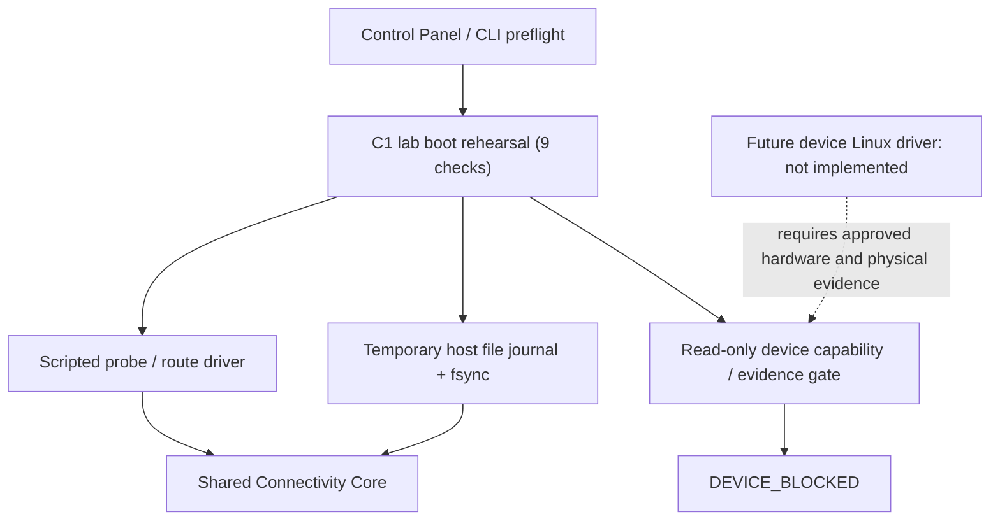

# 24 — W1.10.C1 Device integration preflight

**Status:** software-lab implementation (physical device still BLOCKED). Task [W1.10](tasks/w1.10-predevice-emulation.md) · [machine contract](contracts/device-integration-v1.json).

## Purpose

Prepare the portability seam **before** choosing hardware, without silently granting physical capabilities to the laptop or turning the simulator into a product. The same `ConnectivityController`, `LocalReceipts`, `createFileJournal` and `createBoundedWanPorts` are used in the rehearsal.



## C1.1 — Explicit driver and provisioning contracts

`docs/contracts/device-integration-v1.json` enumerates the expected API boundaries for WAN `probe/applyRoute/readRoute`, journal, workload supervisor, hardware identity/PKI and **trusted boot authority with orphan OS command fencing**. Nine requirement groups remain unverified on a real device: Linux runtime, NIC/kernel, fencing, authenticated route intent, power-cut storage, trust/PKI, OTA/watchdog, kernel workload isolation, physical performance/BOM. Do **not** choose a distro or specific Linux appliance yet.

`inspectDeviceDriverShape` checks only function signatures. It cannot certify the functions, their permissions or effect on the kernel. `assessDeviceReadiness` labels all supplied readiness claims as **unverified**, including `DEVICE_PASS`; resulting device verdict always stays `DEVICE_BLOCKED` and `productionAuthorized:false`. The physical runtime backend and standalone Edge config do not accept `device`.

## C1.2/C1.3 — Boot rehearsal vs device boot authority

`src/runtime/device-boot-intent.js` persists a **single unsigned lab-only** `O0` event in a journal after fsync. Reopen rejects absence, duplicate, unexpected schema, site/device/config revision mismatch. A newly constructed bounded route adapter starts **quarantined**. If the read route differs from the expected safe route, no route write is allowed. A simulated operator repairs the route, `reconcile(expected)` verifies it, and **the same shared Core** then samples WAN and locally acknowledges a real host-fsync receipt. On a new adapter after simulated restart, stale observed route again requires reconciliation.

This is an executable **failure contract**, not a production boot protocol. It has no signature, secret, trust anchor, monotonic counter, anti-rollback, multi-step durable transition intent, kernel lock, OS process kill/fencing or real restart. It must **never** be wired directly to a device backend. Any device driver must first prove trusted route state, exclusive writer ownership, no orphan kernel commands, and safe recovery after lost or ambiguous write/cancellation.

## C1.4 — Commands and evidence

```bash
cd ~/logistica
git switch main && git pull
npm test
npm run device:preflight
npm run device:preflight -- --output /tmp/pef-device-preflight.json
npm run dashboard
# Laboratorio integrado → Ejecutar preflight sin hardware
```

`PEF_DEVICE_INTEGRATION_REHEARSAL_V1` contains nine per-check pass/fail results, a read-only requirement matrix, and explicit flags `physicalValidated:false`, `onDeviceExecuted:false`, `provisioningPerformed:false`, `hostRoutesChanged:false`. Its positive `LAB_PASS` **never** means `DEVICE_PASS`. Linux CI saves `pef-device-preflight` as a separate artifact; existing `prehardware-gate` remains `GO_FOR_DEVICE_INTEGRATION_ONLY`, not production go.

## Next dependency / risk

W1.10.C2 requires a selected Linux platform, deliberate implementation/verification of physical route/boot/PKI drivers and measured CPU/RAM/throughput/power/thermal/recovery with real hardware. W1.10.C3 may only consider promoting the device backend with independently checked physical evidence. No hardware acquisition, systemd installation, external service, secret/key issuance, OS route change or root command is authorized by C1.


## Software/lab acceptance evidence — 2026-10-15

[GitHub Actions #38780758276](https://github.com/krukmat/logistica/actions/runs/38780758276) returned **SUCCESS** in all three jobs: 110 Node regression tests, 9/9 C1 safe preflight assertions, 34/34 prior prehardware assertions, 4/4 golden traces, plus isolated Linux networking/workload and prehardware handoff. [C1 JSON artifact](https://github.com/krukmat/logistica/actions/runs/38780758276/artifacts/11996280973) · [audit](audit/w1.10-c1-2026-10-15.md).

**Verdict:** C1 software contract and safe boot rehearsal **CLOSED**. Hardware provisioning and actual Linux device drivers **NOT IMPLEMENTED / NOT RUN**. Positive laboratory evidence is explicitly ineligible to promote the `device` backend.
