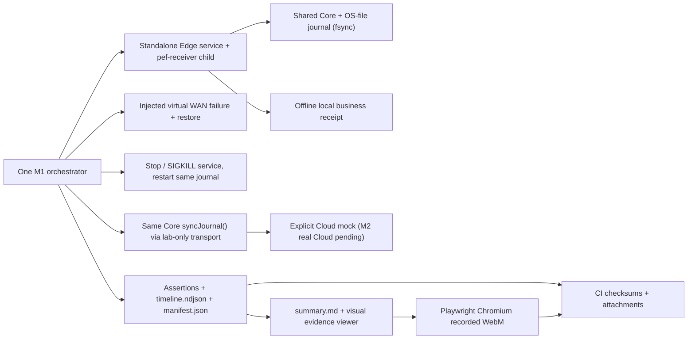

# 30 — M1 evidence-by-design: reproducible end-to-end, documents and video

**Status:** execution plan approved for M1 product priority; **this document specifies the proof system, not evidence that M1 has already passed.** Date 2026-10-18. Development on `main`. Reuse existing standalone Edge, shared Core journal, local receiver and Cloud replay engine.

## Core principle

**One real scenario run = one authoritative set of events = machine-readable assertions + human-readable report + recorded video.** No separate "marketing simulator", no re-keying events in the UI, no screenshots manually stitched into a success story. The browser visualization must consume facts emitted by the M1 runner, not invent connectivity or replay status.

## Flow, scope and current gap



The code already contains `src/runtime/autonomous-edge.js` (headless daemon/workload, receipt and reboot tests), `src/core/edge-runtime.js` (`sync()`), `src/core/cloud-sync.js` (durable cursor after validated remote ACK) and `src/emulator/lab/cloud-replay.js` (ephemeral, unauthenticated Cloud mock). **Gap:** the autonomous service exposes no integrated Cloud sync endpoint/transport; tests of Edge host and Cloud replay exist separately. M1 must compose the existing ports with a scoped test-only transport; *do not silently claim a real persistent Cloud service*. Prefer an injected trusted in-process transport, strict lab-only authorization, no WAN/host route changes.

## M1 tasks (1–2 subtask levels)

**M1.1 — Canonical autonomous scenario**
- **M1.1.a** Launch real local Edge daemon and child with temporary private storage and randomly generated operator credentials, no browser required. Use same shared Core files and journal; run on macOS/CI, and optionally constrained Lima ARM64. No privileged host routing or device backend.
- **M1.1.b** Execute one linear script: all virtual WAN down / `LOCAL_ONLY`; locally receive a package (HTTP 201 **after** `fsyncCompleted:true`); resend identical receipt (200 duplicate), conflict on different payload (409); SIGKILL/crash/restart same journal (receipt survives, new session ID); restore simulated WAN; inject ambiguous remote ACK, verify cursor stays pending; retry via shared `syncJournal` + explicit Cloud mock, verify dedup and `cloudAcked:true` / pending 0. Refuse to mark M1 PASS if restart, cloud replay integration or a hard invariant is missing. Only show states actually emitted.

**M1.2 — Documentary evidence produced by the test**
- **M1.2.a** Write atomic evidence bundle with a unique `runId`, commit SHA, Node/OS/arch, profile, UTC timestamps, test stage IDs, network origin, input counts, eventIds and journal digest snapshots, operator-safe redacted config, precise errors and provenance; `trace.ndjson` for step-by-step machine facts and `report.json` containing assertion results, measured latencies, final state and `physicalValidated:false` / `cloudReal:false` / `powerCutValidated:false`. No passwords, session tokens or private addresses in reports.
- **M1.2.b** Generate `summary.md` **from the report**, a stage-to-requirement matrix and `SHA256SUMS` for artifact integrity. Validate JSON schema and all required stages. `PASS` only if all mandatory conditions pass; failure still outputs useful partial evidence and exits nonzero. Hashes prove file integrity relative to this bundle, not independent third-party attestation.

**M1.3 — Video evidence from the same run**
- **M1.3.a** Serve a tiny read-only `M1 Evidence` timeline viewer sourced directly from this run's `trace.ndjson` / `report.json`. Show `OFFLINE → RECEIVED + FSYNC → CRASH/RESTART → CLOUD MOCK ACK LOST → RETRY → SYNCED` and visible identifiers/counters; conspicuous **`VIRTUAL WAN / CLOUD MOCK / NO PHYSICAL CERTIFICATION`** watermark. Viewer cannot mutate Edge or create synthetic PASS states.
- **M1.3.b** Pin Playwright/Chromium as **development-only** tooling to capture the same evidence viewer at consistent viewport into **WebM**, with optional FFmpeg MP4 transcoding if installed. A short 60–90s explanatory cut can be generated from the actual timeline; raw complete trace stays in the evidence bundle. Video is a replay visualization of instrumented data, **not live physical-device footage or evidence of disk-powerloss durability**. Test video existence, minimum nonempty frames, report ID matching and no misleading labels; don't assert UI pixels prove fsync.

**M1.4 — CI, usability and efficient reruns**
- **M1.4.a** One operator command: `npm run m1:evidence` builds report/trace/docs locally; `npm run m1:evidence:video` adds video; `npm run m1:evidence:verify` rechecks assertions, report schema and hashes independently of browser. All output under `artifacts/m1/<runId>/` and excluded from commits. Reuse Node built-in test harness and dashboard/Core domain code, no production browser/FFmpeg dependency.
- **M1.4.b** CI always runs fast headless M1 assertions on push; produces downloadable JSON/Markdown/trace and evidence SHA256. Record the browser video only in a separate gated job / workflow_dispatch or tagged milestone, never on every unit test run. Publish a uniquely named GitHub Actions artifact tied to the tested commit SHA and workflow run. CI fail-closed if trace/report missing, even if the HTML viewer looks good.

## Minimum immutable acceptance assertions

| Stage | Required backend assertion | Video label |
| --- | --- | --- |
| 01 | Daemon actually running; child healthy; LAN local API available | Headless Core ready |
| 02 | Both synthetic WAN unreachable; connectivity `LOCAL_ONLY` | WAN virtual offline |
| 03 | Receipt HTTP 201 AND durable journal result `fsyncCompleted:true` | Local receipt persisted (host OS fsync) |
| 04 | Identical payload 200 duplicate; conflicting payload 409, no extra receipt | Idempotency enforced |
| 05 | Force-kill/restart daemon; receipt persists; new session, unchanged ID | Durable after process restart |
| 06 | Ambiguous Cloud MOCK ACK: local pending remains; remote replica may store one event | Remote ACK lost; no false cursor |
| 07 | Restore virtual WAN; replay via same shared Core, validated ACK/dedup, local cursor fsync, pending 0 | Reconnected and synced (MOCK) |
| 08 | All independent checks PASS, report+trace+video share same runId and commit | End-to-end software lab PASS |

**Important:** If a given test outcome only exists in a separate Cloud mock test rather than the actual autonomous scenario, keep that row `NOT_IMPLEMENTED` and the full M1 status `PARTIAL` until the integration is real. Do not splice footage between sessions.

## Artifact layout

```text
artifacts/m1/<runId>/
  report.json          # machine-readable gates, full provenance and limitations
  trace.ndjson         # facts emitted by same scenario run
  summary.md           # generated from report; evidence and scenario narrative
  manifest.json        # filenames, sizes, SHA256, sources, software context
  SHA256SUMS           # reproducible integrity check
  m1-demo.webm         # if video capture enabled, exact same runId
  optional/m1-demo.mp4 # only if FFmpeg present, identified as transcoded
```

Do not produce a fabricated demo MP4 or claim CI success before the real runner and capture are implemented and executed. Keep raw evidence useful without requiring video playback.

## Execution gates and deferred requirements

- `GATE_M1_CODE`: standalone service and shared Core/child operate under fault injection, local `fsync` and retry; no separate mock business implementation.
- `GATE_M1_EVIDENCE`: deterministic assertions, independent artifact validator and all negative test paths; schema and manifest hashes match.
- `GATE_M1_VISUAL`: actual browser video is sourced from the same run and all transitions shown match report IDs; accessibility/safe labels; bounded CI cost.
- `GATE_M1_SCOPE`: neither Cloud Lite real backend nor certified physical WAN, flash powerloss, secure OTA, 72h, PKI/mTLS or purchased hardware is claimed. Those remain M2/M3/device tasks.

**Desired outcome:** concise technical proof suitable for review, plus one demonstrative clip whose assertions can be checked against the downloadable artifacts.

## Implementation state — 2026-10-18

M1.1/1.2 integrated in `src/runtime/autonomous-edge.js` with loopback/token-gated virtual-only `/lab/sync` and faults; full real autonomous process E2E runner in `src/runtime/m1-scenario.js`. M1.3 report/trace/manifest/SHA256 and verifier implemented; M1.4 main CI uploads technical bundle; M1.5 static HTML timeline and opt-in Playwright video recorder implemented, dashboard imports same run JSON+NDJSON. **Software-lab and video milestone evidence have different gates**: only declare audiovisual PASS after actual Playwright WebM workflow success. [Tasks & commands](tasks/m1-end-to-end-evidence.md).
