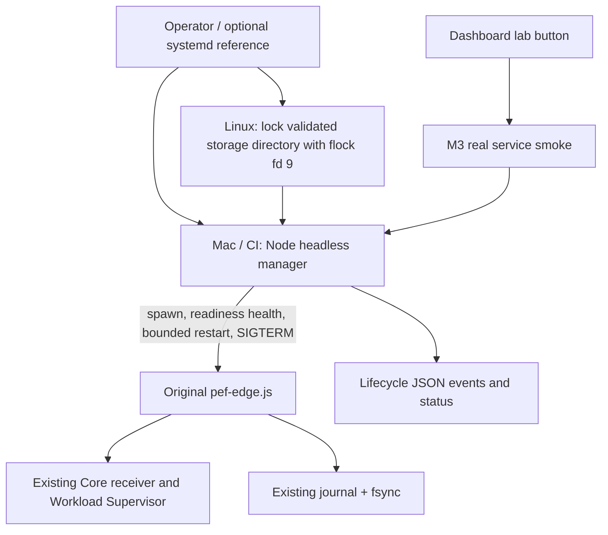

# Auditoría M3.1–M3.2 — Headless boot, supervised process and Linux locking

**Fecha:** 2026-10-18. **Scope:** SOFTWARE_LAB_ONLY. **Code tested:** `c4c49e86e63da7c5b7751a8cabb82bbfdee846b2`. **GitHub Actions:** [#39149664097](https://github.com/krukmat/logistica/actions/runs/39149664097) **SUCCESS**; no external hosting/cost, credentials provisioned or hardware deployment.

## Evidence validated

| Evidence | Result | Limits |
| --- | --- | --- |
| ARM64 native full regression | **152 tests / 152 pass / 0 fail** | ARM64 runner not constrained to 1GiB |
| Linux x64 emulator full regression | **152 tests / 151 pass / 1 platform skip / 0 fail** | Browser M1 video job intentionally skipped |
| Linux namespaces, prehardware gate | **SUCCESS** | Software-lab routing and handoff, no target device |
| CI M3 smoke | **LAB_PASS**; artifact `m3-autonomous-lifecycle-39149664097` attached to run | Executes real Node daemon and receiver, virtual WAN, no Cloud |
| Linux kernel exclusivity E2E | **PASS** in `test/m3-process-manager.test.js`: first wrapper owns `flock`, competitor rejected with code 75, lock released on stop, new instance starts | Exclusivity only among invocations using the same wrapper/validated dir |
| Restart budget | **PASS**: with maxRestarts=1, a second SIGKILL leaves `HALTED`; prevents infinite resurrection | Operator escalation in M3.4 |
| Dashboard HTTP E2E | **PASS**: `mode=lab`, `m3Lifecycle` starts separate managed daemon, injects SIGKILL, checks retained receipt/reopen, shows JSON in `m3-lifecycle-evidence` | Not a second logic simulator, no kernel lock on Mac |

## Delivered architecture

M3 implements a **headless lifecycle supervisor**, not replacement of the Core Supervisor's policies. Existing `/ready` now reflects journal/runtime health and receiver status, rather than only storage. Failure budgets are explicit: `maxRestarts` finite (default 2), backoff, readiness misses before restart and bounded SIGTERM → SIGKILL timeout. Lifecycle logs deliberately omit token. Kernel lock uses util-linux `flock -n` over read-only FD of existing storage directory, held by the *supervisor* across child restarts in the supported Linux wrapper. Mac path uses advisory PID lock only.

## Limitations and outstanding gates

1. Does **not** install or enable systemd/launchd or prove reboot/power-loss boot. `ops/systemd/pef-m3-headless.service.example` is a review-only reference, not production packaging.
2. Kernel lock only excludes cooperating Linux wrapper invocations; a bypassing/unprivileged direct process or root process is not a proof of full device fencing. Current PID lock is lab advisory, not kernel-exclusive on Mac.
3. Synthetic WAN remains synthetic, Cloud Lite remote paid infrastructure remains deferred, no PKI/mTLS device trust or physical R28S powercut.
4. M3.3 configuration transactions, M3.4 full safe-mode and M3.5/M3.6 operating/pilot recovery still remain **NOT_STARTED**; do not claim full M3 completion.
5. Budget cap, negative tests and `LAB_PASS` do not qualify continuous 72h uptime, real NIC or SD endurance.

**Decision:** `M3.1` and `M3.2` **CLOSED / SOFTWARE LAB CI VERIFIED**. Next: `M3.3` transactional configuration and `M3.4` safe-mode recovery, reusing exactly this manager and journal; no cloud spend.
