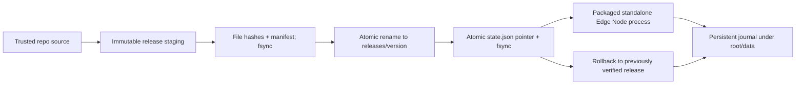

# M5.1–M5.2 — Instalación reproducible y validación Linux sin dispositivo

**Date:** 2026-10-19 · **Branch:** main · **State:** IMPLEMENTED — CI acceptance pending.

## Scope / design

Implement a lab-only release manager operating under an explicitly named subdirectory of `os.tmpdir()`. NO production installer, root, systemd installation, cloud credentials, network changes or physical device work. M5.3 device installation / physical kernel, powercut, WAN, energy and actual OS reboot remain **BLOCKED** pending hardware. The core policy is pure (`src/core/install-policy.js`); all OS filesystem interactions are in `src/runtime/m5-install.js`.



## Tasks and dependencies

| Task | Deliverable / DoD | Depends on | Status |
| --- | --- | --- | --- |
| M5.1.a | Curated allowlist of bin/pef-edge.js, package.json and JS in Core/adapters/runtime/emulator/workloads, versioned hash manifest and fail-closed verification | M4.4 | IMPLEMENTED |
| M5.1.b | `install`, `verify`, `upgrade`, `rollback`, atomic active version, intact persistent journal, no arbitrary target path | M5.1.a | IMPLEMENTED |
| M5.1.c | Idempotency and immutability, interrupted activation, extra/corrupt release denial, unauthorized rollback and nested temporary-path restriction | M5.1.b | IMPLEMENTED |
| M5.2.a | Start actual packaged standalone Edge daemon/allowlisted worker; readiness and durable business ACK while simulated WAN is offline | M5.1 | IMPLEMENTED |
| M5.2.b | Graceful process stop, relaunch from v2/v1 after upgrade/rollback; recover same journal with new session and preserved incident | M5.2.a | IMPLEMENTED |
| M5.2.c | Dashboard HTTP E2E, CI Linux x64/native ARM64, artifacts and explicit service/boot/physical NOT VALIDATED evidence | M5.2.b | IMPLEMENTED — CI pending |

## Runbook (Mac or Linux)

```bash
git switch main && git pull
npm test
npm run m5:lab
npm run dashboard
# Laboratorio integrado -> M5 -> Instalar/reiniciar/actualizar/rollback
```

`npm run m5:lab` uses a unique temporary installation root and cleans it up. It is **safe on Mac**: no sudo, no system service, no edits to the host WAN. To inspect the CLI manually inside a temporary directory, set `root="$(mktemp -d)"` and run:

```bash
npm run m5:install -- install --root "$root" --version v1
npm run m5:install -- verify --root "$root"
npm run m5:install -- upgrade --root "$root" --version v2
npm run m5:install -- rollback --root "$root" --version v1
npm run m5:install -- verify --root "$root"
# rm -rf "$root"  # only after verifying the explicitly created temporary root
```

`npm run m5:linux` is explicitly Linux-only (refuses macOS), and runs in nonprivileged x64/native ARM64 GitHub-hosted Linux runners. It is the **same workflow** as Mac `m5:lab`, not a privileged kernel or device simulation.

## Data and recovery guarantees (scoped)

- Each candidate is SHA-256-validated before activation. `state.json` is atomically replaced after fsync and directory fsync, with previous version retained for rollback. The `data/` journal is distinct and never deleted by upgrade/rollback.
- A crash injected before state activation leaves the previously selected candidate active; a corrupt release causes verify/upgrade to fail closed. A failed fsync is not a physical powercut test.
- Release labels are strictly validated and fixed to the in-repository source (no remote fetch or package manager downloads).
- The release manager **does not** install systemd/launchd, survive machine reboot via OS service configuration, create root-owned directories, enforce real kernel quotas, implement PKI/OTA, or provision any physical interfaces. Version/hash metadata is not a signed update channel.
- Linux process launch is real; restart simulation is a controlled process stop/start, **not an OS boot**. CI Linux S3 isolation continues to validate only the existing receiver, not the Property/Host overlays or the installed service.
- Tests are bounded and the installer only writes to explicit temp directories. CI artifacts report exact platform and checks.

## Traceability

Requirement IDs: REQ-LOC-01, REQ-WRK-01/02, REQ-STA-01/02, REQ-OBS-01; Change: **added**; Classification: CORE policy / MODULE runtime installer / CONFIG release profile / RESOURCE staged manifest; Status: IMPLEMENTED, CI pending. Evidence: `test/m5-install.test.js`, `test/dashboard-integrated.test.js`, `docs/contracts/m5-install-v1.json`, `.github/workflows/pef-emulator.yml`, [audit](../audit/m5-reproducible-install-2026-10-19.md). M5.3 cannot close without hardware and must not be listed as LAB_PASS.
