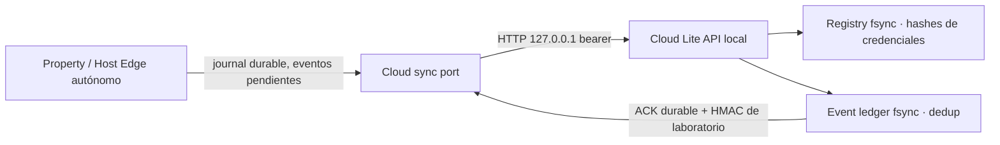

# M6 — Cloud Lite local: identidad, persistencia y sincronización real

**2026-10-19 · main · M6.1–M6.4 IMPLEMENTED, CI LAB_PASS (M6.4 final CI gate pending verification at document creation).**

## Objetivo

Completar un transporte HTTP local real, sin infraestructura contratada y sin exigir disponibilidad del Cloud para arrancar o mantener operaciones Property/Host. Cada Edge conserva operaciones bajo `LOCAL_ONLY`; Cloud Lite confirma remotamente únicamente una ingesta duradera.



## Tasks, dependencias y DoD

| Task | Dependencia | Entregable y aceptación | Estado |
| --- | --- | --- | --- |
| **M6.1.a** | Core identity | Enrolamiento y revisión de identidad por dispositivo | CLOSED SOFTWARE LAB |
| **M6.1.b** | M6.1.a | HTTP localhost independiente, token aleatorio por dispositivo, almacenamiento hash + fsync | CLOSED SOFTWARE LAB |
| **M6.1.c** | M6.1.b | E2E credenciales falsas, scope ajeno, reinicio Cloud y dashboard x64/ARM64 | CLOSED SOFTWARE LAB |
| **M6.2.a** | M6.1 | Validación de sobres Event/Receipt/Property/Host y store fsynced append-only bounded | CLOSED SOFTWARE LAB |
| **M6.2.b** | M6.2.a | ACK después de fsync, dedup, conflicto, cierre/reapertura y corrupción fail-closed | CLOSED SOFTWARE LAB |
| **M6.3.a** | M6.2 | Adapter HTTP real localhost, ACK HMAC ligado al token y cursor Core | CLOSED SOFTWARE LAB |
| **M6.3.b** | M6.3.a | Dos Edge autónomos en serie, WAN sintética offline, ACK perdido, reenvío y restart | CLOSED SOFTWARE LAB |
| **M6.3.c** | M6.3.b | Dashboard `m63Sync` + CI HTTP test | CLOSED SOFTWARE LAB, [CI #39271176439](https://github.com/krukmat/logistica/actions/runs/39271176439) |
| **M6.4.a** | M6.3 | Matriz con caída Cloud, token inválido, ACK falsificado, dedup y Edge reopen | IMPLEMENTED, CI [#39271578783](https://github.com/krukmat/logistica/actions/runs/39271578783) PASS |
| **M6.4.b** | M6.4.a | Dashboard `m64Matrix`, consola `m6:matrix`, CI x64/ARM64 artifacts | IMPLEMENTED; final CI acceptance being checked |

## Operación del laboratorio

```bash
git pull
npm run m6:registry  # M6.1: registro/auth, persistencia y restart
npm run m6:ingest    # M6.2: ledger fsync y ACK remoto
npm run m6:sync      # M6.3: Edge → Cloud Lite real, Property+Host
npm run m6:matrix    # M6.4: fallos reales en Cloud Lite loopback
npm run dashboard    # Laboratorio integrado → M6.1, M6.2, M6.3 y M6.4
```

Cada smoke usa directorios privados de `os.tmpdir()`, crea un servidor HTTP `127.0.0.1` real y borra sus ficheros al finalizar. Los comandos CLI no requieren root, hosting ni cambios de red. `node bin/pef-cloud-lite.js --root <TEMP_PRIVATE_DIR> --enable-ingest` activa ingesta sólo de forma explícita con `PEF_CLOUD_LITE_ADMIN_TOKEN`.

## Criterios y límites de aceptación

- **Evidencia real:** `m61Registry`, `m62Ingest`, `m63Sync`, `m64Matrix` recorren código verdadero de Core, journal, adapter, HTTP y persistencia. M6.3 y M6.4 sustituyen el Cloud mock *en esos escenarios*; el resto de demos tradicionales conserva su mock deliberadamente.
- **Fiabilidad:** no avanzar cursor local con WAN desconectada, Cloud caído, credencial falsa, prueba HMAC falsa o ACK perdido. Cloud guarda una sola vez el evento y puede contestar `duplicate=true` al repetir. La prueba se limita a fsync en OS y reinicio de proceso, no powercut.
- **Trust:** tokens bearer de alta entropía e HMAC vinculante, **NO TLS/mTLS, PKI, remote attestation, revocación/rotación completa, producción o WAN pública**.
- **Recursos:** registry limitado a 128 identidades; archivo de eventos con límite 4MiB/4096 registros, HTTP body acotado. El journal 72h sigue sin certificar.
- **Coste adicional de infraestructura:** 0 EUR al ejecutarse localmente; cuotas de GitHub Actions siguen sujetas al plan. M5.3 físico sigue BLOCKED. No se requiere VM para M6.

[Auditoría M6.1](../audit/m6-1-local-registry-2026-10-19.md) · [Auditoría M6.2–M6.4](../audit/m6-2-4-cloud-lite-local-2026-10-19.md) · [Contrato](../contracts/m6-cloud-lite-local-v1.json).
