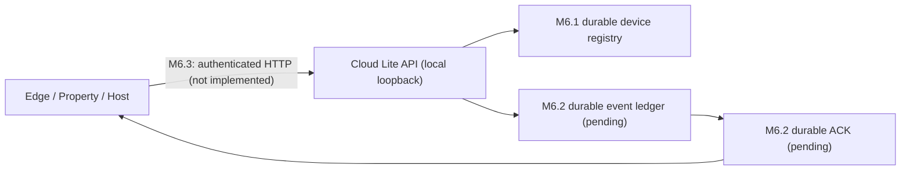

# M6 — Cloud Lite local: registry, durabilidad y reconciliación

**Inicio 2026-10-19 · main**. Sin proveedor externo, sin hosting de pago. Ejecutar y comprobar en Mac y Linux CI.

## Architecture



The former `createLabCloudReplica` remains a mock in W1.9.O and M1–M5 tests. **Do not replace** it before the real M6.3 transport and durable event-ingest are tested.

| Task | Inputs / dependency | Outputs and DoD | Status |
| --- | --- | --- | --- |
| M6.1.a | Existing shared `validateIdentity` from Core; M5.6 LAB CLOSED | Portable enrolment policy, unique device key + revision | IMPLEMENTED |
| M6.1.b | M6.1.a | Standalone HTTP registry, random token generated per device; credentials stored only as SHA-256 digests; fsync/atomic rename, single writer and lab-only local path | IMPLEMENTED |
| M6.1.c | M6.1.b | Real HTTP E2E, invalid credential/scope, restart, corruption test, dashboard action, CI native x64/ARM64 | IMPLEMENTED; CI acceptance pending |
| M6.2 | M6.1 | FSYNC-backed persistent ingestion, dedup and ACK ONLY after durable commit; reject bad envelopes, identity and replay conflicts | PENDING |
| M6.3 | M6.2 | Externalized Edge transport → authentic Cloud Lite endpoint, bounded retry and store/forward, no Core dependency on cloud | PENDING |
| M6.4 | M6.3 | Combined offline/reconnect failure matrix, UI, CI, evidence and resource budgets | PENDING |

### M6.1 operator commands

```bash
git switch main && git pull
npm run m6:registry        # disposable real HTTP smoke, cleans its private temp directory
npm run dashboard          # Lab integrated → M6.1 → Test registry
```

A standalone HTTP process can also be launched **only for local lab use** in an *existing private directory under the system temporary root*. It requires an explicit high-entropy admin token:

```bash
root="$(mktemp -d -t pef-cloud-lite-XXXXXX)"
export PEF_CLOUD_LITE_ADMIN_TOKEN="$(node -e 'process.stdout.write(require("node:crypto").randomBytes(32).toString("hex"))')"
node bin/pef-cloud-lite.js --root "$root"
# The server logs a loopback URL. Admin credentials are not printed.
# Ctrl-C stops the server. Keep the same private root to test process restarts.
```

The server has no outbound networking, TLS/mTLS, revocation/rotation or production device provisioning. The Admin bearer secret is exclusively local and per-device credentials are returned **once** after fsync; a lost response requires a future explicit re-provisioning/rotation API and is never retried unsafely.

## Trust boundary

`POST /v1/admin/enroll` demands `x-pef-admin-token` and an exact `{siteId,deviceId,configRevision}`. A successful enrolment creates a random 256-bit device token returned once; only its SHA-256 hash is kept. Duplicate keys are denied rather than silently rotated. `POST /v1/device/authenticate` requires `x-pef-device-token` matching both identity and revision, with unified 403 on mismatch; no token is returned or echoed. Admin-only status returns the registered count, never hashes.

Both server and storage are localhost/private-temp-lab only; filesystem writes are file+directory fsync/rename. This **does not** certify physical power-loss durability, signed identity, remote authentication transport or production security. The registry accepts 128 devices in this bounded lab; M6.2 will not expand quotas implicitly.

Requirements: REQ-CLO-01, REQ-SEC-01/02, REQ-STA-01, REQ-LOC-01, REQ-OBS-01. Change added, categories `CORE` policy/`MODULE` HTTP server/`CONFIG` local storage/`RESOURCE` bound 128. Risk: ephemeral filesystem, lost one-time credential, no remote TLS. Refer to [audit](../audit/m6-1-local-registry-2026-10-19.md) and [contract](../contracts/m6-cloud-lite-local-v1.json).
