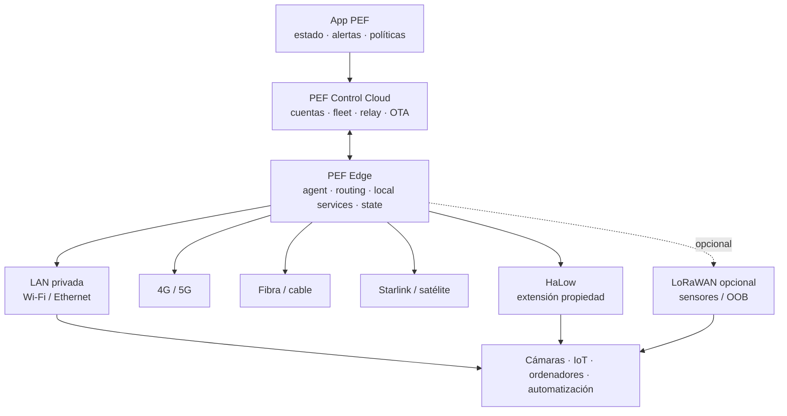
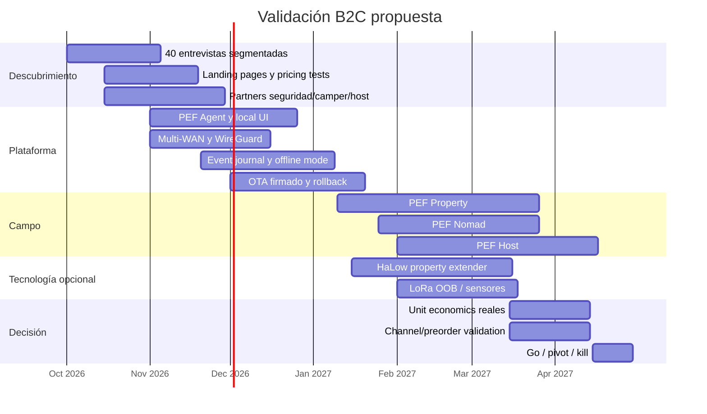

# Private Edge Fabric para consumo: de “Internet privada” a infraestructura digital resiliente para hogares, movilidad y pequeños emplazamientos

## Resumen ejecutivo

El giro de **Private Edge Fabric (PEF) hacia B2C sí abre oportunidades interesantes**, pero obliga a simplificar radicalmente el concepto original. El informe previo estaba correctamente orientado a continuidad operacional, autonomía local, abstracción multi-transporte, identidad y servicios *offline-first*, pero su arquitectura y propuesta económica estaban pensadas principalmente para minería, utilities, industria y otras organizaciones. fileciteturn0file0 En consumo, vender esa arquitectura completa sería demasiado caro y demasiado complejo.

La oportunidad B2C no es vender una “Internet privada” ni otro router multi-WAN. **Ese espacio ya está altamente comoditizado:** Ubiquiti vende actualmente en Europa un Cloud Gateway Ultra por €90 con multi-WAN y routing IPS de 1 Gbit/s; GL.iNet integra 5G, Wi-Fi 7, doble SIM/eSIM, Ethernet y WireGuard en routers portátiles; Peplink combina 5G, múltiples WAN, Starlink y *bonding/failover* con SpeedFusion. citeturn17search1turn18search2turn18search7

PEF sólo resulta defendible en B2C si transforma esa conectividad en algo superior:

> **Una “infraestructura digital privada del lugar” que sigue funcionando cuando falla Internet, cambia automáticamente entre transportes, vigila el emplazamiento, conserva servicios y datos localmente y permite administrar de forma remota vivienda, vehículo o pequeño negocio.**

El cambio semántico es importante:

```text
No vender:

"router resiliente"
"SD-WAN doméstico"
"Internet privada"
"gateway HaLow"


Vender:

"tu propiedad sigue conectada y operativa"
"tu red te acompaña"
"tu segunda casa se vigila aunque falle Internet"
"tu alojamiento no depende de un único operador"
```

La investigación identifica **tres beachheads especialmente interesantes**:

| Prioridad | Segmento | Tesis |
|---|---|---|
| **Primera** | **Viviendas rurales, segundas residencias y fincas con seguridad** | Mejor combinación de mercado español grande, problema remoto claro, hardware moderado y posibilidad de vender seguridad + resiliencia + edge |
| **Segunda** | **Campings, glamping, casas rurales y pequeños B&B** | Menos B2C puro, pero excelente B2B2C: un único gateway monetiza decenas de consumidores, ARPU por emplazamiento mayor y CAC mucho menor |
| **Tercera** | **Autocaravanas/campers** | Producto muy demostrable, instalación de bajo CAPEX y canal especializado; sirve para aprender rápidamente multi-WAN móvil, energía y Starlink |

España tenía **2.514.511 viviendas de uso esporádico** en el Censo de 2021 y el 15,5% de los hogares declaraba disponer de segunda residencia. Esto proporciona una base potencial enorme para un producto de “propiedad remota”, aunque no debe confundirse TAM con demanda efectiva. citeturn16search4turn16search52

Pero hay una advertencia decisiva: **el mercado no puede basarse simplemente en llevar Internet al mundo rural**. En 2026, el Gobierno sitúa la cobertura 5G en el 99,27% de la población española y el 96,13% de la población rural; casi el 95% de los hogares tienen cobertura fija Gigabit y en áreas rurales la cifra alcanza el 86,01%. La CNMC, midiendo adopción y experiencia real, todavía encuentra una brecha —aproximadamente 99% de banda ancha fija en hogares urbanos frente a 78% rurales—, pero el “no tengo Internet” es cada vez un nicho residual, no una tesis de mercado masivo. citeturn21search0turn16search29

Por tanto, **PEF Home debe vender resiliencia, gestión remota y servicios locales, no cobertura**.

También existe una referencia clara sobre sensibilidad al precio: el hogar español pagaba de media **€38,3/mes por un paquete cuádruple de telecomunicaciones** a finales de 2025. Al mismo tiempo, Starlink ofrece actualmente en España Roam 100 GB por €40/mes y Roam ilimitado por €89/mes. Esto dificulta justificar otra cuota de €40–€80 únicamente por conectividad; una suscripción PEF B2C probablemente necesitaría comenzar alrededor de **€9–€29/mes**, salvo que incorpore servicios de alto valor —seguridad, almacenamiento/NVR local, gestión de múltiples propiedades, soporte premium—. Estas bandas de PEF son **hipótesis de willingness-to-pay**, no precios validados mediante encuesta. citeturn16search1turn17search0

La conclusión de negocio más importante es otra: **no subvencionaría hardware ni compraría conectividad para revenderla en la primera etapa**.

El modelo recomendado sería:

\[
\boxed{
Hardware\ vendido\ upfront
+
SaaS\ recurrente
+
conectividad\ contratada\ por\ el\ cliente
}
\]

Esto reduce drásticamente el capital necesario. El cliente conserva su fibra, SIM o Starlink y PEF las utiliza como *underlays*. La empresa monetiza el appliance, el software y los servicios, no los gigabytes.

La arquitectura B2C también debería abandonar la idea de que todo nodo necesita un RK3576. Un RK3576 industrial cuesta actualmente **US$299 sólo como equipo base** y proporciona una NPU de 6 TOPS y capacidad de edge AI; es razonable para `PEF Property Pro`, vídeo/NVR o un camping, pero excesivo para el producto doméstico básico. citeturn18search3 Un PocketBeagle 2 Industrial resulta atractivo como nodo especializado, pero su ausencia de una solución de networking integrada lo hace menos apropiado como router consumidor principal. El SKU masivo debería construirse alrededor de una plataforma ARM/router OpenWrt con Ethernet y Wi-Fi integrados; RK3576, PocketBeagle, HaLow y LoRa deberían entrar sólo donde añadan valor.

**HaLow sigue siendo una hipótesis tecnológica muy interesante, pero pasa de “red principal” a “extensor de propiedad”.** Wi-Fi HaLow permite IP sobre sub-GHz y chipsets actuales como el MM8108 anuncian hasta 43,3 Mbit/s PHY; ETSI ya dispone de estándares armonizados para dispositivos wideband SRD en bandas sub-GHz relevantes. No obstante, el nuevo CNAF español de julio de 2026 sustituye al anterior y el SKU concreto, su potencia, canalización, antena y conformidad RED deben validarse antes de comercializarse. citeturn22search0turn15search35

**LoRaWAN pierde todavía más importancia en B2C.** En la mayoría de hogares y campers no justifica añadir concentrador, servidor y otro conjunto de claves. Puede ser excelente para una finca grande, un camping o dispositivos remotos, pero debe ser un módulo opcional.

**Private 5G prácticamente desaparece del MVP consumidor.** Con 5G público cubriendo ya a la inmensa mayoría de la población española, el coste y complejidad de una red 5G privada carecen de sentido para estos beachheads. citeturn21search0

La tesis final que resulta de esta investigación es:

\[
\boxed{
PEF_{B2C}
=
Resilient\ Local\ Cloud
+
Multi\!-\!WAN
+
Private\ Site\ Network
+
Remote\ Operations
}
\]

y no:

\[
PEF_{B2C}=Private\ Telecom\ Network
\]

Ese desplazamiento reduce CAPEX, regulación y complejidad, pero conserva precisamente la parte más diferenciadora del concepto original.

## Mercado consumidor y selección de segmentos

El consumidor no compra abstracción de transportes, routing distribuido o tolerancia a particiones. Compra resultados muy concretos: **que una cámara siga grabando, que una segunda vivienda siga accesible, que un vehículo encuentre el mejor enlace, que su domótica continúe funcionando o que los huéspedes no pierdan conectividad porque falló un operador**.

Esto aconseja dividir el mercado en tres categorías.

**B2C directo:** segunda residencia, vivienda rural, camper, barco y hogar *off-grid*.

**Prosumer:** finca extensa, videovigilancia, teletrabajo crítico, vivienda + pequeño negocio.

**B2B2C:** camping/glamping, B&B, pequeña casa rural, urbanización y eventos. El comprador no es el consumidor final, pero PEF presta infraestructura a muchos consumidores simultáneamente.

La tabla siguiente combina tamaño relativo, disposición a pagar, CAPEX y posibilidad de construir una diferenciación PEF. Los rangos económicos son **hipótesis de producto para customer discovery**, deliberadamente abiertas; no son precios de mercado observados.

| Segmento candidato | Problema principal | Hardware instalado orientativo | ARPU PEF orientativo, sin ISP | Canal probable | Potencial | Principal objeción |
|---|---|---:|---:|---|---|---|
| **Vivienda rural / segunda residencia** | vigilancia, acceso remoto, continuidad, IoT | €350–1.200 | €10–29/mes | seguridad, solar, domótica, ISP rural, e-commerce | **Muy alto** | la fibra/5G ya cubre gran parte del país |
| **RV / camper** | 5G + Wi-Fi externo + Starlink + VPN + energía | €300–900 | €6–19/mes | dealers, camperizadores, accesorios, D2C | **Alto** | routers de viaje y Starlink ya son muy buenos |
| **Camping / glamping** | guest Wi-Fi, IoT, cámaras, varios uplinks | €1.200–4.500 | €49–149/mes | integradores Wi-Fi, PMS, distribuidores hospitality | **Muy alto B2B2C** | soporte y red LAN pueden complicar el producto |
| **Marina / barco** | marina Wi-Fi + 5G + Starlink + sensores | €700–2.500 | €15–49/mes | electrónica marina, astilleros, marinas | **Alto margen** | ambiente marino + Peplink/Starlink |
| **Comunidad off-grid** | conectividad compartida, energía, servicios locales | €1.000–6.000 | €20–100/site o comunidad | solar/off-grid/integradores | Medio | mercado fragmentado y soporte caro |
| **Urbanización / comunidad cerrada** | red común, cámaras, servicios compartidos | €2.000–10.000+ | €2–8/vivienda o €99–399/site | administradores de fincas, integradores | Alto en teoría | gobernanza, propiedad común, posible regulación de operador |
| **Eventos / festivales** | infraestructura temporal resiliente | €2.000–10.000 reutilizable | mejor por alquiler/evento | AV, producción, rental | Medio | negocio de alquiler, escasa recurrencia por cliente |
| **Backup hogar / micro-SMB** | segunda WAN automática | €250–800 | €9–29 hogar; €19–79 negocio | IT/MSP/e-commerce | Alto volumen | **muy comoditizado** |
| **Finca / cámaras / seguridad** | grandes distancias, vídeo local, alarmas | €600–2.000 | €15–49/mes | seguridad, solar, instaladores | **Muy alto** | privacidad y coste de cámaras/instalación |
| **Hotel pequeño / B&B** | guest Wi-Fi + negocio + cámaras + IoT | €800–3.500 | €39–129/mes | hospitality IT, PMS, seguridad | **Muy alto** | necesita fiabilidad de producto profesional |

### La vivienda remota es mayor de lo que parece

España contabilizó 2,51 millones de viviendas de uso esporádico en el Censo de 2021, equivalentes al 9,4% del parque; otra encuesta del INE estimó que el 15,5% de los hogares tenía segunda residencia. citeturn16search48turn16search52 No todas son mercado objetivo, pero basta una penetración pequeña para crear un mercado considerable.

Por ejemplo, una penetración hipotética del 1% sobre 2,51 millones de viviendas de uso esporádico serían unas **25.000 instalaciones**. A €15/mes de software, eso equivaldría conceptualmente a unos **€4,5 millones de ARR**, antes de churn, IVA, descuentos, CAC y costes. No es una previsión de ventas; muestra que no es necesario dominar el mercado para obtener escala.

Pero el mensaje comercial correcto no sería:

> “te llevo Internet al pueblo”.

España tiene ya una infraestructura de telecomunicaciones extraordinariamente extendida: 5G supera el 99% de población y la cobertura fija Gigabit se aproxima al 95% de hogares. citeturn21search0

Sería:

> **“tu propiedad se gestiona a sí misma incluso cuando su conexión exterior falla.”**

Ahí pueden convivir:

```text
PEF Property
│
├── fibra
├── 4G/5G backup
├── Starlink opcional
│
├── cámaras
├── sensores
├── alarma
├── puerta / acceso
├── riego
├── energía solar
└── almacenamiento local
```

Si desaparece Internet:

```text
Internet
   X

PEF Property
│
├── cámaras siguen grabando
├── automatizaciones siguen funcionando
├── dispositivos se hablan localmente
├── eventos quedan almacenados
└── intenta transporte alternativo
```

La combinación **segunda residencia + finca + cámaras** es probablemente más interesante que tratar esos tres como verticales independientes.

### El caravaning es el mejor laboratorio B2C móvil

La DGT señala que el parque español de autocaravanas pasó de algo más de 48.000 unidades en 2015 a **casi 137.000 en 2026**, casi triplicándose en una década. citeturn16search18turn16search39

Su necesidad encaja casi perfectamente con multi-transporte:

```text
                  PEF Nomad
                      │
        ┌─────────────┼────────────┐
        │             │            │
      5G/eSIM     camping Wi-Fi   Starlink
        │             │            │
        └──────── policy engine ────┘
                      │
                   private LAN
                 /      |      \
              laptops  IoT    TV/NAS
```

Además, Starlink Mini consume aproximadamente **20–40 W de media**, lo que hace que en vehículo y sistemas solares la política energética sea tan importante como el routing. citeturn17search4

El problema es competitivo. Starlink vende específicamente Roam para viajes; GL.iNet ofrece un router portátil Wi-Fi 7/5G con dual-SIM/eSIM, Ethernet y hasta 13,5 horas declaradas de batería; Peplink integra 5G, Starlink, dual-WAN y SpeedFusion. citeturn17search0turn18search6turn18search7

Por eso `PEF Nomad` no puede ser simplemente:

> “router camper premium”.

Necesitaría diferenciarse mediante un **estado local persistente y servicios del vehículo**: VPN privada automática, políticas por coste de datos, funcionamiento offline, almacenamiento local, monitorización energética, cámaras, sensores, gestión del vehículo cuando está aparcado y una interfaz extremadamente sencilla.

### Hospitality pequeño es el segmento económicamente más atractivo

Los alojamientos extrahoteleros españoles registraron **146,3 millones de pernoctaciones en 2025**, máximo histórico. Los campings representaron el 34% y los alojamientos rurales el 8,8%; esto equivale aproximadamente a 49,7 millones y 12,9 millones de pernoctaciones respectivamente. citeturn16search0

Aquí la economía cambia porque una sola venta puede servir a:

```text
1 owner
40 pitches
15 cabins
80 guests
20 cameras
30 IoT devices
```

El CAC deja de ser CAC por consumidor y pasa a ser CAC por establecimiento.

Ese fenómeno hace que **camping/glamping/B&B sea probablemente el mejor puente entre PEF industrial y PEF consumidor**.

### Barcos son high-margin, pero no el primer beachhead

El segmento náutico presenta una disposición a pagar potencialmente mayor y exactamente el problema multi-WAN adecuado: Wi-Fi de marina en puerto, 4G/5G cerca de costa y satélite cuando se aleja.

Como indicador de densidad comercial, sólo la asociación Marinas de Andalucía agrupa actualmente 19 puertos y clubes con 9.739 amarres y reportó 33.492 clientes en 2025. citeturn20search1

Pero aparecen tres dificultades:

- mayor exigencia ambiental y de instalación;
- menor volumen que vivienda;
- competencia directa de soluciones marinas/vehiculares de Peplink y Starlink.

Lo consideraría **vertical premium de segunda ola**, una vez estabilizado PEF Nomad.

### Los segmentos que no priorizaría

**Backup doméstico/SMB genérico** tiene mercado, pero carece de espacio tecnológico suficiente. Cuando un gateway multi-WAN con IPS cuesta €90 y productos 5G/Wi-Fi 7 están disponibles por centenares de euros, intentar ganar simplemente con failover conduce a competencia de hardware. citeturn17search1turn17search10

**Urbanizaciones** podrían generar mucho ARR agregado, pero añaden gobernanza comunitaria, infraestructura común y potencialmente regulación de telecomunicaciones si PEF deja de ser infraestructura privada y empieza a suministrar públicamente acceso. La Ley General de Telecomunicaciones exige notificación previa al Registro de Operadores para redes o servicios disponibles al público, aunque contempla una excepción para acceso RLAN cuando no constituye actividad económica propia o es accesorio de otra actividad. citeturn19search9turn19search0

**Eventos** tienen willingness-to-pay elevado en situaciones críticas, pero el modelo natural parece *rental/event-as-a-service*, no ARR consumidor.

**Comunidades off-grid** representan una aplicación técnicamente preciosa, pero un mercado muy heterogéneo y caro de adquirir. Podrían ser excelentes design partners, no necesariamente un primer canal masivo.

## Producto y arquitectura B2C recomendada

La transformación más importante consiste en **no trasladar la arquitectura industrial directamente al hogar**.

El PEF empresarial estudiado previamente estaba razonablemente estructurado en data plane, routing, control, management y services, y utilizaba edge regional, identidad, almacenamiento local y sincronización. fileciteturn0file0

B2C necesita conservar esas propiedades internamente pero ocultarlas al usuario.

La experiencia debería ser:

```text
enchufar
   ↓
escanear QR
   ↓
app detecta conexiones
   ↓
PEF configura red
   ↓
añadir segunda WAN
   ↓
añadir dispositivos/servicios
   ↓
funciona
```

No:

```text
configure Babel
create WireGuard peer
configure NATS leaf
provision PKI
configure VLANs
set routing metrics
```

### Arquitectura de producto



La diferencia respecto a un router es que **PEF Edge posee estado y servicios**, no sólo rutas.

Cuando desaparece el cloud:

```text
Cloud
  X
  │

PEF Edge
│
├── routing        ✓
├── DNS local      ✓
├── identity cache ✓
├── automations    ✓
├── NVR/storage    ✓
├── MQTT/events    ✓
├── local UI       ✓
└── backlog sync   ✓
```

### Tres niveles de hardware

| Clase | Función | Compute recomendado | Radios |
|---|---|---|---|
| **PEF Lite** | hogar/camper | ARM router-class, OpenWrt/Linux, 1–2 GB | Wi-Fi + Ethernet; 5G opcional |
| **PEF Property** | finca/segunda vivienda | ARM64 2–4 GB + SSD opcional | dual-WAN + 5G + HaLow opcional |
| **PEF Edge Pro** | vídeo/AI/camping/hospitality | RK3576-class, 4–8 GB | Ethernet + 5G + HaLow/LoRa opcional |

El **RK3576** es atractivo en el nivel Pro: el reComputer Industrial concreto que inició esta conversación cuesta actualmente US$299 y combina un SoC RK3576 con NPU de 6 TOPS y una plataforma industrial fanless. citeturn18search3 Ese hardware puede ejecutar localmente clasificación de eventos de cámaras, NVR selectivo, containers y servicios más pesados.

Pero sería un error utilizarlo como requisito mínimo.

La oportunidad masiva necesita reducir:

\[
BOM + potencia + tamaño + soporte
\]

no maximizar TOPS.

**PocketBeagle 2/PocketBeagle 2 Industrial** encajan mejor como nodo auxiliar —control de hardware, gateway de sensores, cámara especializada, energía— que como appliance consumidor central. El modelo Industrial aporta 1 GB DDR4 y 64 GB eMMC, pero necesita expansión para convertirse en un router completo. citeturn5search0

### HaLow: importante, pero como opción que desbloquea propiedades

En el producto consumidor veo HaLow de una forma diferente al concepto original.

No:

```text
every customer → HaLow
```

Sino:

```text
normal house:
PEF ── Wi-Fi/Ethernet ── devices


large property:
PEF ── Wi-Fi/Ethernet ── house
 │
 └──── HaLow ─────────── gate
                  ├──── camera
                  ├──── solar
                  └──── pump
```

Esto crea una historia comercial comprensible:

> “Lleva tu red privada hasta el portón, almacén, parking, placas solares o cámara exterior sin tender fibra.”

Wi-Fi HaLow utiliza sub-GHz y mantiene una red IP; chipsets actuales de Morse Micro anuncian hasta 43,3 Mbit/s PHY y soporte WPA3. Es mucho más apropiado que LoRaWAN cuando el endpoint debe hablar IP. Pero las cifras de fabricante sobre alcance deben comprobarse en España con el perfil radio concreto y nunca utilizarse directamente como SLA. citeturn4search10turn4search12

ETSI ha armonizado EN 304 220 para dispositivos wideband SRD de acceso/terminal en 863–868 MHz y 915,8–919,4 MHz, mientras que España sustituyó el CNAF anterior por la Orden TDF/732/2026 el 18 de julio de 2026. Esto hace imprescindible validar cada SKU europeo contra el CNAF vigente, RED y las condiciones técnicas de la banda; “sub-GHz” no equivale automáticamente a “puedo transmitir con cualquier potencia/ancho de canal”. citeturn15search35turn22search0

### LoRaWAN: feature Pro, no requisito

En B2C, LoRaWAN sólo me parece justificable cuando existen:

- propiedad muy grande;
- sensores alimentados por batería;
- agua/riego;
- puertas remotas;
- depósitos;
- alarmas de bajo bitrate;
- necesidad OOB especialmente fuerte.

Para una vivienda urbana, camper o B&B pequeño:

\[
valor\ LoRaWAN < complejidad\ añadida
\]

La decisión correcta sería que PEF tenga una interfaz para LoRaWAN, no que cada PEF incluya LoRaWAN.

### Software: aquí está el producto

La ventaja defendible debe estar aproximadamente en este stack:

| Componente | Responsabilidad |
|---|---|
| **PEF Agent** | inventario, health, routing, enlaces y políticas |
| **Connectivity Engine** | fibra/5G/Wi-Fi WAN/Starlink, failover y coste |
| **Local Service Runtime** | DNS, proxy, MQTT, automatizaciones, storage |
| **Event Journal** | almacenar eventos durante desconexión |
| **Secure Overlay** | WireGuard/mTLS para acceso remoto |
| **Device Identity** | claves por appliance/dispositivo |
| **Local UI** | administración incluso sin Internet |
| **Cloud Control Plane** | cuentas, notificaciones, configuración, fleet |
| **OTA** | imágenes firmadas, rollback |
| **Service Modules** | NVR, cámaras, energía, RV, hospitality |
| **Mobile App** | la experiencia que oculta toda la complejidad |

La clave conceptual es:

```text
Cloud is management
not survival
```

PEF debería funcionar localmente sin su SaaS.

Eso constituye una diferencia importante frente a vender simplemente “otra caja cloud-managed”.

## Regulación, competencia y barreras de entrada

La regulación B2C es significativamente más favorable que la del PEF industrial si el producto se mantiene como **appliance que utiliza conexiones contratadas por el propio cliente**.

### Telecomunicaciones e ISP

La Ley 11/2022 obliga a quienes suministran redes públicas o servicios de comunicaciones electrónicas disponibles al público a notificar la actividad al Registro de Operadores de la CNMC. No obstante, establece una excepción para el acceso RLAN cuando no constituye actividad económica o es accesorio respecto de otra actividad que no dependa del transporte de señales. citeturn19search9turn19search1

Esto tiene consecuencias estratégicas.

Un hotel que ofrece Wi-Fi como servicio accesorio a sus huéspedes se encuentra en una posición regulatoria muy distinta de una startup que vende explícitamente conectividad a cientos de residentes.

Por eso, la primera versión de PEF debería ser:

```text
customer fiber
customer SIM
customer Starlink
       │
       ▼
      PEF
```

y no:

```text
PEF buys bandwidth
      ↓
resells Internet
      ↓
consumer
```

Ese diseño reduce tanto capital circulante como exposición regulatoria.

En comunidades de propietarios, además, instalaciones sobre elementos comunes entran en el marco de propiedad horizontal. La legislación contempla expresamente acuerdos para instalar infraestructura común de telecomunicaciones y reglas específicas de reparto de costes. citeturn19search2turn19search11 Por eso las urbanizaciones pueden ser atractivas más adelante, pero no tienen la simplicidad contractual de “comprar appliance, enchufar”.

### Radio y conformidad

España dispone desde julio de 2026 de un nuevo CNAF que sustituye al de 2021 y actualiza atribuciones y condiciones técnicas. Cualquier producto HaLow/LoRa/sub-GHz debe diseñarse contra ese marco vigente, no copiando configuraciones estadounidenses. citeturn22search0

Además, un appliance inalámbrico comercializado en la UE entra dentro de la Directiva de Equipos Radioeléctricos y de sus requisitos de ciberseguridad aplicables a determinadas categorías de equipos conectados. La Comisión incorporó normas armonizadas EN 18031 para estos requisitos, aplicables desde 2025 en las categorías relevantes. citeturn15search1turn15search17

El **Cyber Resilience Act** también empieza a afectar directamente al modelo: desde el **11 de septiembre de 2026**, los fabricantes tienen obligaciones de reporte de vulnerabilidades explotadas activamente e incidentes graves para productos con elementos digitales; las obligaciones principales del CRA serán plenamente aplicables desde el **11 de diciembre de 2027**. citeturn15search0turn15search2

Eso significa que desde el MVP deberían existir:

```text
signed OTA
SBOM
vulnerability handling
security contact
rollback
device identity
supported-lifetime policy
incident process
```

No son funciones “enterprise” opcionales; progresivamente serán parte de la disciplina necesaria para vender un appliance digital en Europa. citeturn15search15

### Cámaras y privacidad

El vertical de segunda residencia/finca gana mucho valor con vídeo local, pero también introduce protección de datos. La AEPD mantiene requisitos específicos para videovigilancia en viviendas, comunidades y establecimientos; en comunidades, por ejemplo, las cámaras de zonas comunes no deben captar viviendas o terrenos ajenos y sólo pueden captar de la vía pública la franja mínima necesaria de acceso. citeturn15search12turn15search24

Esto en realidad puede convertirse en oportunidad de producto:

> **local video by default, cloud upload by exception.**

Es decir:

```text
camera
   ↓
local PEF NVR
   ↓
AI/event detection
   ↓
only metadata/event
   ↓
cloud
```

Además de ahorrar uplink, minimiza el volumen de vídeo que sale del emplazamiento.

### El campo competitivo obliga a subir un nivel

PEF no posee ventaja si compite feature contra feature.

| Sustituto | Lo que ya hace bien | Qué debe aportar PEF además |
|---|---|---|
| **Mesh Wi-Fi** | cobertura LAN | resiliencia WAN + servicios locales |
| **Ubiquiti** | gateway, multi-WAN, seguridad, NVR/ecosistema | autonomía *offline-first* y multi-site consumer |
| **GL.iNet** | travel router 5G/VPN | estado persistente y servicios del lugar/vehículo |
| **Starlink** | Internet en sitios remotos/móviles | combinarlo con otros uplinks y mantener servicios sin Starlink |
| **Peplink** | bonding, failover, celular + satélite | plataforma local de compute/identity/services |
| **alarma/cámaras cloud** | seguridad como servicio | operación local + conectividad + privacidad |
| **Private 5G** | red celular privada | innecesario para la mayoría de B2C |

Ubiquiti ilustra bien el riesgo de competir sólo en networking: €90 ya compra multi-WAN, y su catálogo actual incluye gateways con Wi-Fi 7, 5G y NVR por centenares de euros. citeturn17search5turn17search10

Peplink es probablemente el benchmark más serio para PEF Nomad/Marine: su B One 5G ofrece dos WAN Ethernet, 5G, dual-SIM/eSIM y SpeedFusion, e incluso propone explícitamente utilizar 5G como principal y Starlink como backup o viceversa. citeturn18search7turn18search8

Por eso la diferenciación correcta sería:

```text
           NETWORKING
              │
         already crowded
              │
              ▼
     ┌─────────────────┐
     │      PEF        │
     │                 │
     │ networking      │
     │ + local compute │
     │ + state         │
     │ + storage       │
     │ + automation    │
     │ + resilience    │
     │ + fleet         │
     └─────────────────┘
```

## Modelo económico, CAPEX y go-to-market

La restricción de capital inicial cambia la elección del modelo de negocio más que la elección de radio.

Hay tres modelos posibles:

**Appliance + SaaS** es el recomendable.

```text
customer pays hardware upfront
             +
       monthly SaaS
             +
customer keeps ISP contracts
```

**Hardware subvencionado + suscripción** parece atractivo comercialmente pero consume muchísimo working capital.

**Managed connectivity** añade margen potencial, pero también carrier costs, soporte y más exposición regulatoria. Lo pospondría.

### CAPEX por despliegue

Estos son rangos de planificación, no cotizaciones. Incluyen compute/routing básico y accesorios normales, pero la instalación física, cámaras, cableado, antenas complejas o Starlink pueden elevarlos.

| Configuración | Hardware/instalación objetivo | Casos |
|---|---:|---|
| **Low** | **€250–500** | camper, apartamento, backup residencial |
| **Medium** | **€500–1.200** | segunda residencia, finca pequeña, 5G backup, SSD |
| **High consumer** | **€1.200–2.500** | finca extensa, cámaras, HaLow, edge AI, barco |
| **B2B2C site** | **€1.500–5.000+** | camping, glamping, B&B, pequeña comunidad |

Las referencias competitivas demuestran por qué estos objetivos deben mantenerse disciplinados: un gateway Ubiquiti multi-WAN parte de €90, mientras que el RK3576 industrial por sí solo está en US$299. citeturn17search1turn18search3

### Unit economics

Para visualizar el efecto del CAPEX, el siguiente modelo supone que **PEF regalase/subvencionase todo el hardware**, cobrando únicamente SaaS. `OPEX variable` incluye cloud, relay, telemetría y soporte básico asignable, pero **no** incluye CAC, IVA, salarios generales ni conectividad del cliente.

\[
Payback =
\frac{CAPEX_{hardware}}
{ARPU-OPEX_{variable}}
\]

| CAPEX financiado por PEF | ARPU | OPEX variable | Margen bruto recurrente | Payback hardware |
|---:|---:|---:|---:|---:|
| €250 | €15/mes | €4 | 73% | **22,7 meses** |
| €250 | €29 | €5 | 83% | **10,4 meses** |
| €500 | €29 | €6 | 79% | **21,7 meses** |
| €500 | €49 | €9 | 82% | **12,5 meses** |
| €900 | €49 | €10 | 80% | **23,1 meses** |
| €900 | €79 | €16 | 80% | **14,3 meses** |
| €1.500 | €79 | €18 | 77% | **24,6 meses** |

Esto muestra por qué **hardware subvencionado es peligroso para una startup B2C**. Una instalación de €500 con €29 ARPU consume casi 22 meses de contribución antes incluso de recuperar el equipo.

El modelo mucho más capital-efficient sería, por ejemplo:

```text
COGS hardware          €500
sale price             €799
software               €19–29/month

day 1 hardware cash:
+€299 gross contribution
before CAC / fulfilment

then:
recurring software margin
```

Los precios exactos son hipótesis, pero la estructura es la importante.

### Willingness-to-pay

El benchmark de telecomunicaciones español exige prudencia. Un hogar paga de media €38,3/mes por un paquete completo fijo+móvil, mientras Starlink Roam cuesta actualmente €40/mes para 100 GB o €89 ilimitado. citeturn16search1turn17search0

Por eso no asumiría:

```text
PEF Home SaaS = €49/month
```

sin incorporar un valor equivalente a alarma, almacenamiento, remote management u otro servicio claramente monetizable.

Mis hipótesis a validar serían:

| Producto | WTP inicial a testar | ARR por unidad |
|---|---:|---:|
| PEF Home | €9–15/mes | €108–180 |
| PEF Property | €15–29/mes | €180–348 |
| PEF Nomad | €6–15/mes | €72–180 |
| PEF Marine | €19–49/mes | €228–588 |
| PEF Host | €49–149/mes | €588–1.788 |

Estos valores deberían probarse con **Van Westendorp/conjoint + preorders**, no sólo preguntando “¿pagarías €20?”.

### Canales de adquisición

Aquí existe otra oportunidad de reducir CAPEX y CAC.

Para `PEF Property`, no dependería inicialmente de ads directos al consumidor. Buscaría:

```text
security installers
solar installers
home automation
rural ISPs
electricians
property managers
second-home services
              ↓
             PEF
```

El instalador ya posee:

- confianza;
- acceso físico a la vivienda;
- cliente con problema;
- capacidad de montaje;
- oportunidad de soporte.

PEF se convierte en una nueva línea de margen para él.

Para `PEF Nomad`:

```text
camper dealers
camper converters
RV accessory distributors
rental fleets
e-commerce / YouTube creators
```

La DGT contabiliza casi 137.000 autocaravanas/campers en circulación, por lo que incluso el mercado español permite experimentar sin necesidad de lanzar inmediatamente en toda Europa. citeturn16search18

Para `PEF Host`:

```text
Wi-Fi integrators
PMS vendors
security installers
rural accommodation associations
camping distributors
```

Éste debería ser **B2B2C por canal**, no venta puerta a puerta a hoteles.

### Priorización final

Aplicando simultáneamente `escala × WTP × CAPEX × recurrencia × canal × diferenciación`, mi ranking estratégico queda:

| Segmento | Escala | WTP | CAPEX eficiente | Recurrencia | Diferenciación PEF | Prioridad |
|---|---:|---:|---:|---:|---:|---|
| Segunda residencia/finca | ★★★★★ | ★★★ | ★★★★ | ★★★★ | ★★★★★ | **A+** |
| Camping/glamping/B&B | ★★★★ | ★★★★ | ★★★★ | ★★★★★ | ★★★★★ | **A+** |
| Camper/RV | ★★★ | ★★★ | ★★★★★ | ★★★ | ★★★ | **A** |
| Finca cámaras/seguridad | ★★★★ | ★★★★ | ★★★★ | ★★★★★ | ★★★★★ | **A** — integrarlo con Property |
| Barco/marina | ★★★ | ★★★★★ | ★★★ | ★★★★★ | ★★★ | **B+** |
| Urbanización | ★★★★ | ★★★ | ★★★ | ★★★★★ | ★★★★ | **B** |
| Off-grid | ★★ | ★★★★ | ★★★ | ★★★★ | ★★★★★ | **B** |
| Backup SMB/home | ★★★★★ | ★★★★ | ★★★★★ | ★★★★★ | ★ | **B** |
| Eventos | ★★★ | ★★★★ | ★★★ | ★★ | ★★ | **C para producto; A para rental** |

La aparente paradoja es que **backup SMB** tiene muy buenas unit economics, pero no lo escogería como identidad de la empresa: Peplink, Ubiquiti, GL.iNet y operadores ya cubren gran parte del problema. citeturn17search10turn18search7turn18search6

## Beachheads, PoC y recomendación estratégica

Los tres PoC no deberían intentar demostrar “la plataforma completa”. Cada uno debe falsificar una parte distinta de la tesis.

### PEF Property — vivienda remota resiliente

Éste sería mi **beachhead principal**.

El TAM observable español es atractivo: 2,51 millones de viviendas de uso esporádico y un 15,5% de hogares con segunda residencia en los datos censales/encuestas de 2021. citeturn16search4turn16search52

El producto:

```text
                    PEF PROPERTY
                         │
             ┌───────────┼────────────┐
             │           │            │
           fiber        5G        Starlink
             │           │            │
             └──── Connectivity ──────┘
                         │
                   Local services
                         │
         ┌───────────────┼──────────────┐
         │               │              │
      cameras        automation       energy
         │               │              │
       local           local          local
       NVR             logic          data
         │
         └────────── events ────────────┘
                         │
                       cloud
```

**PoC:** 10–20 propiedades durante 60–90 días, incluyendo hogares con fibra buena, 5G-only y una finca grande.

**Hardware:** appliance ARM64 2–4 GB, dos WAN, 5G opcional, SSD 256–512 GB, UPS pequeño; dos propiedades deberían probar HaLow para puerta/cámara/placas solares. Un RK3576 se utilizaría sólo en 2–3 sitios con vídeo/AI, no en todos.

**Pruebas:** cortar fibra; degradar 5G; desconectar cloud PEF; cortar alimentación; llenar storage; reiniciar modem; interrumpir una OTA; dejar el emplazamiento 24–48 horas sin uplink; reconectar.

**Targets provisionales:**

| Métrica | Target PoC |
|---|---:|
| failover IP | <10 s normal; medir p95 |
| servicios locales durante outage | >99,9% del periodo de prueba |
| pérdida de eventos committed | 0 |
| recuperación tras power loss | automática |
| intervenciones físicas | <1 por sitio/mes |
| OTA remota exitosa | >98% |
| alertas falsas de outage | <1/sitio/mes |
| instalación | <45 min sin HaLow |
| satisfacción | NPS/qualitative + preorder |
| WTP | ≥30% acepta €15+/mes o equivalente anual |

Los números son **gates de producto propuestos**, no benchmarks del sector.

### PEF Host — camping, glamping y pequeño alojamiento

Éste sería el **beachhead de margen**.

El tráfico turístico confirma que existe volumen: en 2025 los campings concentraron el 34% de 146,3 millones de pernoctaciones extrahoteleras y el turismo rural otro 8,8%. citeturn16search0

El objetivo no sería sustituir UniFi ni construir el Wi-Fi desde cero.

PEF se colocaría por encima:

```text
                  ISP 1
                    │
                  ISP 2
                    │
                Starlink
                    │
               PEF HOST
                 /   \
                /     \
         existing     local
          Wi-Fi       services
            │          │
         guests     cameras
                   access
                   IoT
                   energy
```

Eso permite incluso **integrarse con UniFi en lugar de competir contra UniFi**.

El valor:

- health remoto del sitio;
- backup automático;
- segmentación guest/staff/IoT;
- servicios locales;
- observabilidad;
- cámaras/eventos;
- control energético;
- almacenamiento durante desconexiones;
- soporte centralizado para el integrador.

**PoC:** un camping/glamping de 30–100 plazas/unidades y un alojamiento rural pequeño durante al menos dos meses de actividad.

**Hardware:** un gateway RK3576-class o x86 ligero, SSD, 5G, Ethernet hacia la red existente, Starlink opcional; HaLow sólo para una zona distante que actualmente exigiría zanja/cable; LoRa sólo si existen contadores, depósitos o sensores que lo justifiquen.

**Métricas esenciales:**

```text
guest-facing outages
support tickets
failover time
WAN cost
remote resolutions
truck rolls
data retained during outage
installation time
monthly support minutes/site
```

Aquí el indicador empresarial decisivo sería:

\[
\frac{support\ cost}{site/month}
\]

Si PEF exige una hora de ingeniero de redes cada mes, el margen desaparece.

Si un canal puede mantener cientos de sitios con minutos de intervención, aparece un SaaS muy atractivo.

### PEF Nomad — camper y RV

Éste sería el **PoC de velocidad de aprendizaje y distribución D2C**.

España dispone ya de cerca de 137.000 autocaravanas/campers registrados según DGT, mientras Starlink ha creado una referencia de precio muy clara para Internet móvil: €40/mes por 100 GB y €89/mes ilimitado en Roam. citeturn16search18turn17search0

El hardware debería ser mucho más pequeño que RK3576:

```text
12 V
 │
 ▼
PEF NOMAD
│
├── 5G / SIM A
├── SIM B / eSIM
├── campsite Wi-Fi WAN
├── Ethernet → Starlink
│
├── private Wi-Fi LAN
├── WireGuard
├── local services
└── power policies
```

Una característica diferencial interesante sería tratar **energía como otro recurso del fabric**:

```text
battery > 70%
  → Starlink allowed

battery 30–70%
  → Starlink on demand

battery < 30%
  → cellular preferred

battery critical
  → low-power network only
```

Eso aprovecha el hecho de que Starlink Mini consume del orden de 20–40 W de media. citeturn17search4

**PoC:** 10 vehículos, 5.000+ km agregados, al menos 30 días.

**Pruebas:** fronteras/regiones, SIM débil, Wi-Fi de camping, Starlink, túneles, movimiento, cambios de alimentación y suspensión nocturna.

**Métricas:**

- tiempo conectado;
- p95 de cambio de WAN;
- reuniones/videollamadas interrumpidas;
- consumo Wh/día;
- GB por transporte;
- coste por GB;
- intervención manual;
- veces que el usuario abre la configuración;
- churn intent/preorder;
- willingness-to-pay.

La métrica UX más agresiva sería:

> **“el usuario no debería necesitar saber por qué WAN está saliendo.”**

### Hoja de ruta del PoC



### Gates antes de invertir más capital

No industrializaría hardware propio hasta demostrar simultáneamente:

| Hipótesis | Gate recomendado |
|---|---|
| Hay problema B2C real | ≥40 entrevistas + comportamiento de compra, no sólo interés |
| Existe WTP SaaS | preorder/piloto de pago en ≥2 segmentos |
| Hardware puede ser barato | COGS base objetivo <€300–400 |
| Instalación puede escalar | <45–60 minutos en SKU básico |
| Multi-WAN añade valor | usuarios experimentan fallos reales resueltos automáticamente |
| Offline-first es diferenciador | al menos un workflow valorado funciona sin Internet |
| HaLow aporta ROI | evita cable/otro AP en casos de finca/host |
| LoRa añade valor | reduce visitas o habilita sensores imposibles; si no, eliminar |
| Soporte no destruye margen | mayoría de incidencias resueltas remotamente |
| Canal funciona | integrador/dealer adquiere clientes más barato que D2C |
| SaaS es retenible | usuarios usan health/security/remote features después de la novedad |
| CRA/RED son asumibles | arquitectura y supply chain aptas para conformidad UE |

El experimento más importante del siguiente Research no debería ser volver a estudiar radios. Debería ser **validar económicamente el problema consumidor**.

La investigación siguiente tendría que buscar, en este orden:

**Primero, evidencia de gasto existente.** Qué pagan propietarios de segundas residencias por alarma, cámaras, mantenimiento remoto, SIMs, Internet, domótica y visitas técnicas; qué pagan campers por routers/antenas/Starlink; qué pagan campings y casas rurales por redes administradas. Esto nos daría un *wallet map* mucho más útil que preguntar genéricamente por willingness-to-pay.

**Segundo, estructura de canales.** Cuántos instaladores de seguridad, solar, camperización, electrónica marina, Wi-Fi hospitality y administradores de segunda vivienda existen; qué margen necesitan; qué software utilizan; cuántos clientes gestionan.

**Tercero, benchmark SKU por SKU.** No “Cisco vs PEF”, sino exactamente:

```text
PEF Property
vs
Ubiquiti + 5G modem + NVR

PEF Nomad
vs
GL.iNet
vs
Peplink
vs
Starlink alone

PEF Host
vs
UniFi
vs
Peplink
vs
dual-ISP conventional setup
```

**Cuarto, pricing experimental.** Testar, por ejemplo, `€399 + €9`, `€599 + €15`, `€799 + €19`, anualidad descontada y lifetime hardware-only, observando conversiones y no respuestas declaradas.

**Quinto, HaLow específicamente como producto de extensión de propiedad.** El experimento no sería “¿alcanza 1 km?”, sino:

\[
\text{¿cuántos euros de zanja, cable, APs o SIMs evita?}
\]

Ésa es la métrica comercial correcta.

La redefinición resultante es bastante distinta del PEF industrial inicial:

```text
PEF INDUSTRIAL
────────────────────────
regional infrastructure
distributed compute
multi-radio
local services
industrial continuity


             ↓
     simplify heavily


PEF CONSUMER
────────────────────────
one resilient appliance
private local services
multiple existing WANs
optional long-range extension
remote property/vehicle control
simple app
```

El mismo núcleo tecnológico puede sostener ambos:

```text
                     PEF CORE IP

      identity
      local-first state
      transport abstraction
      secure remote access
      health / recovery
      signed lifecycle
      service runtime

           /                         \
          /                           \
 INDUSTRIAL PEF                    CONSUMER PEF
 regional edge                    property / nomad
 many nodes                       one appliance
 5G/HaLow/LoRa                    fiber/5G/Starlink
 complex SLA                      simple UX
```

Pero los productos, precios y canales deberían ser distintos.

**Mi recomendación final a 26 de septiembre de 2026 es un `GO` para redefinir PEF hacia consumo, pero no como “consumer networking company”.** El espacio de routers, mesh, multi-WAN y satélite ya está demasiado cubierto. citeturn17search10turn18search6turn18search7

La oportunidad que merece validación es más específica:

> **PEF como “local cloud appliance” de una propiedad o vehículo: una infraestructura privada que utiliza cualquier Internet disponible, continúa funcionando cuando ninguno está disponible y reúne conectividad, seguridad, datos y automatización bajo una sola experiencia.**

Para limitar inversión inicial, empezaría con **hardware comercial, BYO-connectivity y tres PoC paralelos: Property, Host y Nomad**. No diseñaría PCB propia, no asumiría private 5G, no incluiría LoRaWAN obligatoriamente y no subvencionaría hardware.

De esos tres, **PEF Property / segunda residencia + finca + seguridad es la apuesta con mejor potencial de convertirse en mercado consumidor masivo en España**; **PEF Host es probablemente el camino más corto hacia buenos márgenes y ARR**; y **PEF Nomad es el entorno más barato y rápido para demostrar que la abstracción multi-transporte puede convertirse en una experiencia de consumidor realmente superior**.